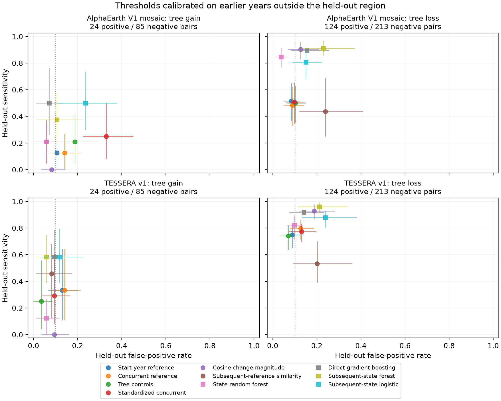
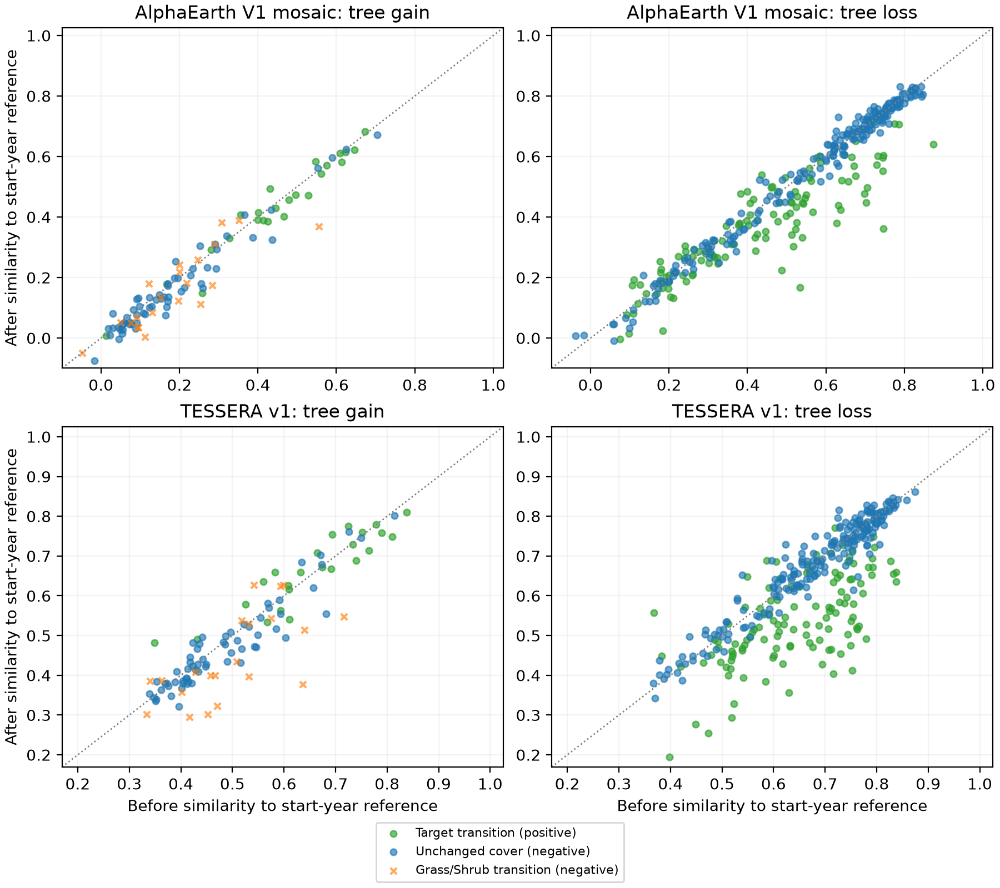
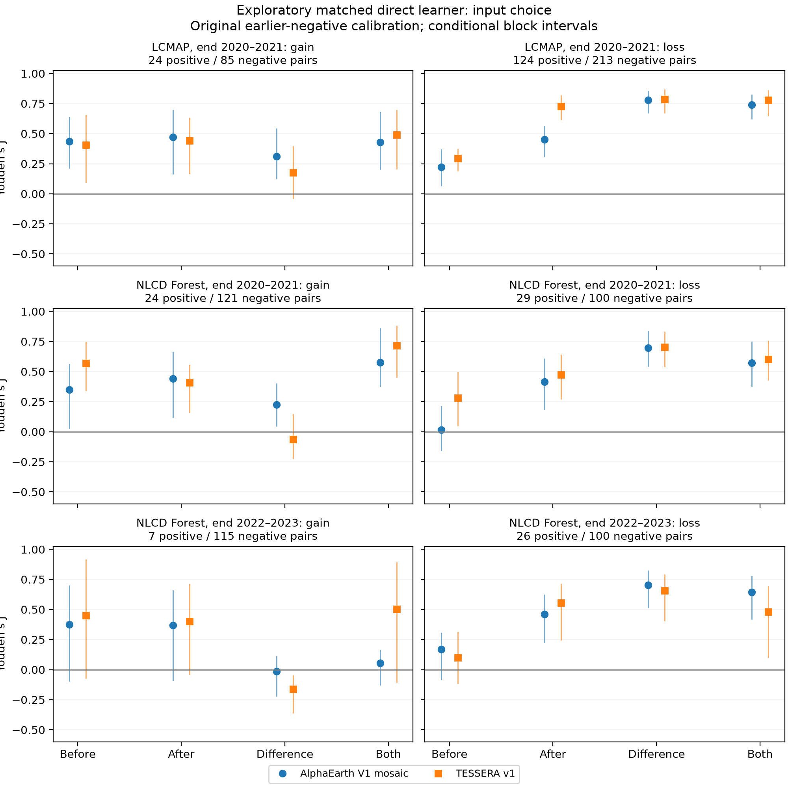
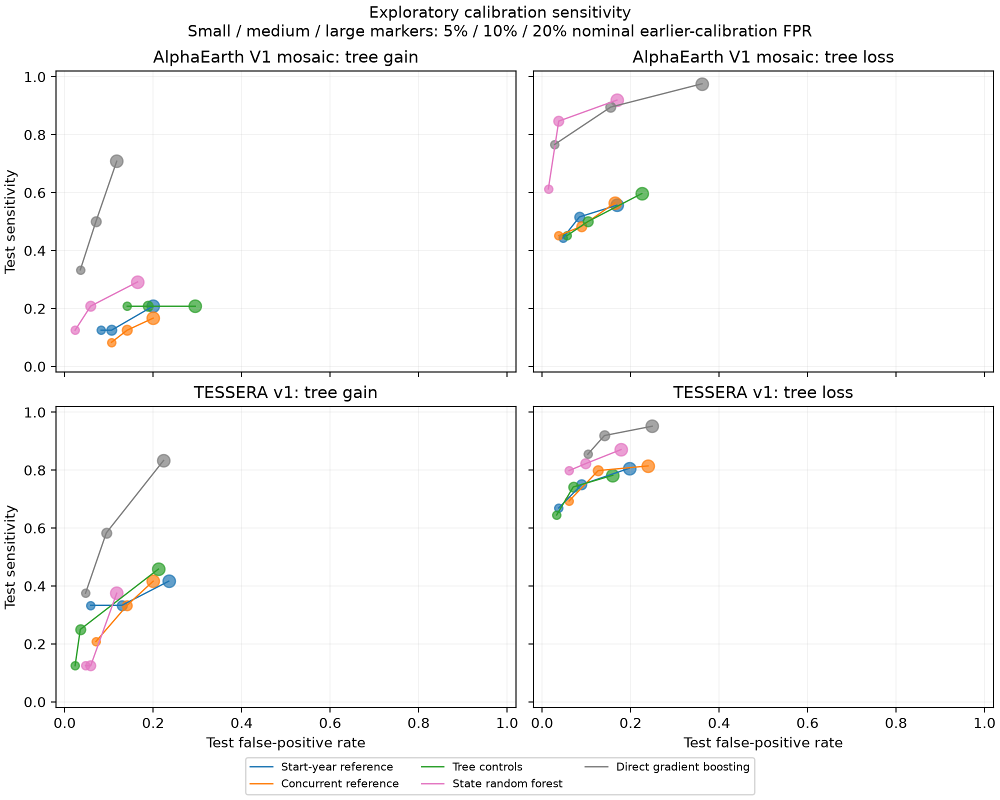

# Transferring tree-cover transition screens with annual satellite embeddings: references, controls and learned readouts

**First draft.** The fixed paired-native check remains unfinished; its empty counts are not robustness evidence.

## Abstract

Tree-cover screening can support restoration monitoring, but reference-similarity changes in satellite embeddings need validation against the cover transitions being screened. We retrospectively compared fixed and concurrent references, independent tree controls and learned readouts using AlphaEarth V1 mosaic and TESSERA v1. All cases supplied the initial class. The US LCMAP test had 446 pairs ending 2020–2021: 24 gain positives/85 negatives and 124 loss positives/213 negatives. At a nominal 10% earlier-negative calibration false-positive rate, concurrent-reference differences in Youden’s J ranged from -0.037 to +0.011; tree-control differences ranged from -0.035 to +0.011. Changed flags for concurrent/controls were AlphaEarth V1 mosaic: 3/9 of 109 gain cases, 19/6 of 337 loss cases; TESSERA v1: 7/10 of 109 gain cases, 18/5 of 337 loss cases. The direct classifier had higher J point estimates than start-fixed in all 4 LCMAP conditions. Cosine magnitude detected 0/24 LCMAP gains in either product, including preplanned patch support. The separate NLCD Forest test also lacked a consistent correction benefit; the direct classifier had higher J point estimates than start-fixed in 7/8 conditions. Forest changed flags (concurrent/controls) were AlphaEarth V1 mosaic: 2020–2021 gain 9/8 of 145, 2020–2021 loss 4/4 of 129, 2022–2023 gain 6/4 of 122, 2022–2023 loss 3/6 of 126; TESSERA v1: 2020–2021 gain 11/16 of 145, 2020–2021 loss 11/5 of 129, 2022–2023 gain 8/20 of 122, 2022–2023 loss 17/22 of 126. Forest centre magnitude detected no overlapping gains (24 per product); later scores detected 0/7 AlphaEarth and 1/7 TESSERA gains. Exploratory matched direct learners had LCMAP gain J point estimates 0.436/0.407 using only initial target vectors; later-state accuracy alone does not measure dependence on subsequent target-vector values. Exploratory fitting/calibration perturbations make 8/8 correction contrasts span both signs; the direct TESSERA loss advantage holds in 6/10 fixed splits, and AlphaEarth centre-magnitude gain detections range from 0/24 to 1/24. An exploratory single-date native-input check changed flags in 5/20 available pairs (10/20 centre inputs identical); full paired-native validation remained unfinished. These retrospective results support validation of endpoints, input periods and transferred thresholds; forecasting and ecological restoration success were not measured.

## 1. Introduction

Monitoring vegetation recovery requires measurements that distinguish a change in land cover from recovery of the ecosystem being restored. The international standards of the Society for Ecological Restoration describe reference ecosystems and measurable indicators across ecological attributes; tree cover alone does not establish restoration success (Gann et al., 2019, Principles 3 and 5). Satellite observations can support monitoring over large areas, but a convenient numerical indicator still needs validation against the particular outcome it is intended to screen.

Public annual satellite embeddings make this question timely. AlphaEarth Foundations and TESSERA provide vectors summarizing satellite observations that can be used in downstream mapping tasks (Brown et al., 2025; Feng et al., 2026). A recent restoration application measures cosine similarity to reference forest embeddings, including geographically selected references (Heiman, 2026). Such a reference score is attractive when detailed local outcome labels are scarce. Its interpretation depends on the reference, however, and changes in the target and reference vectors can both affect its value. Recomputing the reference every year and subtracting changes at independent control plots are plausible adjustments. Neither adjustment establishes that a transferred alert threshold detects the intended cover transition.

We study a narrower, independently interpretable endpoint: transitions between dominant tree and non-tree vegetation cover. This is relevant to deciding whether a reference score is suitable for screening tree-cover gains and losses before more detailed assessment. The intended readers are restoration ecologists and land-cover monitoring teams deciding which readouts to validate before using them in assessment. The study measures screening errors, without measuring restoration success, decisions by practitioners, or savings in field work. The research question is: **do concurrent reference vectors or independent-control adjustment improve tree-cover transition screening in later years and held-out regions, relative to fixed-reference scores and learned readouts?**

The desired cover depends on the appropriate reference ecosystem; tree gain is not treated as inherently beneficial. Each case supplies its initial cover class. Gain screening concerns initially non-tree plots and loss screening initially tree-covered plots. Consequently, classifying the subsequent cover state is a strong and necessary comparator. This is a conditional transition-screening task; it does not evaluate detecting change when both cover states are unknown.

## 2. Prior work and scope of the contribution

AlphaEarth's evaluation includes LCMAP cover-change labels and a cosine-based angular anomaly score. Its reported evaluation uses validation-selected thresholds (Brown et al., 2025, Supplement S3.3.1 and S4.1). Our cosine-change comparator is a monotonic rescaling of that angular anomaly. Our question concerns thresholds calibrated on earlier negative examples outside the eventual test region. Differences from the published sample, labels, threshold rule and split preclude a direct comparison with its reported accuracy.

Heiman (2026, Sections 2–5) evaluates cosine similarity to forest references for restoration polygons in the Brazilian Atlantic Forest. The reference labels use a longer stability history and the application differs from the US cover-transition endpoints studied here. We do not reproduce that ecological assessment or test its conclusions. We examine fixed, concurrent and control-adjusted reference scores using baseline-only reference selection and held-out cover labels.

Change vector analysis already separates a temporal feature-difference vector from its Euclidean intensity; object-level methods also combine that intensity with correlation constraints (Wang et al., 2018, Sections 2.2.3–2.2.4). For unit vectors, the squared Euclidean difference is twice the cosine change magnitude. We do not propose that distinction or a new change-vector method. The present input comparisons concern the transferred operating points of published embeddings under supplied initial vegetation classes.

Conditional change detection with pre-change semantic information is already established. Bernhard et al. (2023, Section 3 and Table 1) distinguish conditional tasks and a cross-modal setting using a prior semantic map and current imagery; their Section 5.4 evaluates that setting. Our supplied initial plot class similarly makes subsequent-state classification a legitimate comparator. We do not propose that task definition or reproduce MapFormer’s image segmentation experiment.

Independent controls and baseline matching already have a substantial methodological history. Meroni et al. (2017, Sections 3–5) apply a before–after control-impact design to remote-sensing assessment of restoration interventions, with control selection and contextual checks. Our controls support a measurement comparison, not a causal estimate of an intervention. They are selected from cover labels and geography; they are not environmentally matched counterfactual ecosystems.

Burns (2026), an author case study rather than a peer-reviewed comparison, already contrasts difference vectors, dot products, stacked annual embeddings and constructions retaining baseline context for landscape-change attribution. Sharma et al. (2026, Sections 2.3–2.4 and 4) combine annual AlphaEarth drift with spectral and thermal indicators and distinguish cover-transition evaluation from unconfirmed within-forest degradation. These applications reinforce the need to name the endpoint being validated.

Singh et al. (2026, Section 2.1.2 and Table 1) already compare temporal reuse of baseline labels, stability filtering and semi-supervised updating under space-time validation. Our baseline-cohort readouts neither reproduce nor outperform that updating framework. Backman et al. (2026, Sections II–III) study supervised bitemporal woody clearing and transfer to regrowth using Sentinel-2 images; separate gain/loss evaluation is not itself a contribution here.

Temporal variation of satellite embeddings and temporal degradation of learned classifiers are also known. Ball et al. (2026, Section 3.5, Table 5) transfer a tree-species classifier across years and discuss both changing representations and a disturbance affecting the landscape. Annual variation, control centring and temporal transfer are therefore not claimed as novel findings. The present contribution is a reproducible comparison of transferred operating points, explicit conditional-state comparators, and boundary checks across two published embedding products and two separately reported cover definitions. Searches are documented in sources.jsonl. An additional AlphaEarth/TESSERA temporal-transfer and domain-adaptation preprint was identified only at abstract level (Gbodjo and Ienco, 2026); its full methods were not reviewed and its results are not supporting evidence here. Failure to find a closer study within the searched range is not evidence that none exists.

## 3. Methods

### 3.1 Labels, sampling and endpoints

The main labels are the public-domain Land Change Monitoring, Assessment, and Projection (LCMAP) component of the AlphaEarth supplemental evaluation release (Google DeepMind, 2025), derived from the USGS reference data (Pengra et al., 2023). We use its human-interpreted dominant-cover classes Trees, Grass/forb/herb and Shrubs and adjacent pairs spanning 2017–2021. LCMAP Trees includes standing dead trees. Dominant Trees is not a verified native forest reference ecosystem or a forest land-use classification. The source benchmark selects one adjacent pair per plot and enriches changes; the resulting sample does not estimate national transition prevalence.

We reserve all eligible Trees-to-Trees plots in the first pair for the reference/control pool and exclude them from the targets. Selection uses only the baseline pair and never requires future stability. Half form the reference centroid and half separate tree controls, allocated by a fixed hash. Here independent controls means disjoint plot membership, not randomized treatment assignment or statistical independence of landscapes. The primary allocation uses seed 14014; four further allocations are sensitivity analyses on the same pool. All eligible tree gains and losses and later stable Trees pairs are retained. Non-tree negative examples are capped by class and year using a fixed hash. A separate baseline-selected non-tree control cohort supports prespecified gain-screening comparisons. Exact counts, deterministic rules and exclusions are generated by scripts/prepare.py and scripts/prepare_controls.py and specified in protocol/plan-v1.md and plan-v2.md.

The separate Annual National Land Cover Database (NLCD) reference-data extension uses Collection 1.0 annual interpreted cover labels, without fitting or recalibrating to them (USGS, 2025). Its Forest class specifies at least 20% tree vegetation cover with trees greater than 5 metres tall; Shrubland includes young trees below 5 metres. We retain original labels and use a computational class crosswalk solely to apply the readouts. This endpoint differs from LCMAP dominant Trees. The extension excludes nearby plots using coordinates, not ownership or personal information. Overlapping years and years beyond the original benchmark are reported separately; they are not pooled into a common ecological outcome or attributed solely to elapsed time. Primary labels and the subset agreeing with the alternate cover label are both reported.

### 3.2 Representations and spatial support

We use published AlphaEarth Foundations V1 annual embeddings and TESSERA v1 embeddings, not newly trained encoders. AlphaEarth's primary source is the unofficial geographic mosaic documented by tge-labs (2026); TESSERA is pinned to the v1 public store. AlphaEarth signed-square quantization is decoded before normalization following the official documentation (Google and Google DeepMind, 2026). Every pixel vector is normalized to unit length. Centre pixels are primary. A support sensitivity normalizes the mean of the nine unit vectors in a 3-by-3 patch and requires all nine pixels to be valid. The mosaic has approximately 0.00008983 degrees per pixel in each axis; the retrieved TESSERA grid has 10-metre pixels in its projected CRS. The geographic mosaic's footprint varies with latitude and is not an exact 30-by-30-metre plot footprint. Inputs were retrieved on 2026-10-25 (UTC). Source URLs, version metadata, coordinates, transforms, licences, raw arrays and hashes are bundled. AlphaEarth distinguishes the represented valid period from the supporting observations (Brown et al., 2025, Section 2); exact support periods for these mosaics were not independently verified. TESSERA documents annual observation sampling (Feng et al., 2026, Appendix A.4). Neither encoder was trained prospectively in this study.

A separately fixed stratified sample compares the AlphaEarth mosaic with official native-grid COG measurements at the same requested coordinates. It reports vector agreement and pixel-centre displacement, without substituting nearby valid pixels. This is an input co-location diagnostic, not a full native-grid classification evaluation. Agreement cannot rule out small changes to threshold decisions.

### 3.3 Geographic and temporal transfer

Five regions are formed by coordinate-only KMeans in a contiguous-US projection. For each held-out region, earlier pairs beginning in 2017 or 2018 outside that region supply fitting and calibration examples. Later pairs beginning in 2019 or 2020 inside it supply test examples. A deterministic hash of five-degree geographic cells reserves calibration cells separately from model-fitting cells. The 2019 endpoint of the earlier pairs overlaps the first later pair’s starting year in other regions. Later target plots are never used in fitting. The same target partitions are offered to all methods, although their actual use of earlier labels differs. This is not an annotation-budget-matched comparison.

Reference and control plots inside the held-out region are excluded. Contemporary embeddings of baseline-selected plots are permitted. Encoders and interpreted labels were produced after some represented years; the design tests retrospective downstream transfer, not a reconstruction of information available in 2019 or a holdout from encoder pretraining. Primary estimates use target pairs available in both products; model-specific availability is reported when it differs. Missing measurements do not cause replacement sampling.

### 3.4 Readouts and calibration

Let a and b be target unit vectors before and after a pair, and r_a and r_b normalized reference means in the corresponding years outside the held-out region. The start-fixed score is (b−a)·r_a, the end-fixed score (b−a)·r_b, and the pooled-fixed score (b−a)·normalize(r_a+r_b). The concurrent score is b·r_b−a·r_a. Algebraically, its difference from the start-fixed score is b·(r_b−r_a), so this comparison mixes reference motion with the target endpoint. Tree-control adjustment subtracts the independent controls' mean start-fixed change. Standardized concurrent scores first centre and scale each year's reference similarity using independent controls, then take the difference. Vanishing control standard deviations are marked unavailable. Directed scores are negated for loss; cosine change magnitude, 1−a·b, is positive for both gain and loss. Subsequent-reference similarity uses only b·r_b, with the direction appropriate to each task.

Learned comparisons include a random forest fitted to both cover states, its probability difference and subsequent-state probability, a subsequent-state logistic classifier, and a direct gradient-boosted transition classifier. All fitting uses only the earlier fitting partition. Prespecified hyperparameters are in the protocol and code; no test-based tuning or selection of a winning correction is performed. Additional pre-analysis comparisons use nearest available references, independent non-tree controls, initial-class control matching and a reference frozen to 2017. Geographic proximity is not assumed to establish ecological matching.

For every method, task and region, the threshold is the higher-interpolated ninetieth percentile of earlier negative calibration scores. A flag requires strict exceedance. At least ten negative calibration cases and eight valid reference/control plots are required where applicable. Finite samples and ties can make calibration more conservative than the nominal ten-percent false-positive rate. This rule does not guarantee the same rate after transfer. The NLCD extension reuses the original fitting and calibration data and explicitly checks equality of thresholds.

### 3.5 Exploratory diagnostics fixed after the primary results

The original methods remain primary. Separate amendments test baseline-cohort state fitting and initial-embedding-matched controls; nominal five- and twenty-percent calibration levels; removal of Grass/Shrub transitions from gain negatives; identical reference-plot membership before and after; initial-target-vector-only state/reference readouts; coordinate-only controls; and initial-class strata with a class-rate baseline; and reference access permitting baseline plots within the target region. Each amendment records what was already known before its execution. No additional metric or exclusion replaces the original endpoint.

The initial-vector comparisons apply the same fitted state models to the before and after vectors and calibrate each readout separately on earlier negatives. The before vector's information may include stable landscape associations and temporally integrated signals; this diagnostic cannot identify their source. One fixed permutation of subsequent target vectors checks that initial-only scores do not depend on their values. Availability still requires both products at both dates. Original encoders and earlier-state training labels were made retrospectively, so these are not forecasting experiments.

The geographic control uses sine and cosine of latitude and longitude, a known representation (Brown et al., 2025, Supplement S5.1.1). Its fixed state forest, state logistic and direct transition boosting models use the original earlier fitting/calibration partitions, supplied initial-class task definitions and common availability mask. No embedding values, year or initial non-tree subclass are learner features. It is one baseline, not two product replications. Failure of this simple baseline could not rule out richer static context. The NLCD extension applies all these fixed readouts using unchanged LCMAP thresholds. A final exploratory control estimates the transition rate within each supplied initial class from earlier fitting cases, with fixed Laplace smoothing (positives+1)/(cases+2), then uses the same earlier-negative calibration rule. Initial-class subgroup reporting retains the original mixed-class thresholds; it does not recalibrate on test subgroups.

The native-grid point-year diagnostic is supplemented by an exploratory fixed paired-target check. Its acquisition was not completed before the stopping rule, and unavailable cases remain untested. A later saved-data alternative substitutes all available native point-years for later targets, leaving an unavailable other date in its original mosaic form. Fitting, reference/control inputs and calibration remain unchanged, and unchanged thresholds/unselected scores are checked. This evaluates single-date input-reading sensitivity, not full native-pair transfer. Descriptive input/score identity counts were added after viewing these results, during the required self-check; no prediction or threshold changes.

A final matched direct-learner amendment was fixed after inspecting both label datasets. It trains the same original gradient-boosted transition learner on initial, subsequent, difference-only and original concatenated inputs, using identical earlier fitting targets, partitions and per-condition negative calibration. Different feature dimensions do not equate model capacity. Original both-date scores, flags and thresholds must reconstruct exactly, and all new Forest thresholds must equal their LCMAP counterparts. All of these input comparisons are exploratory; the already-inspected Forest outcomes are reused rather than a fresh validation. Every input condition and paired contrast is retained.

A final exploratory partition check uses ten fixed earlier fitting/calibration cell assignments, including the original. Only the seed in the existing thirty-percent calibration-cell hash changes; reference allocation, five regions, selected labels, learners and later tests stay fixed. Original-partition reconstruction and unsupervised score invariance are checked. Every split and unavailable condition is retained. Per-split block intervals remain conditional on that split; the range across overlapping partitions is a sensitivity description, not an estimate of independent training variance or a test-based model selection.

### 3.6 Outcomes, uncertainty and process

We report sensitivity, false-positive rate and their difference, Youden's J, with counts. The primary contrasts are concurrent versus start-fixed and tree-control-adjusted versus start-fixed, separately for both tasks and products. J describes an operating point without specifying social costs. AUROC is a secondary descriptive diagnostic for pooled held-out scores; it does not isolate within-year or within-region ranking. We retain all planned comparisons, unavailable conditions, threshold ties, unchanged flags and reference-anchor disagreements.

Two thousand paired geographic-cell bootstrap resamples give descriptive percentile intervals conditional on fitted scores, observed targets and the fixed reference pool. Resamples without both positive and negative cases are omitted; valid-draw counts are retained. These intervals omit training, encoder and independent future-year variability. At observed error floors and ceilings they can collapse, without establishing perfect population performance. Reference allocations are sensitivity analyses, not independent replications. Constant control subtraction preserves rankings within a fixed year and region by algebra; only transferred decisions can demonstrate empirical improvement.

Plans were committed before measurements or analyses to which they apply. Technical failures, timing-related acquisition changes and departures are retained in protocol/deviations.md and experiment records. Analyses fixed after the primary results are identified as exploratory. Code, public selected inputs and a network-free reproduction entry point are supplied; the verification procedure is VERIFY.md. Local Git, timestamps and hashes provide inspectable records, not proof of independent chronology or reproduction.

## 4. Results

### 4.1 Availability and task definition

The fixed main sample contains 857 target pairs. Both products supply valid paired vectors for 854; 3 earlier pairs are unavailable in TESSERA. The resulting paired analysis has 408 earlier fitting/calibration candidates and 446 later test pairs. All later test pairs are available for both centre and patch support. Every test supplies the interpreted initial cover class. Gain and loss are therefore conditional tasks, with the denominators shown below. The positive gain and loss cases occupy 13 and 29 five-degree cells, respectively, counted during self-check to clarify spatial support. No population precision or national transition frequency is estimated.

### 4.2 Primary reference and control contrasts

Table 1 reports the original nominal calibration operating point. A modest change in recall is not automatically an improvement if false positives also increase. Concurrent reference and tree-control effects differ across the four product/task conditions. The point estimates do not support a consistent benefit. The gain intervals remain wide; these observations do not establish equivalence or zero population effects.

| Representation | Task | Readout | True positives / positives | False positives / negatives | Sensitivity | False-positive rate | J |
| --- | --- | --- | --- | --- | --- | --- | --- |
| AlphaEarth V1 mosaic | gain | Start-year reference | 3/24 | 9/85 | 0.125 | 0.106 | 0.019 |
| AlphaEarth V1 mosaic | gain | Concurrent reference | 3/24 | 12/85 | 0.125 | 0.141 | -0.016 |
| AlphaEarth V1 mosaic | gain | Tree controls | 5/24 | 16/85 | 0.208 | 0.188 | 0.020 |
| AlphaEarth V1 mosaic | loss | Start-year reference | 64/124 | 18/213 | 0.516 | 0.085 | 0.432 |
| AlphaEarth V1 mosaic | loss | Concurrent reference | 60/124 | 19/213 | 0.484 | 0.089 | 0.395 |
| AlphaEarth V1 mosaic | loss | Tree controls | 62/124 | 22/213 | 0.500 | 0.103 | 0.397 |
| TESSERA v1 | gain | Start-year reference | 8/24 | 11/85 | 0.333 | 0.129 | 0.204 |
| TESSERA v1 | gain | Concurrent reference | 8/24 | 12/85 | 0.333 | 0.141 | 0.192 |
| TESSERA v1 | gain | Tree controls | 6/24 | 3/85 | 0.250 | 0.035 | 0.215 |
| TESSERA v1 | loss | Start-year reference | 93/124 | 19/213 | 0.750 | 0.089 | 0.661 |
| TESSERA v1 | loss | Concurrent reference | 99/124 | 27/213 | 0.798 | 0.127 | 0.672 |
| TESSERA v1 | loss | Tree controls | 92/124 | 15/213 | 0.742 | 0.070 | 0.672 |

Table 2 retains every primary contrast and its decision count. The intervals condition on fitted scores and the observed reference pool and are not adjusted for multiple comparisons. Most flags are unchanged, making the small differences in calibration consequential. Neither statistical significance nor an equivalence margin was a stopping or selection rule.

| Representation | Task | Readout versus start-fixed | J difference | Conditional 95% interval | Changed flags / cases |
| --- | --- | --- | --- | --- | --- |
| AlphaEarth V1 mosaic | gain | Concurrent reference | -0.035 | -0.079 to 0.000 | 3/109 |
| AlphaEarth V1 mosaic | gain | Tree controls | 0.001 | -0.091 to 0.117 | 9/109 |
| AlphaEarth V1 mosaic | loss | Concurrent reference | -0.037 | -0.100 to 0.014 | 19/337 |
| AlphaEarth V1 mosaic | loss | Tree controls | -0.035 | -0.064 to -0.011 | 6/337 |
| TESSERA v1 | gain | Concurrent reference | -0.012 | -0.074 to 0.051 | 7/109 |
| TESSERA v1 | gain | Tree controls | 0.011 | -0.138 to 0.124 | 10/109 |
| TESSERA v1 | loss | Concurrent reference | 0.011 | -0.039 to 0.087 | 18/337 |
| TESSERA v1 | loss | Tree controls | 0.011 | -0.011 to 0.035 | 5/337 |

### 4.3 Information in the vectors and comparator limits

The prespecified direct transition classifier has higher J point estimates than start-fixed in all 4 product/task conditions. State probability differences and subsequent-state readouts behave differently. These results show that useful information for the supplied cover labels can coexist with a weak scalar change readout. They do not demonstrate equal annotation cost: learned methods use additional earlier target labels, while reference scores use baseline-selected cohorts and negative calibration labels. Predicting the subsequent state is a necessary comparator because the initial class is supplied by the task definition.

| Representation | Task | Readout | True positives / positives | False positives / negatives | Sensitivity | False-positive rate | J | AUROC |
| --- | --- | --- | --- | --- | --- | --- | --- | --- |
| AlphaEarth V1 mosaic | gain | Cosine change magnitude | 0/24 | 7/85 | 0.000 | 0.082 | -0.082 | 0.287 |
| AlphaEarth V1 mosaic | gain | Direct gradient boosting | 12/24 | 6/85 | 0.500 | 0.071 | 0.429 | 0.866 |
| AlphaEarth V1 mosaic | gain | State random forest | 5/24 | 5/85 | 0.208 | 0.059 | 0.150 | 0.663 |
| AlphaEarth V1 mosaic | gain | Subsequent-reference similarity | 5/24 | 5/85 | 0.208 | 0.059 | 0.150 | 0.875 |
| AlphaEarth V1 mosaic | gain | Subsequent-state logistic | 12/24 | 20/85 | 0.500 | 0.235 | 0.265 | 0.759 |
| AlphaEarth V1 mosaic | gain | Subsequent-state forest | 9/24 | 9/85 | 0.375 | 0.106 | 0.269 | 0.846 |
| AlphaEarth V1 mosaic | loss | Cosine change magnitude | 112/124 | 27/213 | 0.903 | 0.127 | 0.776 | 0.968 |
| AlphaEarth V1 mosaic | loss | Direct gradient boosting | 111/124 | 33/213 | 0.895 | 0.155 | 0.740 | 0.957 |
| AlphaEarth V1 mosaic | loss | State random forest | 105/124 | 8/213 | 0.847 | 0.038 | 0.809 | 0.951 |
| AlphaEarth V1 mosaic | loss | Subsequent-reference similarity | 54/124 | 51/213 | 0.435 | 0.239 | 0.196 | 0.754 |
| AlphaEarth V1 mosaic | loss | Subsequent-state logistic | 100/124 | 32/213 | 0.806 | 0.150 | 0.656 | 0.890 |
| AlphaEarth V1 mosaic | loss | Subsequent-state forest | 113/124 | 49/213 | 0.911 | 0.230 | 0.681 | 0.929 |
| TESSERA v1 | gain | Cosine change magnitude | 0/24 | 8/85 | 0.000 | 0.094 | -0.094 | 0.318 |
| TESSERA v1 | gain | Direct gradient boosting | 14/24 | 8/85 | 0.583 | 0.094 | 0.489 | 0.874 |
| TESSERA v1 | gain | State random forest | 3/24 | 5/85 | 0.125 | 0.059 | 0.066 | 0.737 |
| TESSERA v1 | gain | Subsequent-reference similarity | 11/24 | 7/85 | 0.458 | 0.082 | 0.376 | 0.907 |
| TESSERA v1 | gain | Subsequent-state logistic | 14/24 | 10/85 | 0.583 | 0.118 | 0.466 | 0.825 |
| TESSERA v1 | gain | Subsequent-state forest | 14/24 | 5/85 | 0.583 | 0.059 | 0.525 | 0.869 |
| TESSERA v1 | loss | Cosine change magnitude | 115/124 | 40/213 | 0.927 | 0.188 | 0.740 | 0.956 |
| TESSERA v1 | loss | Direct gradient boosting | 114/124 | 30/213 | 0.919 | 0.141 | 0.779 | 0.959 |
| TESSERA v1 | loss | State random forest | 102/124 | 21/213 | 0.823 | 0.099 | 0.724 | 0.929 |
| TESSERA v1 | loss | Subsequent-reference similarity | 66/124 | 43/213 | 0.532 | 0.202 | 0.330 | 0.797 |
| TESSERA v1 | loss | Subsequent-state logistic | 109/124 | 51/213 | 0.879 | 0.239 | 0.640 | 0.938 |
| TESSERA v1 | loss | Subsequent-state forest | 119/124 | 45/213 | 0.960 | 0.211 | 0.748 | 0.950 |

### 4.4 Endpoint composition and reference availability: exploratory checks

The gain-negative definition includes 21 later Grass/Shrub transitions. Removing them from this separate calibration/test condition leaves 64 unchanged-cover negatives and 24 gain positives. Cosine change magnitude still detects 0 gains for AlphaEarth; the full two-product table is analysis/endpoint-v13/stable-negative-gain-table.md. Fitted scores are unchanged on all common cases. Within this sample, the floor persists after removing those transitions. Its biological, temporal or spatial-support cause remains unresolved.

Before/after similarity components reconstructed from saved scores agree with direct raw-vector calculations to a maximum absolute error of 5.55e-16. The scalar plot shows where the change readout differs from an absolute subsequent-state score. It does not measure ecological condition or establish that either the labels or representations are wrong.

The same-reference-plots check changes the TESSERA gain concurrent-reference J contrast from -0.012 to +0.024. Target test scores remain fixed; earlier calibration inputs and thresholds change. Original separately-valid reference means remain primary. This sensitivity limits claims about a general advantage or disadvantage of concurrent references.

### 4.5 Alternative controls, calendar anchors and readouts

The preplanned non-tree, initial-class and frozen-calendar controls produce different operating points (Appendix A). Exact initial-class matching has fewer available cases, so its contrast must use the common-case denominators in the paired comparison file. A gain in its J cannot be compared by subtracting the full-sample start-fixed J. No control rule gives a consistent advantage across all products, tasks and available cases.

The preplanned reference allocations, centre/patch supports and global/nearest-reference conditions give the ranges below. These settings reuse the same targets and pool; their signs are sensitivity counts, not independent evidence or a vote for a method. All settings remain available in the machine-readable tables.

| Representation | Task | Readout versus start-fixed | Sensitivity settings | Minimum J difference | Maximum J difference | Positive | Negative | Zero |
| --- | --- | --- | --- | --- | --- | --- | --- | --- |
| AlphaEarth V1 mosaic | gain | Concurrent reference | 20 | -0.095 | 0.119 | 9 | 10 | 1 |
| AlphaEarth V1 mosaic | gain | Tree controls | 20 | -0.119 | 0.141 | 13 | 7 | 0 |
| AlphaEarth V1 mosaic | loss | Concurrent reference | 20 | -0.169 | 0.003 | 1 | 19 | 0 |
| AlphaEarth V1 mosaic | loss | Tree controls | 20 | -0.040 | 0.052 | 6 | 14 | 0 |
| TESSERA v1 | gain | Concurrent reference | 20 | -0.284 | 0.059 | 4 | 15 | 1 |
| TESSERA v1 | gain | Tree controls | 20 | -0.167 | 0.148 | 13 | 6 | 1 |
| TESSERA v1 | loss | Concurrent reference | 20 | -0.080 | 0.026 | 6 | 14 | 0 |
| TESSERA v1 | loss | Tree controls | 20 | -0.053 | 0.029 | 9 | 10 | 1 |

The original strict reference-region exclusion places the eighth-nearest reference a median 1,071 km away in the centre-pixel sample. An exploratory condition allowing baseline reference/control plots from all regions reduces that median to 579 km. Target fitting and calibration remain region-held-out; the reference-label information access changes. The concurrent-reference J contrast is negative in 8/8 centre conditions across global/nearest selection, while control effects vary (Appendix A). Supervised scores and flags are unchanged by construction and verified. References remain geographically broad and are not locally verified reference ecosystems, even under the relaxed access condition.

Exploratory baseline-cohort state classifiers use only the baseline reference/tree-control/non-tree-control cohorts for state fitting, while their thresholds still require earlier target-negative labels. They therefore reduce one source of state-fitting labels without establishing equal annotation budgets or zero transition-label dependence. Embedding-matched controls use initial-vector similarity rather than geographic distance. Their complete results are in Appendix A. Calibration at the additional five- and twenty-percent nominal levels changes some primary contrast directions; the original ten-percent rule remains primary.

The auxiliary classification release supplies 109 later labels among 166 baseline-cohort plots, with 0 known binary disagreements and 57 unknown later labels. These are isolated annual observations, not complete histories. No primary plot is removed using those later labels.

### 4.6 What requires the subsequent target vector? Exploratory diagnostics

Some gain discrimination remains when a state classifier receives only the initial target vector. The table compares the same fitted state model applied to the before and after vectors, each calibrated using its own earlier-negative scores. Both comparisons retain the same availability mask, which requires both products in both years. The state models were fitted using earlier labelled states, and the encoders and labels were produced retrospectively. These results are therefore associations in a dated representation, not prospective forecasts.

| Representation | Task | State fit | Before vector TP; FP | After vector TP; FP | Before J | After J | Before minus after J | Conditional 95% interval | Changed flags / cases |
| --- | --- | --- | --- | --- | --- | --- | --- | --- | --- |
| AlphaEarth V1 mosaic | gain | Initial-vector state forest | 11/24; 9/85 | 9/24; 9/85 | 0.352 | 0.269 | 0.083 | -0.093 to 0.221 | 8/109 |
| AlphaEarth V1 mosaic | loss | Initial-vector state forest | 47/124; 56/213 | 113/124; 49/213 | 0.116 | 0.681 | -0.565 | -0.693 to -0.386 | 77/337 |
| TESSERA v1 | gain | Initial-vector state forest | 14/24; 10/85 | 14/24; 5/85 | 0.466 | 0.525 | -0.059 | -0.200 to 0.070 | 11/109 |
| TESSERA v1 | loss | Initial-vector state forest | 38/124; 49/213 | 119/124; 45/213 | 0.076 | 0.748 | -0.672 | -0.795 to -0.492 | 93/337 |
| AlphaEarth V1 mosaic | gain | Initial-vector cohort forest | 7/24; 6/85 | 7/24; 8/85 | 0.221 | 0.198 | 0.024 | -0.092 to 0.148 | 4/109 |
| AlphaEarth V1 mosaic | loss | Initial-vector cohort forest | 44/124; 52/213 | 83/124; 38/213 | 0.111 | 0.491 | -0.380 | -0.471 to -0.268 | 63/337 |
| TESSERA v1 | gain | Initial-vector cohort forest | 11/24; 9/85 | 15/24; 4/85 | 0.352 | 0.578 | -0.225 | -0.441 to 0.066 | 15/109 |
| TESSERA v1 | loss | Initial-vector cohort forest | 26/124; 26/213 | 90/124; 34/213 | 0.088 | 0.566 | -0.479 | -0.569 to -0.374 | 78/337 |

Changing the subsequent target-vector values in one fixed within-year permutation leaves all 3568 initial-only scored rows unchanged across 446 target keys. This verifies input dependence in the implementation; it is not another independent empirical replication. Initial reference similarity and baseline-cohort logistic counterparts, including their uncertainty, are retained in analysis/initial-vector-v17/initial-versus-subsequent.csv.

The after vector improves several gain readouts and improves the full state forest substantially for losses. Thus these results do not support the claim that all apparent change accuracy comes from initial information. They do show why subsequent-state classification accuracy alone cannot establish how much information about a transition was newly observed after the initial date.

The separate coordinate-only control uses four sine/cosine latitude/longitude features, with no embedding values, year or initial vegetation subclass as learner inputs. It yields the following associations on the same conditional sample. This is one geographic baseline, not two product replications. It cannot identify the source of information in the embeddings; weaker results would not exclude richer static landscape information.

| Task | Coordinate-only readout | True positives / positives | False positives / negatives | J | AUROC |
| --- | --- | --- | --- | --- | --- |
| gain | Coordinate transition boosting | 7/24 | 5/85 | 0.233 | 0.746 |
| gain | Coordinate state forest | 1/24 | 1/85 | 0.030 | 0.680 |
| gain | Coordinate state logistic | 4/24 | 1/85 | 0.155 | 0.722 |
| loss | Coordinate transition boosting | 91/124 | 88/213 | 0.321 | 0.656 |
| loss | Coordinate state forest | 45/124 | 50/213 | 0.128 | 0.568 |
| loss | Coordinate state logistic | 40/124 | 46/213 | 0.107 | 0.693 |

The exploratory initial-class-rate baseline flags 0/24 gains and 0/85 negatives; 62 gain-task cases tie their regional threshold. This simple baseline does not explain the initial-vector forest results: gains are flagged within both initial vegetation classes, as shown below. The original mixed-class thresholds are retained within each subgroup. Small subgroup denominators and richer interactions with landscape context remain limitations.

| Representation | Initial vegetation class | State readout | True positives / positives | False positives / negatives | J | AUROC |
| --- | --- | --- | --- | --- | --- | --- |
| AlphaEarth V1 mosaic | Grass/forb/herb | Initial-vector state forest | 3/9 | 4/40 | 0.233 | 0.794 |
| AlphaEarth V1 mosaic | Grass/forb/herb | Subsequent-state forest | 3/9 | 5/40 | 0.208 | 0.861 |
| TESSERA v1 | Grass/forb/herb | Initial-vector state forest | 6/9 | 5/40 | 0.542 | 0.883 |
| TESSERA v1 | Grass/forb/herb | Subsequent-state forest | 6/9 | 4/40 | 0.567 | 0.931 |
| AlphaEarth V1 mosaic | Shrubs | Initial-vector state forest | 8/15 | 5/45 | 0.422 | 0.769 |
| AlphaEarth V1 mosaic | Shrubs | Subsequent-state forest | 6/15 | 4/45 | 0.311 | 0.837 |
| TESSERA v1 | Shrubs | Initial-vector state forest | 8/15 | 5/45 | 0.422 | 0.744 |
| TESSERA v1 | Shrubs | Subsequent-state forest | 8/15 | 1/45 | 0.511 | 0.834 |

All 337 loss-task cases begin as Trees. The class-rate score is constant within each regional fit, making zero loss flags a consequence of the task and threshold definition. This is not counted as a discovery. Region-specific estimates can differ, so the pooled score is not globally constant.

### 4.7 Separate Forest-class endpoint and later years

The NLCD extension contains 523 selected pairs from 488 plots. Paired centre availability is 522/523. Its primary denominators are 2022–2023 gain: 7 positives/115 negatives; 2022–2023 loss: 26 positives/100 negatives; 2020–2021 gain: 24 positives/121 negatives; 2020–2021 loss: 29 positives/100 negatives. Pairs ending in 2020–2021 pairs overlap the original calendar range; 2022–2023 pairs extend it. Neither endpoint differences nor horizon differences can be attributed solely to time.

All 620 original-method threshold comparisons match the LCMAP calibration, with the added initial/cohort/coordinate/class-rate thresholds checked separately. No NLCD outcome enters fitting or calibration. The primary correction contrasts and counts are below. Intervals remain conditional descriptive block intervals; the small positive counts limit their interpretation. The later gain positives occupy 4 five-degree cells; the corresponding correction intervals retain 1982 valid draws after omitting resamples without both classes. These support counts were added during self-check; the original bootstrap draws and intervals are unchanged.

| Representation | Pair end years | Task | Positive / negative | Start-fixed J | Concurrent J difference [interval] | Tree-control J difference [interval] | Changed flags concurrent/control |
| --- | --- | --- | --- | --- | --- | --- | --- |
| AlphaEarth V1 mosaic | 2022–2023 | gain | 7/115 | -0.191 | +0.000 [-0.059, 0.050] | -0.035 [-0.067, -0.008] | 6/4 of 122 |
| AlphaEarth V1 mosaic | 2022–2023 | loss | 26/100 | 0.537 | -0.018 [-0.090, 0.039] | -0.012 [-0.081, 0.055] | 3/6 of 126 |
| TESSERA v1 | 2022–2023 | gain | 7/115 | -0.083 | -0.017 [-0.078, 0.043] | -0.065 [-0.937, 0.150] | 8/20 of 122 |
| TESSERA v1 | 2022–2023 | loss | 26/100 | 0.615 | -0.115 [-0.350, 0.021] | +0.055 [-0.184, 0.202] | 17/22 of 126 |
| AlphaEarth V1 mosaic | 2020–2021 | gain | 24/121 | 0.117 | -0.158 [-0.452, 0.008] | -0.066 [-0.117, -0.022] | 9/8 of 145 |
| AlphaEarth V1 mosaic | 2020–2021 | loss | 29/100 | 0.220 | -0.064 [-0.142, -0.010] | +0.004 [-0.058, 0.093] | 4/4 of 129 |
| TESSERA v1 | 2020–2021 | gain | 24/121 | -0.048 | -0.025 [-0.170, 0.075] | -0.018 [-0.239, 0.131] | 11/16 of 145 |
| TESSERA v1 | 2020–2021 | loss | 29/100 | 0.357 | -0.050 [-0.113, 0.034] | -0.034 [-0.113, 0.033] | 11/5 of 129 |

The complete readouts, magnitude-score counts, initial-versus-subsequent comparisons and primary/alternate-agreeing subset are retained in Appendix B and the CSV outputs. Agreement means identical primary and alternate interpreted cover classes at both dates. It is not a verified confidence level, absence of within-class change or ecological recovery.
### 4.8 Native-grid input co-location

Of 120 fixed sampled point-years, 113 native patches were obtained, 113 centres are valid in both inputs and 49 raw centre vectors are exactly equal. Overall summaries are below; role/year/latitude strata and every selected slot remain in analysis/native-v5. Pixel-centre distances are in metres. Centre/patch cosine values compare representations at the same requested coordinates but potentially different footprints.

| Native/mosaic co-location metric | Valid pairs | Minimum | Fifth percentile | Median | Maximum |
| --- | --- | --- | --- | --- | --- |
| Centre cosine | 113 | 0.907660 | 0.982823 | 0.999399 | 1.000000 |
| Patch cosine | 113 | 0.977003 | 0.991166 | 0.999435 | 1.000000 |
| Pixel-centre distance (m) | 113 | 0.304594 | 1.364329 | 5.021877 | 9.867387 |

This diagnostic neither re-fits the full study on native inputs nor tests stability of every small threshold contrast. Any disagreement confines the AlphaEarth estimates to the geographic mosaic actually evaluated. Cross-product differences cannot be attributed solely to encoders with their different input-processing paths.

The separately fixed paired-native case check is unfinished: only 1/32 point-years are available, leaving 0/16 complete pairs. Its empty counts are not evidence of unchanged decisions. Checking all saved original targets found no complete native pair, so the full paired comparison cannot be recovered from these measurements without additional acquisition.

An exploratory saved-data alternative replaces one available target date in each of 20 pairs, leaving its other date as a mosaic input. It contains 1 gain positive/1 gain negative and 10 loss positive/8 loss negatives; 6 substitutions affect the before date and 14 the after date. All fitting, references, controls and calibration remain mosaics. At least one flag changes in 5/20 pairs across the retained readouts and supports. This is an availability-selected, mixed-footprint case test, not an estimate of full native-grid performance or which footprint is correct.

Identity counts added during self-check show 10/20 identical centre vectors and 7/20 identical patch vectors. Both gain-case centre inputs are identical, so their unchanged centre decisions are predictable, not robustness evidence. Subsequent-state scores can also stay fixed when only the initial date changes. Appendix C gives these counts for every readout and separates score identity from changed flags. The observed changes reinforce the geographic-mosaic scope of small AlphaEarth contrasts; paired-native transfer remains untested.

### 4.9 Matched direct-learner input comparison: exploratory

The initial-vector state diagnostic does not hold the training target and algorithm constant against the direct transition comparator. The later exploratory matched-learner analysis addresses that comparison: before-only, after-only, difference-only and original both-date inputs use the same earlier transition labels, learner hyperparameters, partitions and calibration rule. Input dimensions differ, so equal settings do not imply equal capacity. Original both-date scores/flags/thresholds are reconstructed exactly. Both endpoints had already been inspected before this amendment; the Forest results here are reused exploratory data, not a fresh validation.

The before-only input retains gain discrimination in the observed sample. Difference-only J is lower than both-date J in 6/6 gain conditions and higher in 6/6 loss conditions across the three separately reported populations and two products. These are descriptive point directions on shared fitted samples; conditional intervals often include zero, and no universal ordering or equivalence is established. A learned difference-vector readout can flag some LCMAP gains even when scalar magnitude flags none. Conversely, differencing alone does not give uniformly strong gain transfer. These results qualify interpretations based solely on either a magnitude score or a subsequent-state classifier.

Appendix D retains every input condition's operating point. The original LCMAP reduced-input contrasts below show uncertainty and changed decisions explicitly; the separate Forest contrasts and label-agreement subsets are in the supplied CSV files. Before-only results remain retrospective associations with dated vector values, not prospective forecasts or identification of the source of the information.

| Representation | Task | Input versus both-date direct learner | J difference | Conditional 95% interval | Changed flags / cases |
| --- | --- | --- | --- | --- | --- |
| AlphaEarth V1 mosaic | gain | Direct learner: before only | 0.006 | -0.240 to 0.217 | 14/109 |
| AlphaEarth V1 mosaic | loss | Direct learner: before only | -0.519 | -0.687 to -0.355 | 123/337 |
| TESSERA v1 | gain | Direct learner: before only | -0.082 | -0.229 to 0.080 | 15/109 |
| TESSERA v1 | loss | Direct learner: before only | -0.486 | -0.585 to -0.379 | 102/337 |
| AlphaEarth V1 mosaic | gain | Direct learner: after only | 0.043 | -0.348 to 0.346 | 22/109 |
| AlphaEarth V1 mosaic | loss | Direct learner: after only | -0.289 | -0.384 to -0.193 | 71/337 |
| TESSERA v1 | gain | Direct learner: after only | -0.048 | -0.155 to 0.057 | 9/109 |
| TESSERA v1 | loss | Direct learner: after only | -0.051 | -0.124 to 0.024 | 44/337 |
| AlphaEarth V1 mosaic | gain | Direct learner: difference only | -0.119 | -0.341 to 0.115 | 17/109 |
| AlphaEarth V1 mosaic | loss | Direct learner: difference only | 0.040 | -0.053 to 0.139 | 51/337 |
| TESSERA v1 | gain | Direct learner: difference only | -0.313 | -0.609 to 0.043 | 41/109 |
| TESSERA v1 | loss | Direct learner: difference only | 0.007 | -0.080 to 0.106 | 45/337 |

### 4.10 Earlier fitting/calibration partition sensitivity: exploratory

The final exploratory check completed all 10 fixed earlier geographic-cell assignments: the original partition and its 9 perturbations. Reference cohorts, model settings, later tests and the calibration rule remain fixed. The original condition reconstructs 21408 prediction rows and 480 thresholds. Unsupervised score values on common keys are unchanged; their transferred decisions can vary through calibration. Learned scores can also vary through fitting.

The table retains every centre primary correction and direct-learner contrast. Its range is over these overlapping conditions, not an uncertainty interval or a selection of a best split. Positive/negative direction counts are not independent replications. Case ranges show whether differing availability could explain contrasts. There are 4800/4800 available method/fold conditions across all readouts/supports; 0 lack a threshold record and 0 have invalid calibration. Unavailable conditions are retained in the output rather than replaced.

| Representation | Task | Readout versus start-fixed | Available partitions | J difference range | Positive/zero/negative directions | Positive / negative case ranges | Changed flags range |
| --- | --- | --- | --- | --- | --- | --- | --- |
| AlphaEarth V1 mosaic | gain | Concurrent reference | 10 | -0.035 to +0.065 | 5/3/2 | 24–24 / 85–85 | 0–6 |
| AlphaEarth V1 mosaic | gain | Tree controls | 10 | -0.053 to +0.030 | 2/5/3 | 24–24 / 85–85 | 0–9 |
| AlphaEarth V1 mosaic | gain | Direct gradient boosting | 10 | +0.310 to +0.643 | 10/0/0 | 24–24 / 85–85 | 14–41 |
| AlphaEarth V1 mosaic | loss | Concurrent reference | 10 | -0.055 to +0.015 | 1/0/9 | 124–124 / 213–213 | 16–34 |
| AlphaEarth V1 mosaic | loss | Tree controls | 10 | -0.069 to +0.026 | 1/0/9 | 124–124 / 213–213 | 6–24 |
| AlphaEarth V1 mosaic | loss | Direct gradient boosting | 10 | +0.191 to +0.352 | 10/0/0 | 124–124 / 213–213 | 69–134 |
| TESSERA v1 | gain | Concurrent reference | 10 | -0.071 to +0.072 | 2/1/7 | 24–24 / 85–85 | 0–10 |
| TESSERA v1 | gain | Tree controls | 10 | -0.072 to +0.065 | 6/1/3 | 24–24 / 85–85 | 1–10 |
| TESSERA v1 | gain | Direct gradient boosting | 10 | +0.256 to +0.484 | 10/0/0 | 24–24 / 85–85 | 26–52 |
| TESSERA v1 | loss | Concurrent reference | 10 | -0.065 to +0.059 | 3/0/7 | 124–124 / 213–213 | 10–38 |
| TESSERA v1 | loss | Tree controls | 10 | -0.018 to +0.064 | 4/0/6 | 124–124 / 213–213 | 3–23 |
| TESSERA v1 | loss | Direct gradient boosting | 10 | -0.124 to +0.208 | 6/0/4 | 124–124 / 213–213 | 64–92 |

Magnitude-score gain true-positive ranges across these same partitions are AlphaEarth V1 mosaic centre: 0–1; AlphaEarth V1 mosaic patch: 0–0; TESSERA v1 centre: 0–0; TESSERA v1 patch: 0–0. The nonzero AlphaEarth centre condition is seed 14015: 1/24 true positives and 17/85 false positives. This bounds the original zero-count observation; the original partition is not replaced.

All partition-specific counts, operating points, conditional intervals, cell memberships, fitting counts and patch-support counterparts remain in analysis/partition-sensitivity-v24. This check examines one fitting/calibration choice; it does not estimate independent training-data, encoder or future-year variance. The original results remain primary.

## 5. Discussion

The measurement decision matters more than whether a reference trajectory looks smooth. A constant control subtraction preserves within-year/region rankings by construction; transferred thresholds can nevertheless change alerts. Here the primary point estimates are small and mixed, and an availability sensitivity changes one contrast’s sign. Applying a concurrent centroid or removing a control mean is therefore insufficient evidence that a tree-cover screen has improved.

The loss/gain asymmetry requires endpoint-specific interpretation. A magnitude score can respond to many changes, while a tree-gain label describes a particular transition. Even the unchanged-negative counterfactual leaves the observed gain floor, and supplied initial states make subsequent-state classification informative. The data do not establish a mechanism for the asymmetry. Gradual changes crossing a dominant-cover boundary, differences between plot and pixel support, annual timing, and stable contextual information in representations remain possible explanations. None is confirmed by this experiment.

Initial-vector state readouts make a further distinction necessary. Performance on a subsequent label need not all depend on the subsequent target-vector values. Initial vectors can already associate with later transitions in this retrospective, enriched sample. Coordinate-only results show one measured geographic association, without explaining the embedding results. Conversely, the subsequent vector improves several gain readouts and the loss state forest. The evidence supports reporting both input periods and readouts, without calling initial-only discrimination forecasting, leakage or a benchmark defect.

Holding the direct learner and transition target fixed retains the distinction between gain and loss input requirements in the observed samples. Difference-only inputs have different point behaviour for gains and losses, and both-date inputs are not uniformly the strongest operating point. This is additional exploratory evidence for checking the input construction and endpoint together, rather than treating the scalar magnitude floor as absence of all predictive information in vector differences. Shared fitting, unequal feature dimensions, data reuse and conditional uncertainty prevent a general causal or optimality conclusion.

The fitting/calibration partition check shows that earlier data assignment can change the sign of every primary correction contrast while leaving its unsupervised test scores fixed. The original direct-learner advantage also has a TESSERA loss boundary across these splits. Reporting conditional test-case intervals alone therefore misses a measured source of operating-point sensitivity. These overlapping perturbations do not quantify independent training-sample uncertainty or identify whether fitting versus calibration drives changes in learned readouts.

A negative result for this cover-transition endpoint does not reject sensitivity to useful within-class ecological changes that the labels do not measure. Conversely, successful cover classification cannot validate restoration recovery. Practitioners should evaluate the intended endpoint, false-positive budget and temporal/geographic transfer rather than treating a change in reference similarity as self-validating progress.

## 6. Limitations

The samples are enriched benchmarks and the gain denominators are small. All initial classes are given without mapping error. The products and labels were made after some represented years; temporal holdout concerns downstream readouts, with an overlapping boundary year, not historical deployment or encoder pretraining isolation. Input representations and human interpretation may share satellite information. Ecological field outcomes, causal interventions, practitioners’ decisions and benefits to users are not measured.

Baseline Trees plots are not verified reference ecosystems and can change after selection. Partial additional cover labels cannot verify full annual histories or within-class stability. Geographic nearest controls can remain distant after region holdout. The primary AlphaEarth input is an unofficial geographic mosaic; a co-location diagnostic cannot substitute for a full native-grid classification evaluation. Reference, supervised and baseline-cohort methods use different labelled cohorts and calendar coverage, so their differences do not isolate annotation efficiency.

Bootstrap intervals condition on the observed fitted scores and reference pool and omit training, encoder and independent future-year uncertainty. An observed zero sensitivity can yield a degenerate interval; it is not evidence of zero population sensitivity. Products, versions, sample definitions, support, threshold rules and retrieval dates delimit every empirical claim. The NLCD endpoint differs in definition, sample and horizon and remains separate.

The process record discloses a brief breach of the concurrent-experiment limit and a later launch guard, retained acquisition/reporting failures and incomplete raw records from one failed retrieval. These records permit inspection; local Git, timestamps and hashes do not demonstrate independent chronology or reproduction.

Topic selection consulted one required critique from another model, OpenAI gpt-6-astra, on 2026-10-25. That model did not write or review the paper. The paired-native test was not completed by the acquisition cutoff; the saved single-date alternative does not resolve full native-grid transfer.

## 7. Reproduction and data attribution

VERIFY.md describes the offline entry point. The recorded end-to-end self-rerun returned PASS. It covers the current numerical code. This is a rerun by the authoring AI session, not independent reproduction. Details and runtime are in review/self-rerun-3.json. Selected raw measurements, public labels, fixed plans, code, predictions and failure records are bundled. No live data download or AI call is required to recompute the scientific estimates. The sole other-model generation was the permitted topic-candidate critique; it was not a paper review, research assistant or experimental model measurement.

The AlphaEarth Foundations Satellite Embedding dataset is produced by Google and Google DeepMind. AlphaEarth data are CC BY 4.0; TESSERA v1 data are CC0; analysed LCMAP and Annual NLCD reference data are public domain. The full input archive contains unused components with separate terms. Source records distinguish relevant full-text checks from abstract-only search records.

## References

Gann, G. D., et al. (2019). [International principles and standards for the practice of ecological restoration. Second edition](https://doi.org/10.1111/rec.13035). Restoration Ecology.

Meroni, M., et al. (2017). [Remote sensing monitoring of land restoration interventions in semi-arid environments with a before–after control-impact statistical design](https://doi.org/10.1016/j.jag.2017.02.016). International Journal of Applied Earth Observation and Geoinformation, 59, 42–52.

Brown, C. F., et al. (2025). [AlphaEarth Foundations: An embedding field model for accurate and efficient global mapping from sparse label data](https://arxiv.org/abs/2507.22291v2). arXiv:2507.22291v2.

Feng, Z., et al. (2026). [TESSERA: Temporal Embeddings of Surface Spectra for Earth Representation and Analysis](https://arxiv.org/abs/2506.20380v7). arXiv:2506.20380v7; first preprint 2025.

Heiman, A. (2026). [Characterizing Brazilian Atlantic Forest Restoration Outcomes with Geospatial AlphaEarth Embeddings](https://arxiv.org/abs/2605.05547v1). arXiv:2605.05547v1, ICLR ML4RS workshop preprint.

Ball, J. G. C., et al. (2026). [Geospatial foundation models enable data-efficient tree species mapping in temperate mountain forests](https://doi.org/10.1016/j.srs.2026.100466). Science of Remote Sensing, article 100466.

Pengra, B. W., et al. (2023). [LCMAP CONUS Reference Data Product 1984–2021 land cover, land use and change process attributes](https://doi.org/10.5066/P933Z1TK). U.S. Geological Survey data release.

Google DeepMind (2025). [AlphaEarth Foundations Supplemental Evaluation Datasets, v1.0.0](https://doi.org/10.5281/zenodo.16585402). Zenodo data release.

U.S. Geological Survey (2025). [Annual National Land Cover Database (NLCD) Collection 1.0 Reference Data Product](https://doi.org/10.5066/P13EDMAF). U.S. Geological Survey data release; official MRLC archive last modified 29 April 2026.

Google and Google DeepMind (2026). [AlphaEarth Foundations satellite embeddings on Google Cloud Storage](https://developers.google.com/earth-engine/guides/aef_on_gcs_readme). Official data access and dequantization documentation, checked 25 October 2026.

TESSERA project (2026). [TESSERA data and GeoTessera documentation](https://github.com/ucam-eo/tessera). Official project data documentation, checked 25 October 2026.

Burns, M. (2026). [Rethinking Change Detection and Attribution: How You Compare Satellite Embeddings Matters](https://medium.com/google-earth/rethinking-change-detection-and-attribution-how-you-compare-satellite-embeddings-matters-858f17f577d7). Author case study, Google Earth and Earth Engine, 13 April.

Sharma, A., et al. (2026). [Label-Free Detection of Hidden Forest Degradation Using Sentinel-2, Landsat Thermal Stress and AlphaEarth Embeddings](https://www.preprints.org/manuscript/202610.0842). Preprints.org, version1, not peer reviewed.

Gbodjo, Y. J. E., and Ienco, D. (2026). [Assessing the generalization of geospatial embeddings for temporal transfer in land cover classification](https://doi.org/10.2139/ssrn.6890917). SSRN preprint; abstract-only search record, full methods not reviewed.

Bernhard, M., Strauß, N., and Schubert, M. (2023). [MapFormer: Boosting Change Detection by Using Pre-change Information](https://arxiv.org/abs/2303.17859v4). ICCV2023; arXiv2303.17859v4.

Singh, G., Slingsby, J. A., Robinson, T. B., and Moncrieff, G. (2026). [Reducing the labeling burden in time-series mapping using Common Ground: a semi-automated approach to tracking changes in land cover and species over time](https://arxiv.org/pdf/2602.04373). arXiv:2602.04373v1.

Backman, K., Wood, J., and Roff, A. (2026). [Learning Woody Clearing with Loss Alignment for Zero-Shot Regrowth and Woody Segmentation](https://arxiv.org/html/2608.26489v1). arXiv:2608.26489v1, 27 August 2026.

Wang, Z., Liu, Y., Ren, Y., and Ma, H. (2018). [Object-Level Double Constrained Method for Land Cover Change Detection](https://doi.org/10.3390/s19010079). Sensors 19(1), 79; published 26 December 2018.

tge-labs (2026). [AEF Mosaic README](https://data.source.coop/tge-labs/aef-mosaic/README.md). Source Cooperative account documentation for the unofficial public mosaic, checked 25 October 2026.

## Appendix A. Additional controls and exploratory readouts

These tables retain planned additional controls and the exploratory baseline-cohort/matching readouts. The exact class-matched condition has different availability. Full paired comparisons, calibration levels, year/region strata, all supports and all seeds are supplied as CSV files.

Preplanned additional controls and calendar anchors:

| Representation | Task | Readout | True positives / positives | False positives / negatives | J |
| --- | --- | --- | --- | --- | --- |
| AlphaEarth V1 mosaic | gain | Initial-class controls | 5/21 | 12/54 | 0.016 |
| AlphaEarth V1 mosaic | gain | Frozen 2017 reference | 3/24 | 11/85 | -0.004 |
| AlphaEarth V1 mosaic | gain | Frozen 2017 + tree controls | 4/24 | 15/85 | -0.010 |
| AlphaEarth V1 mosaic | gain | Nearest non-tree controls | 7/24 | 18/85 | 0.080 |
| AlphaEarth V1 mosaic | gain | Non-tree controls | 6/24 | 14/85 | 0.085 |
| AlphaEarth V1 mosaic | loss | Frozen 2017 reference | 57/124 | 15/213 | 0.389 |
| AlphaEarth V1 mosaic | loss | Frozen 2017 + tree controls | 57/124 | 21/213 | 0.361 |
| TESSERA v1 | gain | Initial-class controls | 4/21 | 3/54 | 0.135 |
| TESSERA v1 | gain | Frozen 2017 reference | 8/24 | 7/85 | 0.251 |
| TESSERA v1 | gain | Frozen 2017 + tree controls | 6/24 | 3/85 | 0.215 |
| TESSERA v1 | gain | Nearest non-tree controls | 7/24 | 7/85 | 0.209 |
| TESSERA v1 | gain | Non-tree controls | 6/24 | 6/85 | 0.179 |
| TESSERA v1 | loss | Frozen 2017 reference | 83/124 | 23/213 | 0.561 |
| TESSERA v1 | loss | Frozen 2017 + tree controls | 75/124 | 16/213 | 0.530 |

Exploratory baseline-cohort and embedding-matched control readouts:

| Representation | Task | Readout | True positives / positives | False positives / negatives | J |
| --- | --- | --- | --- | --- | --- |
| AlphaEarth V1 mosaic | gain | Baseline-cohort logistic | 5/24 | 5/85 | 0.150 |
| AlphaEarth V1 mosaic | gain | Baseline-cohort forest | 7/24 | 8/85 | 0.198 |
| AlphaEarth V1 mosaic | gain | Embedding-matched controls | 10/24 | 17/85 | 0.217 |
| AlphaEarth V1 mosaic | loss | Baseline-cohort logistic | 35/124 | 21/213 | 0.184 |
| AlphaEarth V1 mosaic | loss | Baseline-cohort forest | 83/124 | 38/213 | 0.491 |
| AlphaEarth V1 mosaic | loss | Embedding-matched controls | 65/124 | 33/213 | 0.369 |
| TESSERA v1 | gain | Baseline-cohort logistic | 18/24 | 16/85 | 0.562 |
| TESSERA v1 | gain | Baseline-cohort forest | 15/24 | 4/85 | 0.578 |
| TESSERA v1 | gain | Embedding-matched controls | 7/24 | 7/85 | 0.209 |
| TESSERA v1 | loss | Baseline-cohort logistic | 79/124 | 22/213 | 0.534 |
| TESSERA v1 | loss | Baseline-cohort forest | 90/124 | 34/213 | 0.566 |
| TESSERA v1 | loss | Embedding-matched controls | 101/124 | 34/213 | 0.655 |

Exploratory baseline-reference access including the target region, with target labels still held out:

| Representation | Reference selection | Task | Readout versus start-fixed | J difference | Conditional 95% interval | Changed flags / cases |
| --- | --- | --- | --- | --- | --- | --- |
| AlphaEarth V1 mosaic | global | gain | Concurrent reference | -0.024 | -0.061 to 0.000 | 2/109 |
| AlphaEarth V1 mosaic | global | gain | Tree controls | 0.001 | -0.093 to 0.117 | 9/109 |
| AlphaEarth V1 mosaic | global | loss | Concurrent reference | -0.011 | -0.062 to 0.026 | 11/337 |
| AlphaEarth V1 mosaic | global | loss | Tree controls | 0.002 | -0.037 to 0.038 | 9/337 |
| AlphaEarth V1 mosaic | nearest8 | gain | Concurrent reference | -0.041 | -0.193 to 0.128 | 10/109 |
| AlphaEarth V1 mosaic | nearest8 | gain | Tree controls | 0.006 | -0.067 to 0.128 | 4/109 |
| AlphaEarth V1 mosaic | nearest8 | loss | Concurrent reference | -0.089 | -0.166 to -0.005 | 47/337 |
| AlphaEarth V1 mosaic | nearest8 | loss | Tree controls | 0.003 | -0.043 to 0.054 | 20/337 |
| TESSERA v1 | global | gain | Concurrent reference | -0.012 | -0.063 to 0.040 | 5/109 |
| TESSERA v1 | global | gain | Tree controls | -0.013 | -0.151 to 0.084 | 8/109 |
| TESSERA v1 | global | loss | Concurrent reference | -0.046 | -0.101 to 0.009 | 23/337 |
| TESSERA v1 | global | loss | Tree controls | 0.031 | -0.011 to 0.071 | 12/337 |
| TESSERA v1 | nearest8 | gain | Concurrent reference | -0.024 | -0.056 to 0.000 | 2/109 |
| TESSERA v1 | nearest8 | gain | Tree controls | 0.000 | 0.000 to 0.000 | 0/109 |
| TESSERA v1 | nearest8 | loss | Concurrent reference | -0.033 | -0.071 to 0.000 | 19/337 |
| TESSERA v1 | nearest8 | loss | Tree controls | 0.045 | -0.014 to 0.113 | 24/337 |

## Appendix B. The separate NLCD Forest endpoint

All readouts retain LCMAP fitting/calibration. The complete method set, strata, paired contrasts and conditional intervals are in analysis/nlcd-v4, analysis/nlcd-initial-v17, analysis/nlcd-geography-v18 and analysis/nlcd-class-v19. The rows below are fixed primary methods, the standard magnitude/direct/state comparators, and the added input-period diagnostic. No winning condition is selected. Initially supplied classes and repeated plot-years remain part of the design.

Magnitude, direct and subsequent-state comparisons under primary labels:

| Representation | Pair end years | Task | Readout | True positives / positives | False positives / negatives | J |
| --- | --- | --- | --- | --- | --- | --- |
| AlphaEarth V1 mosaic | 2022–2023 | gain | Cosine change magnitude | 0/7 | 1/115 | -0.009 |
| AlphaEarth V1 mosaic | 2022–2023 | gain | Direct gradient boosting | 1/7 | 10/115 | 0.056 |
| AlphaEarth V1 mosaic | 2022–2023 | gain | Subsequent-state forest | 0/7 | 1/115 | -0.009 |
| AlphaEarth V1 mosaic | 2022–2023 | loss | Cosine change magnitude | 24/26 | 23/100 | 0.693 |
| AlphaEarth V1 mosaic | 2022–2023 | loss | Direct gradient boosting | 24/26 | 28/100 | 0.643 |
| AlphaEarth V1 mosaic | 2022–2023 | loss | Subsequent-state forest | 21/26 | 37/100 | 0.438 |
| TESSERA v1 | 2022–2023 | gain | Cosine change magnitude | 1/7 | 7/115 | 0.082 |
| TESSERA v1 | 2022–2023 | gain | Direct gradient boosting | 4/7 | 8/115 | 0.502 |
| TESSERA v1 | 2022–2023 | gain | Subsequent-state forest | 3/7 | 2/115 | 0.411 |
| TESSERA v1 | 2022–2023 | loss | Cosine change magnitude | 25/26 | 30/100 | 0.662 |
| TESSERA v1 | 2022–2023 | loss | Direct gradient boosting | 19/26 | 25/100 | 0.481 |
| TESSERA v1 | 2022–2023 | loss | Subsequent-state forest | 24/26 | 34/100 | 0.583 |
| AlphaEarth V1 mosaic | 2020–2021 | gain | Cosine change magnitude | 0/24 | 1/121 | -0.008 |
| AlphaEarth V1 mosaic | 2020–2021 | gain | Direct gradient boosting | 15/24 | 6/121 | 0.575 |
| AlphaEarth V1 mosaic | 2020–2021 | gain | Subsequent-state forest | 8/24 | 3/121 | 0.309 |
| AlphaEarth V1 mosaic | 2020–2021 | loss | Cosine change magnitude | 25/29 | 8/100 | 0.782 |
| AlphaEarth V1 mosaic | 2020–2021 | loss | Direct gradient boosting | 23/29 | 22/100 | 0.573 |
| AlphaEarth V1 mosaic | 2020–2021 | loss | Subsequent-state forest | 25/29 | 37/100 | 0.492 |
| TESSERA v1 | 2020–2021 | gain | Cosine change magnitude | 0/24 | 6/121 | -0.050 |
| TESSERA v1 | 2020–2021 | gain | Direct gradient boosting | 19/24 | 9/121 | 0.717 |
| TESSERA v1 | 2020–2021 | gain | Subsequent-state forest | 16/24 | 8/121 | 0.601 |
| TESSERA v1 | 2020–2021 | loss | Cosine change magnitude | 22/29 | 18/100 | 0.579 |
| TESSERA v1 | 2020–2021 | loss | Direct gradient boosting | 23/29 | 19/100 | 0.603 |
| TESSERA v1 | 2020–2021 | loss | Subsequent-state forest | 28/29 | 26/100 | 0.706 |

Initial versus subsequent state forest readouts under primary labels:

| Representation | Pair end years | Task | State readout | True positives / positives | False positives / negatives | J | AUROC |
| --- | --- | --- | --- | --- | --- | --- | --- |
| AlphaEarth V1 mosaic | 2022–2023 | gain | Baseline-cohort forest | 0/7 | 1/115 | -0.009 | 0.973 |
| AlphaEarth V1 mosaic | 2022–2023 | gain | Initial-vector cohort forest | 2/7 | 2/115 | 0.268 | 0.961 |
| AlphaEarth V1 mosaic | 2022–2023 | gain | Initial-vector state forest | 1/7 | 1/115 | 0.134 | 0.793 |
| AlphaEarth V1 mosaic | 2022–2023 | gain | Subsequent-state forest | 0/7 | 1/115 | -0.009 | 0.843 |
| AlphaEarth V1 mosaic | 2022–2023 | loss | Baseline-cohort forest | 18/26 | 29/100 | 0.402 | 0.807 |
| AlphaEarth V1 mosaic | 2022–2023 | loss | Initial-vector cohort forest | 3/26 | 35/100 | -0.235 | 0.471 |
| AlphaEarth V1 mosaic | 2022–2023 | loss | Initial-vector state forest | 6/26 | 42/100 | -0.189 | 0.423 |
| AlphaEarth V1 mosaic | 2022–2023 | loss | Subsequent-state forest | 21/26 | 37/100 | 0.438 | 0.875 |
| TESSERA v1 | 2022–2023 | gain | Baseline-cohort forest | 1/7 | 3/115 | 0.117 | 0.850 |
| TESSERA v1 | 2022–2023 | gain | Initial-vector cohort forest | 2/7 | 1/115 | 0.277 | 0.866 |
| TESSERA v1 | 2022–2023 | gain | Initial-vector state forest | 2/7 | 1/115 | 0.277 | 0.768 |
| TESSERA v1 | 2022–2023 | gain | Subsequent-state forest | 3/7 | 2/115 | 0.411 | 0.928 |
| TESSERA v1 | 2022–2023 | loss | Baseline-cohort forest | 19/26 | 28/100 | 0.451 | 0.892 |
| TESSERA v1 | 2022–2023 | loss | Initial-vector cohort forest | 7/26 | 25/100 | 0.019 | 0.488 |
| TESSERA v1 | 2022–2023 | loss | Initial-vector state forest | 11/26 | 38/100 | 0.043 | 0.489 |
| TESSERA v1 | 2022–2023 | loss | Subsequent-state forest | 24/26 | 34/100 | 0.583 | 0.918 |
| AlphaEarth V1 mosaic | 2020–2021 | gain | Baseline-cohort forest | 6/24 | 6/121 | 0.200 | 0.838 |
| AlphaEarth V1 mosaic | 2020–2021 | gain | Initial-vector cohort forest | 6/24 | 6/121 | 0.200 | 0.829 |
| AlphaEarth V1 mosaic | 2020–2021 | gain | Initial-vector state forest | 8/24 | 6/121 | 0.284 | 0.750 |
| AlphaEarth V1 mosaic | 2020–2021 | gain | Subsequent-state forest | 8/24 | 3/121 | 0.309 | 0.846 |
| AlphaEarth V1 mosaic | 2020–2021 | loss | Baseline-cohort forest | 20/29 | 28/100 | 0.410 | 0.723 |
| AlphaEarth V1 mosaic | 2020–2021 | loss | Initial-vector cohort forest | 16/29 | 36/100 | 0.192 | 0.594 |
| AlphaEarth V1 mosaic | 2020–2021 | loss | Initial-vector state forest | 19/29 | 37/100 | 0.285 | 0.572 |
| AlphaEarth V1 mosaic | 2020–2021 | loss | Subsequent-state forest | 25/29 | 37/100 | 0.492 | 0.840 |
| TESSERA v1 | 2020–2021 | gain | Baseline-cohort forest | 15/24 | 10/121 | 0.542 | 0.914 |
| TESSERA v1 | 2020–2021 | gain | Initial-vector cohort forest | 13/24 | 7/121 | 0.484 | 0.855 |
| TESSERA v1 | 2020–2021 | gain | Initial-vector state forest | 16/24 | 10/121 | 0.584 | 0.830 |
| TESSERA v1 | 2020–2021 | gain | Subsequent-state forest | 16/24 | 8/121 | 0.601 | 0.898 |
| TESSERA v1 | 2020–2021 | loss | Baseline-cohort forest | 25/29 | 26/100 | 0.602 | 0.821 |
| TESSERA v1 | 2020–2021 | loss | Initial-vector cohort forest | 9/29 | 25/100 | 0.060 | 0.599 |
| TESSERA v1 | 2020–2021 | loss | Initial-vector state forest | 17/29 | 30/100 | 0.286 | 0.592 |
| TESSERA v1 | 2020–2021 | loss | Subsequent-state forest | 28/29 | 26/100 | 0.706 | 0.892 |

Primary/alternate-agreeing cover subset, reported separately:

| Representation | Pair end years | Task | Readout | True positives / positives | False positives / negatives | J |
| --- | --- | --- | --- | --- | --- | --- |
| AlphaEarth V1 mosaic | 2022–2023 | gain | Start-year reference | 0/5 | 11/59 | -0.186 |
| AlphaEarth V1 mosaic | 2022–2023 | gain | Concurrent reference | 0/5 | 11/59 | -0.186 |
| AlphaEarth V1 mosaic | 2022–2023 | gain | Tree controls | 0/5 | 13/59 | -0.220 |
| AlphaEarth V1 mosaic | 2022–2023 | gain | Cosine change magnitude | 0/5 | 0/59 | 0.000 |
| AlphaEarth V1 mosaic | 2022–2023 | loss | Start-year reference | 12/22 | 4/83 | 0.497 |
| AlphaEarth V1 mosaic | 2022–2023 | loss | Concurrent reference | 11/22 | 2/83 | 0.476 |
| AlphaEarth V1 mosaic | 2022–2023 | loss | Tree controls | 13/22 | 8/83 | 0.495 |
| AlphaEarth V1 mosaic | 2022–2023 | loss | Cosine change magnitude | 20/22 | 17/83 | 0.704 |
| TESSERA v1 | 2022–2023 | gain | Start-year reference | 1/5 | 16/59 | -0.071 |
| TESSERA v1 | 2022–2023 | gain | Concurrent reference | 1/5 | 19/59 | -0.122 |
| TESSERA v1 | 2022–2023 | gain | Tree controls | 0/5 | 13/59 | -0.220 |
| TESSERA v1 | 2022–2023 | gain | Cosine change magnitude | 0/5 | 1/59 | -0.017 |
| TESSERA v1 | 2022–2023 | loss | Start-year reference | 21/22 | 20/83 | 0.714 |
| TESSERA v1 | 2022–2023 | loss | Concurrent reference | 18/22 | 19/83 | 0.589 |
| TESSERA v1 | 2022–2023 | loss | Tree controls | 18/22 | 9/83 | 0.710 |
| TESSERA v1 | 2022–2023 | loss | Cosine change magnitude | 21/22 | 26/83 | 0.641 |
| AlphaEarth V1 mosaic | 2020–2021 | gain | Start-year reference | 2/13 | 5/60 | 0.071 |
| AlphaEarth V1 mosaic | 2020–2021 | gain | Concurrent reference | 0/13 | 4/60 | -0.067 |
| AlphaEarth V1 mosaic | 2020–2021 | gain | Tree controls | 2/13 | 9/60 | 0.004 |
| AlphaEarth V1 mosaic | 2020–2021 | gain | Cosine change magnitude | 0/13 | 1/60 | -0.017 |
| AlphaEarth V1 mosaic | 2020–2021 | loss | Start-year reference | 8/23 | 6/85 | 0.277 |
| AlphaEarth V1 mosaic | 2020–2021 | loss | Concurrent reference | 7/23 | 7/85 | 0.222 |
| AlphaEarth V1 mosaic | 2020–2021 | loss | Tree controls | 8/23 | 7/85 | 0.265 |
| AlphaEarth V1 mosaic | 2020–2021 | loss | Cosine change magnitude | 20/23 | 5/85 | 0.811 |
| TESSERA v1 | 2020–2021 | gain | Start-year reference | 2/13 | 14/60 | -0.079 |
| TESSERA v1 | 2020–2021 | gain | Concurrent reference | 1/13 | 12/60 | -0.123 |
| TESSERA v1 | 2020–2021 | gain | Tree controls | 0/13 | 5/60 | -0.083 |
| TESSERA v1 | 2020–2021 | gain | Cosine change magnitude | 0/13 | 4/60 | -0.067 |
| TESSERA v1 | 2020–2021 | loss | Start-year reference | 12/23 | 14/85 | 0.357 |
| TESSERA v1 | 2020–2021 | loss | Concurrent reference | 12/23 | 18/85 | 0.310 |
| TESSERA v1 | 2020–2021 | loss | Tree controls | 11/23 | 14/85 | 0.314 |
| TESSERA v1 | 2020–2021 | loss | Cosine change magnitude | 18/23 | 16/85 | 0.594 |

## Appendix C. Saved single-date native input sensitivity

Only one date per pair is substituted; the other remains a mosaic vector. The fixed-pair native experiment remains incomplete. Identical-score tolerance is an absolute tolerance of 1e-12. Counts below refer to the same small set of pairs across multiple methods and are not independent observations. Full scores, common-case TP/FP counts and input identities are supplied in analysis/native-single-date-v22.

| Support | Task | Readout | Cases | Identical substituted inputs | Identical scores | Changed flags |
| --- | --- | --- | --- | --- | --- | --- |
| centre | gain | Concurrent reference | 2 | 2 | 2 | 0 |
| centre | gain | Tree controls | 2 | 2 | 2 | 0 |
| centre | gain | Cosine change magnitude | 2 | 2 | 2 | 0 |
| centre | gain | Direct gradient boosting | 2 | 2 | 2 | 0 |
| centre | gain | End-year reference | 2 | 2 | 2 | 0 |
| centre | gain | Pooled reference | 2 | 2 | 2 | 0 |
| centre | gain | Standardized concurrent | 2 | 2 | 2 | 0 |
| centre | gain | Start-year reference | 2 | 2 | 2 | 0 |
| centre | gain | State random forest | 2 | 2 | 2 | 0 |
| centre | gain | Subsequent-reference similarity | 2 | 2 | 2 | 0 |
| centre | gain | Subsequent-state logistic | 2 | 2 | 2 | 0 |
| centre | gain | Subsequent-state forest | 2 | 2 | 2 | 0 |
| centre | loss | Concurrent reference | 18 | 8 | 8 | 2 |
| centre | loss | Tree controls | 18 | 8 | 8 | 1 |
| centre | loss | Cosine change magnitude | 18 | 8 | 8 | 0 |
| centre | loss | Direct gradient boosting | 18 | 8 | 8 | 1 |
| centre | loss | End-year reference | 18 | 8 | 8 | 2 |
| centre | loss | Pooled reference | 18 | 8 | 8 | 2 |
| centre | loss | Standardized concurrent | 18 | 8 | 8 | 1 |
| centre | loss | Start-year reference | 18 | 8 | 8 | 2 |
| centre | loss | State random forest | 18 | 8 | 8 | 3 |
| centre | loss | Subsequent-reference similarity | 18 | 8 | 11 | 1 |
| centre | loss | Subsequent-state logistic | 18 | 8 | 11 | 0 |
| centre | loss | Subsequent-state forest | 18 | 8 | 11 | 0 |
| patch | gain | Concurrent reference | 2 | 1 | 1 | 0 |
| patch | gain | Tree controls | 2 | 1 | 1 | 0 |
| patch | gain | Cosine change magnitude | 2 | 1 | 1 | 0 |
| patch | gain | Direct gradient boosting | 2 | 1 | 1 | 0 |
| patch | gain | End-year reference | 2 | 1 | 1 | 0 |
| patch | gain | Pooled reference | 2 | 1 | 1 | 0 |
| patch | gain | Standardized concurrent | 2 | 1 | 1 | 0 |
| patch | gain | Start-year reference | 2 | 1 | 1 | 0 |
| patch | gain | State random forest | 2 | 1 | 1 | 0 |
| patch | gain | Subsequent-reference similarity | 2 | 1 | 1 | 0 |
| patch | gain | Subsequent-state logistic | 2 | 1 | 1 | 0 |
| patch | gain | Subsequent-state forest | 2 | 1 | 1 | 0 |
| patch | loss | Concurrent reference | 18 | 6 | 6 | 1 |
| patch | loss | Tree controls | 18 | 6 | 6 | 1 |
| patch | loss | Cosine change magnitude | 18 | 6 | 6 | 0 |
| patch | loss | Direct gradient boosting | 18 | 6 | 9 | 0 |
| patch | loss | End-year reference | 18 | 6 | 6 | 1 |
| patch | loss | Pooled reference | 18 | 6 | 6 | 0 |
| patch | loss | Standardized concurrent | 18 | 6 | 6 | 2 |
| patch | loss | Start-year reference | 18 | 6 | 6 | 2 |
| patch | loss | State random forest | 18 | 6 | 6 | 0 |
| patch | loss | Subsequent-reference similarity | 18 | 6 | 10 | 1 |
| patch | loss | Subsequent-state logistic | 18 | 6 | 10 | 0 |
| patch | loss | Subsequent-state forest | 18 | 6 | 10 | 0 |

## Appendix D. Matched direct-learner operating points

All four fixed inputs are shown. Both-date input means the original concatenation of before, after and difference vectors. This amendment was fixed after inspecting both endpoints; all rows are exploratory and share earlier LCMAP fitting/calibration. Full conditional paired intervals, year/region strata, feature dimensions and threshold/reconstruction checks are in analysis/direct-inputs-v23 and analysis/nlcd-direct-inputs-v23. No winning input condition is selected.

| Test population | Representation | Task | Direct input condition | True positives / positives | False positives / negatives | J | AUROC |
| --- | --- | --- | --- | --- | --- | --- | --- |
| LCMAP, end 2020–2021 | AlphaEarth V1 mosaic | gain | Direct learner: after only | 15/24 | 13/85 | 0.472 | 0.861 |
| LCMAP, end 2020–2021 | AlphaEarth V1 mosaic | gain | Direct learner: before only | 13/24 | 9/85 | 0.436 | 0.812 |
| LCMAP, end 2020–2021 | AlphaEarth V1 mosaic | gain | Direct learner: difference only | 10/24 | 9/85 | 0.311 | 0.729 |
| LCMAP, end 2020–2021 | AlphaEarth V1 mosaic | gain | Direct gradient boosting | 12/24 | 6/85 | 0.429 | 0.866 |
| LCMAP, end 2020–2021 | AlphaEarth V1 mosaic | loss | Direct learner: after only | 74/124 | 31/213 | 0.451 | 0.847 |
| LCMAP, end 2020–2021 | AlphaEarth V1 mosaic | loss | Direct learner: before only | 42/124 | 25/213 | 0.221 | 0.702 |
| LCMAP, end 2020–2021 | AlphaEarth V1 mosaic | loss | Direct learner: difference only | 113/124 | 28/213 | 0.780 | 0.953 |
| LCMAP, end 2020–2021 | AlphaEarth V1 mosaic | loss | Direct gradient boosting | 111/124 | 33/213 | 0.740 | 0.957 |
| LCMAP, end 2020–2021 | TESSERA v1 | gain | Direct learner: after only | 12/24 | 5/85 | 0.441 | 0.876 |
| LCMAP, end 2020–2021 | TESSERA v1 | gain | Direct learner: before only | 14/24 | 15/85 | 0.407 | 0.853 |
| LCMAP, end 2020–2021 | TESSERA v1 | gain | Direct learner: difference only | 11/24 | 24/85 | 0.176 | 0.621 |
| LCMAP, end 2020–2021 | TESSERA v1 | gain | Direct gradient boosting | 14/24 | 8/85 | 0.489 | 0.874 |
| LCMAP, end 2020–2021 | TESSERA v1 | loss | Direct learner: after only | 110/124 | 34/213 | 0.727 | 0.932 |
| LCMAP, end 2020–2021 | TESSERA v1 | loss | Direct learner: before only | 59/124 | 39/213 | 0.293 | 0.764 |
| LCMAP, end 2020–2021 | TESSERA v1 | loss | Direct learner: difference only | 109/124 | 20/213 | 0.785 | 0.948 |
| LCMAP, end 2020–2021 | TESSERA v1 | loss | Direct gradient boosting | 114/124 | 30/213 | 0.779 | 0.959 |
| NLCD Forest, end 2022–2023 | AlphaEarth V1 mosaic | gain | Direct learner: after only | 3/7 | 7/115 | 0.368 | 0.834 |
| NLCD Forest, end 2022–2023 | AlphaEarth V1 mosaic | gain | Direct learner: before only | 3/7 | 6/115 | 0.376 | 0.831 |
| NLCD Forest, end 2022–2023 | AlphaEarth V1 mosaic | gain | Direct learner: difference only | 1/7 | 18/115 | -0.014 | 0.544 |
| NLCD Forest, end 2022–2023 | AlphaEarth V1 mosaic | gain | Direct gradient boosting | 1/7 | 10/115 | 0.056 | 0.793 |
| NLCD Forest, end 2022–2023 | AlphaEarth V1 mosaic | loss | Direct learner: after only | 19/26 | 27/100 | 0.461 | 0.844 |
| NLCD Forest, end 2022–2023 | AlphaEarth V1 mosaic | loss | Direct learner: before only | 8/26 | 14/100 | 0.168 | 0.670 |
| NLCD Forest, end 2022–2023 | AlphaEarth V1 mosaic | loss | Direct learner: difference only | 25/26 | 26/100 | 0.702 | 0.940 |
| NLCD Forest, end 2022–2023 | AlphaEarth V1 mosaic | loss | Direct gradient boosting | 24/26 | 28/100 | 0.643 | 0.920 |
| NLCD Forest, end 2022–2023 | TESSERA v1 | gain | Direct learner: after only | 3/7 | 3/115 | 0.402 | 0.771 |
| NLCD Forest, end 2022–2023 | TESSERA v1 | gain | Direct learner: before only | 4/7 | 14/115 | 0.450 | 0.831 |
| NLCD Forest, end 2022–2023 | TESSERA v1 | gain | Direct learner: difference only | 1/7 | 35/115 | -0.161 | 0.328 |
| NLCD Forest, end 2022–2023 | TESSERA v1 | gain | Direct gradient boosting | 4/7 | 8/115 | 0.502 | 0.860 |
| NLCD Forest, end 2022–2023 | TESSERA v1 | loss | Direct learner: after only | 22/26 | 29/100 | 0.556 | 0.867 |
| NLCD Forest, end 2022–2023 | TESSERA v1 | loss | Direct learner: before only | 7/26 | 17/100 | 0.099 | 0.535 |
| NLCD Forest, end 2022–2023 | TESSERA v1 | loss | Direct learner: difference only | 22/26 | 19/100 | 0.656 | 0.882 |
| NLCD Forest, end 2022–2023 | TESSERA v1 | loss | Direct gradient boosting | 19/26 | 25/100 | 0.481 | 0.868 |
| NLCD Forest, end 2020–2021 | AlphaEarth V1 mosaic | gain | Direct learner: after only | 13/24 | 12/121 | 0.442 | 0.890 |
| NLCD Forest, end 2020–2021 | AlphaEarth V1 mosaic | gain | Direct learner: before only | 10/24 | 8/121 | 0.351 | 0.857 |
| NLCD Forest, end 2020–2021 | AlphaEarth V1 mosaic | gain | Direct learner: difference only | 8/24 | 13/121 | 0.226 | 0.722 |
| NLCD Forest, end 2020–2021 | AlphaEarth V1 mosaic | gain | Direct gradient boosting | 15/24 | 6/121 | 0.575 | 0.917 |
| NLCD Forest, end 2020–2021 | AlphaEarth V1 mosaic | loss | Direct learner: after only | 19/29 | 24/100 | 0.415 | 0.790 |
| NLCD Forest, end 2020–2021 | AlphaEarth V1 mosaic | loss | Direct learner: before only | 6/29 | 19/100 | 0.017 | 0.609 |
| NLCD Forest, end 2020–2021 | AlphaEarth V1 mosaic | loss | Direct learner: difference only | 24/29 | 13/100 | 0.698 | 0.903 |
| NLCD Forest, end 2020–2021 | AlphaEarth V1 mosaic | loss | Direct gradient boosting | 23/29 | 22/100 | 0.573 | 0.884 |
| NLCD Forest, end 2020–2021 | TESSERA v1 | gain | Direct learner: after only | 11/24 | 6/121 | 0.409 | 0.914 |
| NLCD Forest, end 2020–2021 | TESSERA v1 | gain | Direct learner: before only | 17/24 | 17/121 | 0.568 | 0.903 |
| NLCD Forest, end 2020–2021 | TESSERA v1 | gain | Direct learner: difference only | 8/24 | 48/121 | -0.063 | 0.446 |
| NLCD Forest, end 2020–2021 | TESSERA v1 | gain | Direct gradient boosting | 19/24 | 9/121 | 0.717 | 0.936 |
| NLCD Forest, end 2020–2021 | TESSERA v1 | loss | Direct learner: after only | 23/29 | 32/100 | 0.473 | 0.804 |
| NLCD Forest, end 2020–2021 | TESSERA v1 | loss | Direct learner: before only | 16/29 | 27/100 | 0.282 | 0.621 |
| NLCD Forest, end 2020–2021 | TESSERA v1 | loss | Direct learner: difference only | 23/29 | 9/100 | 0.703 | 0.913 |
| NLCD Forest, end 2020–2021 | TESSERA v1 | loss | Direct gradient boosting | 23/29 | 19/100 | 0.603 | 0.861 |

