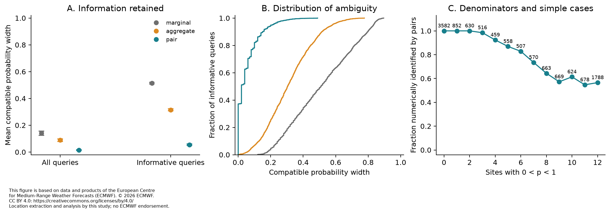
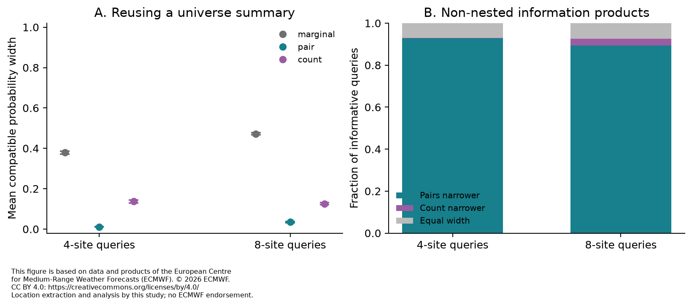
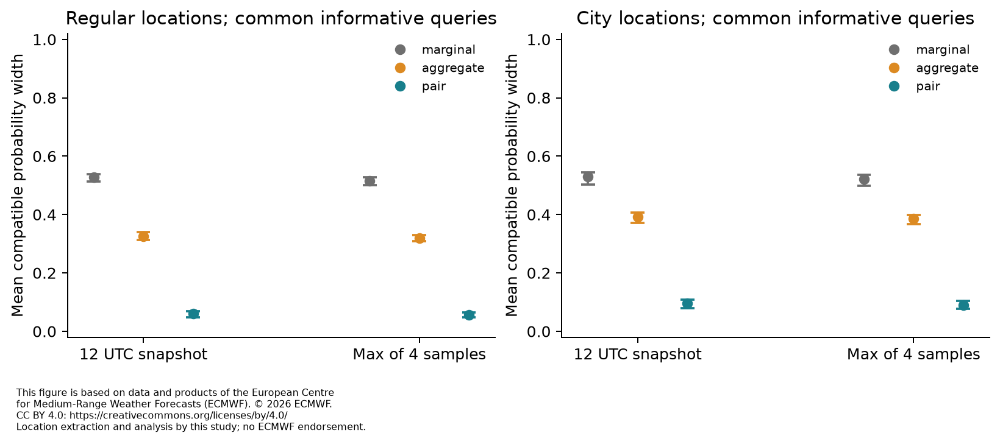
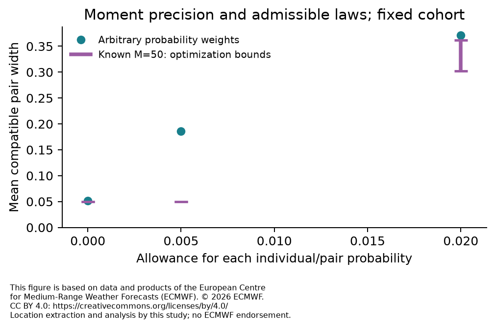

# Spatial temperature-exceedance probabilities from ensemble summaries: an empirical partial-identification study

## Abstract

Heat preparedness across several locations can require a probability that a common capacity threshold is crossed, whereas a map of individual exceedance probabilities does not generally specify that probability. We evaluate how much of an operational ensemble's spatial count-tail probability is retained by individual probabilities, those probabilities plus one aggregate second binomial moment, and all pairwise co-exceedance probabilities. The target is the empirical forecast distribution, not observed weather or health outcomes. Primary bounds permit arbitrary probability weights; known-size equal-weight ensembles are checked separately. Across 28 matched initialization dates, 12,096 twelve-site queries had mean identification interval widths 0.1407, 0.0885 and 0.0142, respectively. Among all queries, 3,941 reference probabilities were zero and 3,469 were one; 5,064 queries had at most two uncertain sites. In the 2,871 prespecified informative queries, the corresponding widths were 0.5139, 0.3146 and 0.0547; pairs numerically identified 1,068 tails. The aggregate moment captured 43.4% of the marginal-to-pair interval narrowing in that stratum.

In the fixed 120-query sensitivity cohort, allowing each individual and pairwise moment to change by 0.005 changed mean pair width from 0.0514 to 0.1858. All 120 relaxed query sets have a positive-width floor by construction; these neighborhoods are not statistical confidence sets.

Exploratory subset queries found the parent portfolio's full count distribution gave narrower intervals than the pairwise table in 717 of 36,337 informative cases; the pairwise table gave narrower intervals in 32,999. A coherent binary mask answers all tested fixed-threshold subset queries exactly by construction. On 2,595 common informative queries, exploratory marginal-midpoint absolute error was 0.0437, versus 0.0102 for the pair midpoint. Wide compatible intervals did not imply comparably large observed point errors. An exploratory fixed-size check shows that 0.005 admits no changed moment counts for all 120 queries. At 0.02, the all-case mean width was bounded by 0.3025 and 0.3621; 26 queries had an unresolved endpoint. An exploratory self-check notes that the informative filter itself fixes a weakly optimal action at cost ratio 0.1 for all 2,871 informative queries; certification uses only the released moments. No observed-weather skill, public-health benefit or practical traffic saving was measured.

## 1. Introduction

Heat–health action plans connect warnings to actions, responsibilities and available response capacity. The World Health Organization's guidance stresses local warning criteria and coordination between health and other services; dry-bulb temperature alone does not validate a health-warning trigger [1]. If an organization can prepare a limited number of locations, the probability that several locations cross a threshold may matter alongside each location's probability. This study examines that information requirement using simplified portfolios of locations. It does not estimate actual staffing needs or show that the portfolios correspond to an existing response network.

Ensemble forecasts provide multiple possible weather fields. Member identifiers preserve which local outcomes occur together. Reducing these fields to a probability at each location removes that association. This is an established problem in multivariate forecast post-processing: ensemble copula coupling restores dependence using the raw ensemble's ranks [2]. It matters to distinguish information retained from forecast accuracy. A summary can reproduce an inaccurate ensemble exactly; conversely, a calibrated local probability does not identify the dependence needed for a joint event.

Practical warning products also require events defined for the intended decision. Ponzano et al. describe co-designed ensemble products, including heat-related applications using the wet-bulb globe temperature and explicit cost–loss considerations [3]. Our temperature thresholds and capacity fractions are deliberately simpler experimental definitions, not replacements for those applications. A recent conference abstract reports operational compression of large rainfall ensembles into histograms that sacrifice spatial correlation [4; **complete abstract checked, no full study assessed**]. That report motivates examining retained joint-event information, but supplies no evidence that this study's queries represent users of that service. Numerical compression also has application-specific effects, including effects on nonlinear spatial threshold diagnostics [5]. We investigate exact low-order summaries of binary events rather than an alternative numerical-field compressor.

The practical question is not whether dependence can matter in principle. It is how much ambiguity remains in actual forecast states after particular information is released, and how often a decision can be certified despite that ambiguity. A cheap aggregate moment might retain much of what a larger pairwise table provides. Conversely, pairwise summaries might look adequate because most locations are certain, because finite ensembles imply exact zero cells, or because the chosen event is far from a decision boundary. These alternatives require explicit denominators and sensitivity checks.

**Research question.** For fixed portfolios in operational forecasts, how tightly do individual, aggregate-second-moment and pairwise summaries bound the probability that at least a specified number of locations exceed a temperature threshold, and how often do those bounds certify an illustrative binary action? Exploratory extensions ask whether the answer changes for subset queries, city-based locations and a four-time maximum. The intended readers are ensemble-product designers, researchers in multivariate forecasting, and practitioners assessing whether a delivered forecast product supports their joint-event query.

## 2. Prior work and scope of contribution

Dependence reconstruction in weather ensembles predates this study. Schefzik, Thorarinsdottir and Gneiting [2] separate calibrated margins from an empirical dependence template. Lakatos et al. [6, methods §§3.2.1–3.2.5 checked] compare several template-based approaches. Their Schaake shuffle uses historical **observations**, whereas our baseline uses ranks from earlier **forecast ensembles**. We therefore call it a historical forecast-rank reconstruction, not a Schaake shuffle or a calibrated climatology.

The European Centre for Medium-Range Weather Forecasts (ECMWF) Forecast User Guide already explains why separate event probabilities cannot generally be combined without dependence information and describes counting joint events in coherent members [12]. It also cautions that a finite ensemble's zero or one is not real-weather certainty. Our study quantifies compatibility with exact empirical summaries; it does not discover those general principles or interpret an empirical zero as absence of weather risk.

Bounds on probabilities from incomplete event probabilities are also established. Ramachandra and Natarajan [7, §1.1] review general bivariate-information linear programs and aggregated moments. Their paper's specialized pairwise-independence results do not apply to our empirically dependent events; we use the general finite-event linear-program formulation. Hoppe [8] discusses hybrid moments and the influence of redundant events on bounds. Neither the linear program, nested tightening under additional constraints, nor the fact that pairwise information need not determine higher-order events is a new result here.

Padmanabhan and Natarajan [13, §§1.2–1.3 in the checked preprint] state the same general count-tail program with given marginal and bivariate probabilities and review the sorted-marginal bound. Their specialized tree-graph results address computational tractability with partial bivariate information. Here the complete pair table is retained for small portfolios, and the research concerns its empirical information retention. This closer mathematical precedent further confines the contribution to the measured forecast cases and comparisons.

Decision-specific cost–loss analysis and compound weather events are likewise established; Olivetti et al. [9] evaluate weather forecast value in a decision-specific framework. Our losses are expectations under a retained empirical ensemble law, with no observation-based verification. They must not be read as economic benefits in practice.

Within the recorded literature-search range, we did not find the same empirical comparison of these information releases for the count-tail queries studied here. This is a bounded search statement, not a claim of novelty or absence. The contribution sought is a reproducible empirical audit of ambiguity, including cases where apparently sufficient summaries owe their performance to simple or finite-sample conditions. Exact task-specific count distributions and coherent binary masks are included because a comparison only with independence would give an incomplete picture of available information products.

## 3. Methods

### 3.1 Data and fixed sample

The primary design scheduled 29 initialization dates from 2026-06-03 to 2026-09-27, two ensemble products, and leads 84 and 180 hours, giving 116 fifty-member forecast units. Each unit contains twelve portfolios of twelve sites, three temperature thresholds and three capacity fractions. The primary analysis uses 28 dates for which all four product/lead units are complete, yielding 12,096 queries. Overall, 115 scheduled forecast units completed. The fixed adequate-date criterion was twelve. The analysis status is `adequate_predeclared_date_count`. Smaller portfolio analyses retain their separate denominators. There were 1 unavailable scheduled units; availability and every retained partial input are recorded. No replacement dates were selected.

We use public ECMWF Open Data forecasts on the 0.25° grid. The operational products are the Artificial Intelligence Forecasting System ensemble (AIFS ENS) and Integrated Forecasting System (IFS) ensembles initialized at 00 UTC; perturbation member identifiers 1–50 are retained and the control member is excluded. Product names, valid steps, parameter, units, member identifiers and point coordinates are checked against the GRIB messages. The official operational calendar lists IFS Cycle 50r1 and AIFS ENS v2 from 12 May 2026 [10], before the sampled season. These labels are documentary attributions from the calendar, not independently decoded cycle identifiers in every GRIB message. The data period, operational product paths and retained field metadata define the measured scope.

For each center, a compact portfolio uses three latitude offsets and four longitude offsets; a dispersed portfolio uses a wider set of offsets. Exact coordinates, subset indices and the fixed calendar are in `protocol/design-v1.json`. Smaller portfolios use fixed nested locations, so size comparisons also change spatial selection and density. Portfolios may overlap and their sites are not independent observations. They are experimental spatial configurations, not a probability sample of regions or a mapping of actual service demand. Fixed absolute thresholds permit a common information comparison but do not represent equally unusual or equally harmful heat in different climates.

The archive is accessed anonymously through bounded byte-range reads of indexed public GRIB messages. Complete global transport fields are decoded, then selected site vectors are retained losslessly with source URLs, ranges, field hashes, metadata and timestamps. A small set of full temperature messages is additionally retained solely for offline decoder validation; other global values outside the selected sites are not retained, and none are analyzed as scientific variables. Offline verification starts from the bundled selected vectors and those validation fixtures; optional network re-extraction is separate. Failed transfers and partial vectors remain recorded. The cause of HTTP errors and truncated transfers is not assigned to the data provider.

Later extractions can reuse nearest-point indices only when GRIB grid-definition bytes match exactly across members. Decoded values at those indices are checked against the original nearest-point routine for the first newly decoded member and member50 of each raw unit. The retained full-message fixtures allow those checks to be repeated offline. This implementation change preserves the fixed coordinates, member identities and selected values; no controlled speed comparison is claimed.

### 3.2 Target and released information

Let \(X_{mj}=1\) when member \(m\)'s temperature at site \(j\) meets or exceeds threshold \(t\). The empirical distribution assigns mass \(1/M\) to each of the \(M\) coherent binary rows. For a portfolio of \(n\) sites, let \(S=\sum_j X_j\) and \(q_k=P(S\geq k)\). “Probability” below means this empirical ensemble probability unless explicitly stated otherwise.

Here \(k\) is an activation threshold measured in locations. If an application instead specifies a literal capacity of \(C\) locations, the event of exceeding that capacity would use \(k=C+1\). The studied fractions do not assert an existing service's capacity.

We compare three nested releases:

1. Individual probabilities \(p_j=E[X_j]\).
2. Those probabilities and the scalar \(a=E[\binom{S}{2}]\).
3. Those probabilities and every \(b_{ij}=E[X_iX_j]\).

The scalar is the second binomial moment, half the second factorial moment. The aggregate scalar equals \(\sum_{i<j}b_{ij}\). When deterministic sites are removed computationally, their contributions are determined by the fixed margins and are accounted for exactly. We minimize and maximize \(\sum_x w_x1\{\sum_j x_j\geq k\}\) over binary states \(x\in\{0,1\}^n\), subject to \(w_x\geq0\), \(\sum_xw_x=1\) and the corresponding released equalities. The interval \([L_k,U_k]\) is sharp within this finite-state class up to numerical tolerance. Marginal-only endpoints use the classical sorted-marginal expression reviewed in [13, §1.2], checked against the equivalent linear program on validation fixtures.

The primary feasible class permits arbitrary real probability weights. It is larger than the class of exactly \(M\) equally weighted coherent rows. This is a substantive distinction, tested by the prespecified integer sensitivity rather than hidden in the word “ensemble.” The binary-state class imposes no further atmospheric dynamics or spatial-smoothness constraints. Its extrema describe compatibility with the released information; they need not describe equally plausible meteorological scenarios. Exact zero pair cells exclude states because probabilities are nonnegative; deterministic sites are removed. Such reductions preserve the feasible set for exact inputs. The perturbation sensitivity restores all binary states and relaxes the individual and pairwise equalities.

We use SciPy/HiGHS dual simplex with per-solve time limits and verify primal residuals, nonnegative mass, dual feasibility and the primal–dual gap. The numerical identification tolerance is \(10^{-7}\). These checks are floating-point certificates, not formal exact-arithmetic proofs. Analytic fixtures, random binary examples, permutations, complements, integer cases and round trips are checked separately from weather results.

### 3.3 Evaluation and comparisons

The primary metric is interval width \(U_k-L_k\), reported across all cases and in a stratum fixed in advance: at least four sites have empirical probabilities strictly between zero and one, and \(0.1\leq q_k\leq0.9\). This stratum exposes uncertainty hidden by floor and ceiling cases; conditioning on it changes the target population of queries. It is not an observed-weather verification set. We count \(q_k=0\), \(q_k=1\), deterministic portfolios and portfolios with at most two uncertain sites. In particular, an empirical tail at zero or one need not imply that a coarse summary determines it.

For an illustrative protective action with cost–loss ratio \(c\), acting has normalized expected cost \(c\), and not acting has expected loss \(q_k\). A weakly optimal action is certified when \(U_k\leq c\) or \(L_k\geq c\), with ties and the numerical tolerance explicit. The fixed cost ratios are illustrations, not measured practitioner preferences. Interval width also equals the length of cost ratios in \([0,1]\) where neither action is certified. This identity is an interpretation of the metric, not an experimental discovery or an assumption that real cost ratios are uniform.

Point reconstructions include independence via a Poisson-binomial distribution, the pair-interval midpoint, and a historical forecast-rank template. The latter uses up to six earlier complete initialization dates for the same product and lead, requires at least three, resolves temperature-rank ties by member identifier, and applies each earlier rank template to the current exceedance counts. It reproduces the current margins exactly but is not guaranteed to reproduce current dependence. Comparisons with this baseline use a common availability set. These methods consume different information: the comparison measures the combined release and reconstruction. Point error and illustrative decision regret are computed against the original ensemble, not against observations.

A full distribution of \(S\) exactly answers every capacity threshold for the known portfolio, so it is an essential reference. We do not propose pairwise tables as a preferable delivery format for that task. A coherent binary mask also answers every query for that fixed temperature threshold, including subset queries. Its sufficiency follows by construction and is checked by round trips.

### 3.4 Repetition, uncertainty and prespecified sensitivities

The fixed sample crosses initialization dates, forecast products, lead times, centers, geometries, temperature thresholds and capacity fractions. We preserve those paired conditions when resampling dates. Circular moving-block resampling uses three scheduled date slots per block and the fixed seed, with 2,000 repetitions. Reported intervals describe resampling variation within this convenience sample. They do not measure calibration uncertainty, population representativeness, or independent variation among every site, member or query. Missing scheduled dates remain slots in the resampling design; replicates with no eligible query have undefined means and are omitted from the quantiles.

Prespecified sensitivities use one seeded nested member subset of sizes 10 and 25 per forecast. A deterministic hash ordering selects up to 120 informative primary cases for integer-weight extrema and moment perturbation. Integer solves have a five-second limit per endpoint; unresolved cases are reported. The pairwise perturbation analysis allows each individual and pairwise probability to differ from its released value by at most 0.005 or 0.02. These are mathematical sensitivity neighborhoods, not simultaneous statistical confidence sets or estimated measurement errors.

### 3.5 Exploratory extensions

The subset extension was planned after the initial primary result was available and is explicitly exploratory. For fixed queries containing four or eight sites from a twelve-site universe, it compares all universe pairwise information with the full universe count distribution plus individual probabilities. These information sets are not nested. A query-only pairwise table is a diagnostic; a query-specific count distribution and the coherent binary mask are exact references. Queries were fixed without selecting for outcome differences. The informative subset stratum additionally requires at least two uncertain sites outside the query. The count distribution determines a shifted subset count if every outside site is individually deterministic; a constant outside count observed only in the original ensemble is not the same released-information guarantee.

The city/time extension was fixed before acquiring its new coordinate vectors. Natural Earth's public-domain populated-place layer supplies a geography-only eligibility filter and selection, using metropolitan population estimates only for eligibility, not burden weights or rankings. Twelve distinct snapped cells are selected near each center and by a dispersed maximin rule. The original proposed gazetteer was abandoned when its robots policy prohibited retrieval; it was not obtained from a mirror. The replacement source and exact realized coordinates were committed before new weather extraction. These are cartographic city samples, not complete city censuses or verified urban microclimates. Their changed locations and spacing do not isolate an urban land-use effect.

The schedule contains twelve fixed dates. For each completed product/horizon combination, four six-hourly fields on the forecast day are aligned by member ID. The sitewise maximum over those four samples is compared with the 12 UTC snapshot. It is not the continuous daily maximum, and a threshold crossed at different sites need not be crossed simultaneously. The original regular portfolios are re-extracted alongside the city portfolios to check extraction consistency. The extension shares dates and forecasts with the primary study and is not independent confirmation. Its resampling uses two scheduled dates per block. Common informative queries under both time definitions are reported alongside each definition's own stratum.

Further exploratory checks address interpretation. For an exact pair constraint matrix \(A\), full column rank is a sufficient condition for unique binary-state weights; an event vector \(e=A^Ty\) has probability \(y^Tb\) fixed by the released moments. We count constant events after zero-cell pruning, full-column-rank cases, numerical event row-space membership and remaining cases separately. Rank uses a relative singular-value threshold of \(10^{-10}\), row-space residual tolerance \(10^{-8}\). These are numerical sufficient-condition diagnostics; rank deficiency does not prove that nonnegative feasible weights are nonunique. Separately, marginal- and aggregate-interval midpoints provide additional point controls with the same error/regret outcomes, leaving the originally planned methods intact.

After the prespecified member-size summaries revealed different informative denominators, an exploratory saved-data comparison holds query identities fixed using the M50 informative set and the intersection informative at all three member sizes. The same nested member selections are retained. This controls query composition, while the empirical laws still change; it does not identify a causal effect of ensemble size or provide repeated-sampling uncertainty.

A further exploratory selection check planned 100 nested member draws and completed 100. Each draw samples ten and twenty-five members without replacement from the original fifty, sharing one nested permutation across all queries from the same forecast. The same frozen sensitivity cohort is retained. Both all fixed query identities and common informative identities are summarized. The stated draw quantiles describe conditional selection variation in this fixed finite dataset, not confidence about weather probabilities or additional independent forecasts.

After the all-moments perturbation result, controlled precision comparisons keep individual probabilities exact, then keep their aggregate second binomial moment exact as well, while allowing pairwise moments the original tolerances. The frozen sensitivity cohort, full binary-state space and LP tolerances remain unchanged. These additions are exploratory and do not model a measured publication error.

An exploratory interaction check recognizes that probabilities from exactly fifty equally weighted members are multiples of 0.02. A 0.005 allowance around their exact observed individual and pair probabilities therefore admits no changed count; it leaves the exact-count integer feasible set unchanged. The original optimal integer endpoints are reused for that structural comparison. At radius 0.02 we instead solve new integer problems with each moment count allowed to differ by one, retaining the original five-second endpoint limit. Incumbent/dual bounds give all-case width envelopes when exact optimization is unresolved. Replacing an event row by all zeros or a non-event row by all ones supplies a structural 0.04 width floor in this informative cohort, checked from source arrays. These facts are class/precision boundaries, not new mathematical discoveries or measured publication processes.

Coverage diagnostics use all observed complete-unit outputs, including units on otherwise unmatched dates. If \(N\) scheduled widths include \(K\) missing values and observed sum \(T\), the safe full-schedule mean envelope is \([T/N,(T+K)/N]\), using width bounds \([0,1]\). Unknown informative eligibility is treated conservatively. Equal-center weighting, leave-one-center-out estimates and block lengths one and five are additional sensitivities. These envelopes and weighting choices are exploratory and do not imply random missingness or representative sampling.

An optional exploratory coverage check can reuse the already scheduled overlapping city extraction for the exhausted original unit. It requires agreement with every retained original member's values and field hash and with the original index. Its separately derived regular-site input and recovered-calendar summary preserve the original missing flag and primary sample. It introduces no extra retrieval and no independent forecast sample.

### 3.6 Reuse terms and research process

ECMWF data are used under [CC BY 4.0](https://creativecommons.org/licenses/by/4.0/) and the applicable general terms. **This document is based on data and products of the European Centre for Medium-Range Weather Forecasts (ECMWF).** © 2026 ECMWF. We extracted locations, thresholded members and computed new summaries; ECMWF has not endorsed these analyses. Natural Earth data are public domain. Source-specific reuse records and retrieval dates are included with the data.

Plans and revisions, source passages, failed experiments and Git commits are bundled. Git dates are self-reported and hashes establish file consistency, not independence or tamper-proofness. One authorized topic-candidate critique used the API model identifier `gpt-6-astra`, reasoning effort `xhigh`, on 25 October 2026 UTC; its original request, output and usage are retained. It was topic-selection consultation, not experimental data, paper authorship or peer review. No AI API was used to write or debug the analysis. The model carrying out the study is presented in the session as GPT-6/Codex; an exact runtime model identifier was not observable. No human participants or individual-level records were used.

## 4. Results

### 4.1 Primary identification results

Table 1 separates all queries from the informative stratum. Brackets are 95% date-block resampling intervals, not uncertainty about true weather probabilities. For the informative stratum, the aggregate moment captured 43.4% of the total width reduction from margins to pairs, computed as a ratio of summed reductions. Nested tightening itself follows from the constraints; these numerical magnitudes and the case composition are the empirical outcomes.

**Table 1. Primary compatible probability widths.**

| Product | Stratum | N | q=0 / q=1 | ≤2 uncertain | Marginal width [interval] | Aggregate width [interval] | Pair width [interval] | Pair identified |
| --- | --- | --- | --- | --- | --- | --- | --- | --- |
| all | all | 12,096 | 3,941/3,469 | 5,064 | 0.1407 [0.1246, 0.1571] | 0.0885 [0.0786, 0.0986] | 0.0142 [0.0123, 0.0163] | 9,895 |
| all | informative | 2,871 | 0/0 | 0 | 0.5139 [0.5080, 0.5197] | 0.3146 [0.3081, 0.3220] | 0.0547 [0.0505, 0.0597] | 1,068 |
| aifs-ens | all | 6,048 | 1,840/1,665 | 2,355 | 0.1546 [0.1380, 0.1712] | 0.0954 [0.0861, 0.1048] | 0.0149 [0.0133, 0.0167] | 4,886 |
| aifs-ens | informative | 1,582 | 0/0 | 0 | 0.5167 [0.5079, 0.5255] | 0.3097 [0.3020, 0.3172] | 0.0522 [0.0479, 0.0569] | 618 |
| ifs | all | 6,048 | 2,101/1,804 | 2,709 | 0.1267 [0.1096, 0.1442] | 0.0816 [0.0701, 0.0929] | 0.0136 [0.0109, 0.0162] | 5,009 |
| ifs | informative | 1,289 | 0/0 | 0 | 0.5105 [0.4971, 0.5206] | 0.3207 [0.3084, 0.3307] | 0.0578 [0.0506, 0.0646] | 450 |

Across all available original analyses, the maximum checked primal residual was 9.51e-12, dual violation 5.14e-12, and primal–dual gap 1.39e-12. These are numerical checks, not independent validation. Figure 1 shows width distributions and identification by the number of uncertain sites.

### 4.2 Decisions and point reconstruction

Table 2 reports certification among informative queries within 0.1 of each illustrative action threshold. Ties admit either action. Full-sample and boundary-only denominators are in `decision-summary.csv`; certification here concerns the empirical forecast law.

**Table 2. Release-only action certification near the threshold.**

| Cost ratio | N | q>c | q<c | q=c ties | Marginal certified | Aggregate certified | Pair certified |
| --- | --- | --- | --- | --- | --- | --- | --- |
| 0.1000 | 532 | 426 | 0 | 106 | 0.2% | 15.0% | 91.0% |
| 0.2500 | 693 | 297 | 396 | 0 | 2.3% | 10.0% | 74.7% |
| 0.5000 | 623 | 260 | 302 | 61 | 0.5% | 7.2% | 75.6% |

The action-side counts were added during the exploratory self-check. Because the informative filter requires q≥0.1, at cost ratio 0.1 the filter itself supplies a weakly optimal protective action for every included query. Certification here deliberately uses only released moments, not knowledge of that evaluation selection. The lowest-cost row therefore measures release-only certification on a one-sided evaluation set; it is not an operational error rate or evidence that a user supplied with the filter would remain uncertain.

The historical baseline was unavailable for 1,296 primary queries before sufficient prior dates existed. Table 3 holds its availability set fixed for all point methods. Error and normalized expected regret are relative to the original ensemble; lower values do not establish more accurate weather forecasts.

**Table 3. Point reconstruction against the retained ensemble.**

| Reconstruction | N | Mean absolute error | Resampling interval | Expected regret at c=0.25 |
| --- | --- | --- | --- | --- |
| independent | 2,595 | 0.1411 | [0.1366, 0.1453] | 0.0119 |
| historical_copula | 2,595 | 0.0272 | [0.0264, 0.0280] | 0.0008 |
| pair_midpoint | 2,595 | 0.0102 | [0.0098, 0.0107] | 0.0002 |

### 4.3 Prespecified sensitivity checks

The fixed hash ordering selected 120 informative queries. Integer and perturbation outputs were retained for 120 and 120 queries, respectively. Only solver status 0 is counted as an optimal integer result; unresolved cases are not assigned exact endpoints. Completed comparisons use their own stated denominators.

**Table 4. Exact fifty-member integer comparison.**

| Information | Attempted | Optimal | Unresolved | Mean width reduction | Maximum reduction |
| --- | --- | --- | --- | --- | --- |
| aggregate | 120 | 109 | 11 | 0.0197 | 0.0681 |
| pair | 120 | 120 | 0 | 0.0018 | 0.0262 |

**Table 5. Arbitrary-weight moment neighborhoods.**

| Moment tolerance | N | Dates | Mean pair width | Identified count |
| --- | --- | --- | --- | --- |
| 0.0000 | 120 | 27 | 0.0514 | 44 |
| 0.0050 | 120 | 27 | 0.1858 | 0 |
| 0.0200 | 120 | 27 | 0.3712 | 0 |

Moment relaxation preserves the original empirical law as feasible, so widening is structurally expected; its size is the sensitivity outcome. For every query in this cohort, mixing the original law with all-zero or all-one states at weight epsilon changes each individual and pair probability by at most epsilon. These two feasible mixtures give an interval of width epsilon. Thus the loss of exact identification at positive tolerance is structurally required, not a separate empirical discovery. Allowances change deterministic margins and zero pair cells as well as nonzero moments. The prespecified check cannot attribute widening to one of those channels; the exploratory controlled comparisons address exact individual and aggregate information separately.

The nested member subsets below use one deterministic selection per forecast unit. Their informative strata are defined within each member subset and therefore differ in composition; these are not repeated-sampling estimates of the true forecast law.

**Table 6. One prescribed member subset per forecast.**

| Members | Stratum | N | Dates | q=0 | q=1 | ≤2 uncertain | Marginal width | Aggregate width | Pair width | Pair identified |
| --- | --- | --- | --- | --- | --- | --- | --- | --- | --- | --- |
| 10 | all | 12096 | 28 | 4546 | 4231 | 6414 | 0.1258 | 0.0605 | 0.0006 | 12033 |
| 10 | informative | 3176 | 28 | 0 | 0 | 0 | 0.4528 | 0.2150 | 0.0023 | 3117 |
| 25 | all | 12096 | 28 | 4162 | 3764 | 5556 | 0.1368 | 0.0805 | 0.0055 | 11262 |
| 25 | informative | 2726 | 28 | 0 | 0 | 0 | 0.5212 | 0.2998 | 0.0219 | 2018 |
| 50 | all | 12096 | 28 | 3941 | 3469 | 5064 | 0.1407 | 0.0885 | 0.0142 | 9895 |
| 50 | informative | 2871 | 28 | 0 | 0 | 0 | 0.5139 | 0.3146 | 0.0547 | 1068 |

### 4.4 Exploratory reuse for subset queries

The subset extension includes 28 matched dates and 193,536 queries, of which 36,337 meet the stronger informative criterion. Table 7 shows full and informative strata. Deterministic outside sites are separated because they make the full count curve a shifted query-specific count curve. This condition is stronger than a constant outside count observed only in the original ensemble.

**Table 7. Reusing the universe count distribution or pair table for subset queries.**

| Query sites | Stratum | N | Dates | q=0 | q=1 | All outside sites fixed | Universe pairs width | Universe count width | Count narrower | Pairs narrower | Equal width |
| --- | --- | --- | --- | --- | --- | --- | --- | --- | --- | --- | --- |
| 4 | all | 96768 | 28 | 28533 | 28743 | 31935 | 0.0026 | 0.0367 | 45 | 33548 | 63175 |
| 4 | informative | 14998 | 28 | 0 | 0 | 0 | 0.0113 | 0.1367 | 7 | 13932 | 1059 |
| 8 | all | 96768 | 28 | 30701 | 27939 | 38739 | 0.0093 | 0.0354 | 1442 | 32237 | 63089 |
| 8 | informative | 21339 | 28 | 0 | 0 | 0 | 0.0350 | 0.1254 | 710 | 19067 | 1562 |

The maximum oracle probability discrepancy was 2.22e-16. The count and pair information sets are non-nested; neither observed average nor narrower cases establish a universal ordering.

For the fixed 50-member, 12-site binary problem, the simple fixed-width encodings require 600 bits (75bytes) for coherent rows, 468bits (59bytes) for margins and pairs, and 144bits (18bytes) for margins and the universe count curve. These are format calculations with round-trip checks, not measured network traffic or optimal coding. Count/mask sufficiency is known by construction, not a discovered weather result. A mask at one temperature threshold does not retain arbitrary other thresholds or raw temperatures.

## 5. Discussion

In this sampled informative stratum, pairwise information left a mean compatible width of 0.0547, compared with 0.5139 from margins alone. That empirical narrowing must be read beside the 2,871-query denominator, the all-case floor/ceiling composition and the moment/member sensitivities. Numerical identification in a finite ensemble is a statement about exact supplied moments, not a guarantee under rounded, estimated or future forecast distributions. The exploratory midpoint controls qualify a practical interpretation: on their common informative set, marginal-only midpoint absolute error was 0.0437, and pair-midpoint error 0.0102. These observed errors describe one original ensemble per query, whereas compatibility ranges concern every law meeting the release. A lack of certification therefore does not show that all marginal-only point reconstructions perform poorly on the sampled queries or that a real operational shortfall has been measured.

The general lesson is to specify the query before deciding that a forecast summary is sufficient. For a fixed portfolio, the count distribution is an exact compact answer to every capacity threshold. For changing subsets at a fixed temperature threshold, preserving coherent binary scenarios is another exact option. Pairwise tables may support a wider range of queries than a single total-count curve, but that does not make them universally sufficient or the preferred encoding. Our fixed-width payload accounting excludes headers, optimal coding and general compression; it cannot establish actual download savings or a provider deployment recommendation.

The admissible probability laws and the precision of the release must also be specified together. A continuous moment neighborhood allows probabilities unavailable to a known equal-weight ensemble. In the fixed-size check, an allowance smaller than one moment-count increment leaves the integer constraints unchanged. This qualifies any interpretation that a small decimal tolerance necessarily destabilizes an exact finite-ensemble release. Larger tolerances can allow changed counts; the new integer solves measure that regime while retaining bounds for unresolved endpoints. Neither neighborhood estimates the precision of a particular forecast product.

The results describe compatibility under released empirical moments. They do not justify replacing a coherent forecast with an independence reconstruction, nor do they show that the original joint forecast is correct. A practitioner would still need a locally meaningful event definition, calibrated forecasts, realistic capacity costs and evaluation with observations. Those requirements are separate from checking whether the delivered information can answer the desired query.

## 6. Limitations

The spatial configurations and calendar are convenience designs from a limited season and two operational products. Absolute temperature thresholds have different climatological meanings across locations; no region or product is ranked for public-health performance. Site counts are not population exposure, workload or simultaneous peak demand. City coordinates are snapped to coarse model cells, and the cartographic source's population definitions and dates differ. The four-time maximum misses between-sample extremes and is defined on a UTC day rather than each location's local warning day.

All reference probabilities come from finite raw ensembles. Exact zero probabilities and exact pair cells can make partial identification appear stronger than it would be for a smoothed or population forecast law. Moment perturbation probes that sensitivity but does not estimate the true uncertainty in moments. The main LP allows arbitrary weighted laws; the integer comparisons cover a selected cohort. Exact optima and bounds for unresolved integer endpoints have separate denominators. Larger portfolios, different ensemble sizes, additional thresholds, weights for unequal site burdens, changing portfolio membership and other hazards are not established by these results.

Complete-case matching may introduce selection if transfer failures depend on archive or field properties. Partial and unmatched data are retained; their absence is not evidence of weather performance. Historical templates use a short archive and are not an optimized or calibrated dependence model. Midpoint comparison does not estimate the optimal practical reconstruction. Numerical tolerance can affect very small widths and boundary ties. Resampling intervals cannot repair the sample's lack of representativeness or make correlated queries independent.

No human usability, adoption, health benefit, realized economic benefit or actual network traffic was measured. The exploratory extensions were added after an early primary result; they are not independent confirmatory tests. The trial is one AI-led study. Topic selection consulted `gpt-6-astra` on 2026-10-25 UTC. These are provider-returned identifiers; the critique was consultation, not a numerical evaluation dataset or peer review. A review by another AI agent is planned after this first draft and has not yet been received. Neither the critique nor the author’s verification constitutes independent human peer review or independent reproduction.

## 7. Reproduction and availability

`VERIFY.md` gives a single offline entry point, a reduced numerical replay and the full replay procedure. Saved selected-temperature arrays and original responses suffice without an AI API or external network. Reproduction writes to a caller-supplied output location outside the checked source copy. Optional fresh data extraction and the original topic-critique API call are separate from recomputation. `claims.jsonl` maps main claims to artifacts, commands and expected results. The author ran the documented `reduced` procedure in a fresh working copy: status `passed`. This is an author re-run, not independent reproduction. The verification report states which costly LPs were re-solved and which saved outputs supplied aggregate recomputation.

## References

1. WHO Regional Office for Europe (2026). *Heat–health action plans: guidance, second edition: executive summary.* [Official publication](https://www.who.int/europe/publications/m/item/heat-health-action-plans--guidance--second-edition--executive-summary).
2. Schefzik, R., Thorarinsdottir, T. L., & Gneiting, T. (2013). Uncertainty quantification in complex simulation models using ensemble copula coupling. *Statistical Science*, 28, 616–640. [doi:10.1214/13-STS443](https://doi.org/10.1214/13-STS443).
3. Ponzano et al. (2025). Bridging the gap between ensemble forecasting and end-user needs for decision-making on high-impact events. *Advances in Science and Research*, 22, 39–52. [doi:10.5194/asr-22-39-2025](https://doi.org/10.5194/asr-22-39-2025).
4. Cooper, F., Nath, S., Weisheimer, A., & Palmer, T. (2026). Histogram compression of large ensemble forecasts. EGU26-15706. **Conference abstract only.** [doi:10.5194/egusphere-egu26-15706](https://doi.org/10.5194/egusphere-egu26-15706).
5. Tintó Prims, O., Redl, R., Rautenhaus, M., Selz, T., Matsunobu, T., Modali, K. R., & Craig, G. (2024). The effect of lossy compression of numerical weather prediction data on data analysis: a case study using enstools-compression 2023.11. *Geoscientific Model Development*, 17, 8909–8925. [doi:10.5194/gmd-17-8909-2024](https://doi.org/10.5194/gmd-17-8909-2024).
6. Lakatos, M., Lerch, S., Hemri, S., & Baran, S. (2022). Comparison of multivariate post-processing methods using global ECMWF ensemble forecasts. [arXiv:2206.10237v2](https://arxiv.org/html/2206.10237v2).
7. Ramachandra, A. K., & Natarajan, K. (2023). Tight probability bounds with pairwise independence. *SIAM Journal on Discrete Mathematics*, 37(2), 516–555. [doi:10.1137/21M1408294](https://doi.org/10.1137/21M1408294). General LP discussion used; pairwise independence not assumed here.
8. Hoppe, F. M. (2009). The effect of redundancy on probability bounds. *Discrete Mathematics*. [doi:10.1016/j.disc.2007.12.052](https://doi.org/10.1016/j.disc.2007.12.052).
9. Olivetti, L., Messori, G., Avner, P., & Hallegatte, S. (2026). Assessing the real-world economic value of weather forecasts under compounding extremes: a decision-specific framework. World Bank Policy Research Working Paper 11407. [Official report](https://documents.worldbank.org/curated/en/099836006022622606/pdf/IDU-3d41fc50-bb68-481a-ae9f-95c258fb251c.pdf).
10. ECMWF. *AIFS data specification; operational cycle calendar and joint upgrade announcement; Open Data and general terms.* Relevant official pages and retrieval records are archived in `literature/` and `sources.jsonl`. [Official archived source](https://www.ecmwf.int/en/forecasts/datasets/open-data), [Official archived source](https://apps.ecmwf.int/datasets/licences/general/), [Official archived source](https://www.ecmwf.int/en/forecasts/datasets/aifs-machine-learning-data), [Official archived source](https://www.ecmwf.int/en/forecasts/documentation-and-support/changes-ecmwf-model), [Official archived source](https://www.ecmwf.int/en/about/media-centre/news/2026/ifs-cycle-50r1-aifsv2-live)
11. Natural Earth. *1:10m cultural vectors: populated places; terms of use.* [Populated places](https://www.naturalearthdata.com/downloads/10m-cultural-vectors/10m-populated-places/), [public-domain terms](https://www.naturalearthdata.com/about/terms-of-use/). Archive version and SHA-256 are recorded with the realized design.
12. ECMWF (2022). *Forecast User Guide, 7.1 Consideration of Probability*, version 15, 14 November 2022. [Historical version](https://confluence.ecmwf.int/pages/viewpage.action?navigatingVersions=true&pageId=298956912). Relevant full sections on time intervals, areas, combined events, finite ensembles and calibration checked. No current interface capability is inferred from this historical page.
13. Padmanabhan, D., & Natarajan, K. (2021). Tree bounds for sums of Bernoulli random variables: a linear optimization approach. *INFORMS Journal on Optimization*, 3(1), 23–45. [doi:10.1287/ijoo.2019.0038](https://doi.org/10.1287/ijoo.2019.0038). Relevant full passages checked in [arXiv:1910.06321v1](https://arxiv.org/pdf/1910.06321v1), the 2019 preprint.

## Appendix: additional descriptive analyses

### A. City locations and four-time maximum (exploratory)

The schedule contains 12 dates and 48 product/horizon combinations. The boundary analysis completed 128 raw fields and 32 combinations, with 8 fully matched dates. Its predefined adequacy threshold is 8 matched dates and its status is `adequate_predeclared_date_count`; adequacy does not imply completion of the full schedule. Re-extracted original snapshots compared 1,591 member fields, with 0 value mismatches and 0 field-hash mismatches. These are extraction checks on overlapping forecasts, not new independent forecast samples.

| Locations | Time definition | Stratum | N | q=0 / q=1 | ≤2 uncertain | Marginal | Aggregate | Pair |
| --- | --- | --- | --- | --- | --- | --- | --- | --- |
| regular | snapshot12 | all | 3,456 | 1,169/997 | 1,482 | 0.1367 | 0.0877 | 0.0154 |
| regular | snapshot12 | common_informative | 726 | 0/0 | 0 | 0.5285 | 0.3262 | 0.0599 |
| regular | maximum4 | all | 3,456 | 1,131/1,101 | 1,593 | 0.1304 | 0.0836 | 0.0139 |
| regular | maximum4 | common_informative | 726 | 0/0 | 0 | 0.5160 | 0.3191 | 0.0557 |
| city | snapshot12 | all | 3,456 | 1,330/988 | 1,386 | 0.1260 | 0.0933 | 0.0229 |
| city | snapshot12 | common_informative | 614 | 0/0 | 0 | 0.5290 | 0.3919 | 0.0952 |
| city | maximum4 | all | 3,456 | 1,294/1,075 | 1,494 | 0.1200 | 0.0887 | 0.0201 |
| city | maximum4 | common_informative | 614 | 0/0 | 0 | 0.5221 | 0.3865 | 0.0896 |

Paired width differences, own informative strata and the all-cells-at-least-half-land conditional diagnostic are in the city/time numerical outputs. The latter is exploratory, uses one IFS mask, and does not remove any original locations. No increase in event probabilities from taking a maximum is interpreted as a discovery.

### B. Coverage, weighting and resampling (exploratory)

Of 12,528 fixed scheduled primary queries, 108 lack a complete original forecast unit. The following conservative envelopes use all known complete-unit rows, including otherwise unmatched dates, and permit every missing width in [0,1]. Informative eligibility of missing rows is unknown. These are missing-data envelopes, not resampling intervals or sharp feasible-weather bounds.

| Stratum | Information | Available | Unknown | Matched-date mean | Scheduled lower | Scheduled upper |
| --- | --- | --- | --- | --- | --- | --- |
| all | marginal | 12420 | 108 | 0.1407 | 0.1411 | 0.1498 |
| all | aggregate | 12420 | 108 | 0.0885 | 0.0888 | 0.0974 |
| all | pair | 12420 | 108 | 0.0142 | 0.0144 | 0.0230 |
| informative | marginal | 2990 | 108 | 0.5139 | 0.4957 | 0.5306 |
| informative | aggregate | 2990 | 108 | 0.3146 | 0.3036 | 0.3384 |
| informative | pair | 2990 | 108 | 0.0547 | 0.0529 | 0.0878 |

`weighting-summary.csv` reports equal-eligible-center means and leave-one-center-out ranges; `block-sensitivity.csv` reports block lengths 1, 3, 5. These describe sensitivity to a convenience design, not population inference. Center tables are descriptive and are not regional performance rankings.

### C. Coarse-cell land fractions

| Locations | Site slots | Land fraction <0.5 | 0 < land fraction <1 | Minimum | Maximum |
| --- | --- | --- | --- | --- | --- |
| regular | 144 | 1 | 26 | 0.0000 | 1.0000 |
| city | 144 | 3 | 56 | 0.0469 | 1.0000 |

The diagnostic uses one IFS mask field. Repeated portfolio slots can represent the same cell. It does not verify AIFS surface classes or urban microclimates, and no locations were removed.

### D. Sufficient explanations for identification (exploratory)

The numerical rank diagnostic covers 115 available forecast units. The categories below are mutually exclusive in their displayed priority order. A constant event can also occur in a full-column-rank system, so the category count alone is not the total number of full-rank systems. Constant events are absent from the informative stratum by construction, because its empirical tail lies strictly between zero and one. Rank deficiency does not prove joint-law nonuniqueness under nonnegative constraints.

| Stratum | Sufficient explanation or remainder | N | Denominator | Fraction | ≤2 uncertain |
| --- | --- | --- | --- | --- | --- |
| all | constant_after_pair_support | 7381 | 12096 | 0.6102 | 5052 |
| all | full_column_rank | 859 | 12096 | 0.0710 | 12 |
| all | event_in_row_space | 531 | 12096 | 0.0439 | 0 |
| all | identified_other | 1124 | 12096 | 0.0929 | 0 |
| all | not_identified | 2201 | 12096 | 0.1820 | 0 |
| informative | constant_after_pair_support | 0 | 2871 | 0.0000 | 0 |
| informative | full_column_rank | 202 | 2871 | 0.0704 | 0 |
| informative | event_in_row_space | 147 | 2871 | 0.0512 | 0 |
| informative | identified_other | 719 | 2871 | 0.2504 | 0 |
| informative | not_identified | 1803 | 2871 | 0.6280 | 0 |

These familiar sufficient conditions help interpret the observed exact tails; they are not new mathematical results or evidence of meteorological calibration.

### E. Additional midpoint controls (exploratory)

The following common-availability comparison applies the same interval-midpoint construction to each release. It complements the planned independence/historical/pair-midpoint table and prevents a poor independence choice from being conflated with every possible use of margins.

| Stratum | Information | N | Compatible width | Midpoint absolute error | Resampling low | Resampling high | Expected regret c=0.25 |
| --- | --- | --- | --- | --- | --- | --- | --- |
| all | marginal | 10800 | 0.1426 | 0.0146 | 0.0128 | 0.0164 | 0.0004 |
| all | aggregate | 10800 | 0.0902 | 0.0088 | 0.0078 | 0.0098 | 0.0001 |
| all | pair | 10800 | 0.0147 | 0.0028 | 0.0025 | 0.0032 | 0.0000 |
| informative | marginal | 2595 | 0.5150 | 0.0437 | 0.0425 | 0.0447 | 0.0016 |
| informative | aggregate | 2595 | 0.3171 | 0.0242 | 0.0236 | 0.0249 | 0.0006 |
| informative | pair | 2595 | 0.0557 | 0.0102 | 0.0098 | 0.0107 | 0.0002 |

### F. Overlapping extraction coverage check (exploratory)

All 41 retained original members agreed in selected values and global field hashes with the prospectively scheduled city extraction. The original cached index was reused for extraction; byte identity is a cache-consistency check, not a second archive retrieval. The separately reconstructed calendar has 29 matched dates. The original missing unit, two-invocation ledger and primary sample remain intact. Agreement cannot be checked for fields never observed originally. This is not independent confirmation.

| Stratum | N | Marginal | Aggregate | Pair | Aggregate narrowing share |
| --- | --- | --- | --- | --- | --- |
| all | 12528 | 0.1425 | 0.0897 | 0.0145 | 0.4123 |
| informative | 3017 | 0.5138 | 0.3149 | 0.0551 | 0.4336 |

### G. Prespecified smaller portfolios

These fixed nested locations change portfolio size and spatial selection together. They do not isolate a pure size effect. All-case and informative denominators retain the original stratum definition.

| Sites | Stratum | N | q=0 | q=1 | ≤2 uncertain | Marginal | Aggregate | Pair | Pair identified |
| --- | --- | --- | --- | --- | --- | --- | --- | --- | --- |
| 8 | all | 12096 | 3941 | 3463 | 5685 | 0.1247 | 0.0701 | 0.0117 | 9977 |
| 8 | informative | 2770 | 0 | 0 | 0 | 0.4649 | 0.2579 | 0.0455 | 1082 |
| 4 | all | 12096 | 3561 | 3796 | 8166 | 0.0787 | 0.0264 | 0.0039 | 11162 |
| 4 | informative | 1419 | 0 | 0 | 0 | 0.3756 | 0.1434 | 0.0226 | 861 |

### H. Member counts on common query identities (exploratory)

Holding query identities fixed preserves the large difference in pairwise identification across these nested member selections. The common-informative set excludes empirical floor/ceiling tails and portfolios with fewer than four uncertain sites at any member size. The empirical moments and laws still differ, so this does not establish a pure causal size effect or repeated-sampling behavior.

| Fixed query set | Members | N | q=0 | q=1 | ≤2 uncertain | Marginal width | Aggregate width | Pair width | Pair identified | Pair width minus M50 |
| --- | --- | --- | --- | --- | --- | --- | --- | --- | --- | --- |
| M50_informative | 10 | 2871 | 112 | 131 | 78 | 0.4694 | 0.2239 | 0.0026 | 2812 | -0.0521 |
| M50_informative | 25 | 2871 | 7 | 3 | 5 | 0.5037 | 0.2903 | 0.0215 | 2141 | -0.0332 |
| M50_informative | 50 | 2871 | 0 | 0 | 0 | 0.5139 | 0.3146 | 0.0547 | 1068 | 0.0000 |
| common_informative | 10 | 2405 | 0 | 0 | 0 | 0.5300 | 0.2521 | 0.0028 | 2352 | -0.0560 |
| common_informative | 25 | 2405 | 0 | 0 | 0 | 0.5484 | 0.3139 | 0.0233 | 1745 | -0.0355 |
| common_informative | 50 | 2405 | 0 | 0 | 0 | 0.5505 | 0.3333 | 0.0588 | 817 | 0.0000 |

### I. Controlled moment precision (exploratory)

These conditions were planned after the prespecified all-moments-relaxed result. Both retain exact individual probabilities; the second also retains the exact aggregate second binomial moment. Only pair probabilities have the displayed allowance. All binary states are restored. The same frozen cohort and LP tolerances are used, and interval nesting and empirical-law feasibility are checked.

| Pair allowance | Exact moments | N | Dates | Mean width | Identified |
| --- | --- | --- | --- | --- | --- |
| 0.0050 | Individual probabilities | 120 | 27 | 0.1420 | 0 |
| 0.0050 | Individual probabilities and aggregate moment | 120 | 27 | 0.1363 | 0 |
| 0.0200 | Individual probabilities | 120 | 27 | 0.2718 | 0 |
| 0.0200 | Individual probabilities and aggregate moment | 120 | 27 | 0.2429 | 0 |

The sensitivity persists with individual and aggregate information held exact. This is a controlled mathematical comparison, not an attribution to one particular zero-cell channel or an estimated rounding, publication or sampling-error process.

### J. Repeated member selections (exploratory)

The prospective stopping target was 100 draws; 100 completed, status `complete`. The table reports the mean of per-draw means and the 2.5th/97.5th percentiles of those means, with denominators per draw. Forecasts and query identities are reused; the draw count is not an independent forecast sample size. M50 rows reuse saved original endpoints. The changed smaller empirical laws prevent a pure causal size interpretation.

| Query set | Members | Draws | Nonempty draws | Mean N | Minimum N | Maximum N | Mean pair width | Draw quantiles | Mean identified fraction | Width below M50 draws |
| --- | --- | --- | --- | --- | --- | --- | --- | --- | --- | --- |
| Common informative | 10 | 100 | 100 | 101.6700 | 92 | 110 | 0.0026 | 0.0000–0.0077 | 0.9788 | 100 |
| Common informative | 25 | 100 | 100 | 101.6700 | 92 | 110 | 0.0206 | 0.0152–0.0261 | 0.7230 | 100 |
| Common informative | 50 | 100 | 100 | 101.6700 | 92 | 110 | 0.0557 | 0.0512–0.0593 | 0.3399 | 0 |
| M50 informative | 10 | 100 | 100 | 120.0000 | 120 | 120 | 0.0025 | 0.0000–0.0071 | 0.9793 | 100 |
| M50 informative | 25 | 100 | 100 | 120.0000 | 120 | 120 | 0.0193 | 0.0148–0.0237 | 0.7377 | 100 |
| M50 informative | 50 | 100 | 100 | 120.0000 | 120 | 120 | 0.0514 | 0.0514–0.0514 | 0.3667 | 0 |

### K. Known ensemble size and moment precision (exploratory)

The 0.005 condition is lattice-equivalent to exact counts for all 120 selected queries. The 0.02 condition has a one-row-replacement width floor of 0.04 for every selected query with both empirical outcomes. These are structural facts. The table separates reused exact-count optima from new time-limited solves and reports bounds on the mean over every recorded case, so unresolved optimization is not silently excluded.

| Moment radius | N | Both endpoints optimal | Unresolved | Mean width lower bound | Mean width upper bound | Basis |
| --- | --- | --- | --- | --- | --- | --- |
| 0.0050 | 120 | 120 | 0 | 0.0497 | 0.0497 | Saved exact-count optima; lattice identity |
| 0.0200 | 120 | 94 | 26 | 0.3025 | 0.3621 | New bounded integer solves and witnesses |

Of 120 new query pairs, 94 had both endpoints optimal and 26 remained unresolved. The optimal-case mean width was 0.3570; its denominator differs from the all-case envelope above. These floating-point solver bounds and separately checked feasible integer witnesses are not formal exact-arithmetic proofs.

