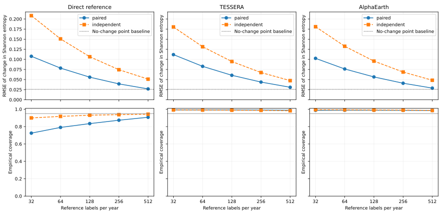

# Revisiting reference locations for changes in Swiss declared crop-group diversity: a resampling benchmark

<!-- Manuscript source: numerical fields are filled from recorded analysis outputs. -->

## Abstract

Monitoring crop diversity for agricultural landscape management requires distinguishing annual changes from sampling error before reporting an increase or decrease. We benchmark revisited versus independent reference locations for Shannon diversity of Swiss declared crop groups in 30 held-out landscapes and 90 adjacent-year contrasts, using 32–512 labels per year. The preplanned direct-sampling comparison gave a revisited/independent mean squared error ratio of 0.275 at 128 labels/year; prespecified grassland- and arable-dominated ratios were 0.198 and 0.597. Direct interval coverage was 83.4% versus 93.1%, and 20.3% versus 32.1% of reported directions were wrong. Predicting no change beat direct sampling at every tested budget and all frozen assisted estimates at 128 labels/year. Frozen logistic assistance from two annual satellite embedding products gave no RMSE gain with revisiting; frozen forests gave a modest one at that budget. There were 35 contrasts with |ΔH|<0.01, 4 exact zeros and 3 wholly unchanged label populations; none was excluded. An exploratory translation to relative error in the effective-number ratio gives RMS errors of 5.6% with revisiting, 10.8% independently and 2.6% for no change at 128 labels/year. Further exploratory checks show that independent annual labelling errors remove most of the coverage deficit while worsening point error, and that the original assisted interval rule omitted a projection derivative, making intervals too wide. The headline gain and coverage deficit concern perfectly repeatable declaration labels on a fixed frame; field-audit errors, costs and ecological outcomes were not measured.

## 1. Introduction

Crop diversity describes both the crops present in an agricultural landscape and their relative areas. Researchers and policy staff use spatial indicators of this composition to study agricultural landscapes and support monitoring of agricultural programs. Public crop maps and harmonized declarations now make repeated measurement possible, but the suitability of a map for a diversity indicator depends on its errors at the scale of the intended application. A recent assessment using administrative declarations found that conventional crop-map accuracy summaries did not by themselves establish fitness for local landscape-heterogeneity measurement [CROP-FITNESS2026]. The practical decision is whether a monitoring programme should revisit reference locations and whether its evidence supports reporting an annual increase or decrease rather than an unresolved change.

Annual satellite embedding products offer a convenient source of predictors for such monitoring. They summarize remote-sensing observations in numerical vectors that can be used by relatively small downstream classifiers [TESSERA2025; AEF2025]. This makes it feasible to hold a classifier fixed and apply it to later years. It does not establish the precision of an area-composition change estimate. A monitoring system still needs a probability-based reference sample and an assessment of uncertainty [OLOFSSON2014].

One choice is whether to revisit the same reference locations or draw a new sample each year. Repeated and rotating samples have a long history in crop-acreage estimation [ROTATION-SAMPLE1981]. Their benefit depends on dependence between measurements at the same locations over time. For a model-assisted estimate, the relevant dependence is that remaining after prediction. Crops can also move between fields while landscape proportions change little. Consequently, neither label persistence nor pixel classification accuracy alone supplies the answer for a nonlinear diversity indicator.

We ask: **At a fixed annual reference-label budget, how reliably can model-assisted estimates based on frozen classifiers of annual satellite embeddings identify changes in the diversity of declared crop groups, and does revisiting reference locations improve inference relative to independent samples?** We compare established sampling and estimation procedures on public annual declarations. The target is change in spatial area composition. Crop rotations, crop species diversity, ecological outcomes and policy effects are separate quantities.

## 2. Prior work

The components of the comparison are established. Probability-sampled reference information and reference-based area estimation are central recommendations for land-change assessment [OLOFSSON2014]. Remote-sensing area-estimation studies have compared confusion-matrix adjustments, regression estimators and direct sampling at different sampling fractions [LI2014]. Estimating class proportions rather than predicting individual labels is also studied as quantification and label-shift estimation. Source-confusion correction relies on conditions such as stable class-conditional predictions and adequate source support [LIPTON2018]. Those conditions differ from obtaining fresh probability-sampled target references.

Repeated-sample theory already explains why covariance affects the variance of a change estimate [ROTATION-SAMPLE1981]. Design-based model-assisted change estimation for permanent and temporary forest-inventory plots, including external prediction models and first-phase sampling variance, is also established [MASSEY2015]. We use that principle as an interpretation and validation tool, rather than presenting the covariance identity as a new result.

Crop-map fitness for Shannon-based heterogeneity measurement is already an explicit research subject [CROP-FITNESS2026]. Cross-year crop classification with annual embeddings is also studied [SENEGAL2026]. The present empirical target is the behavior of a fixed reference budget, including uncertainty and abstention, when the estimate is a change in diversity rather than a single-year map or class area. A targeted search covered crop diversity, temporal transfer, quantification, model-assisted area estimation, permanent/rotating samples, and uncertainty in entropy, including recent work. The recorded search scope and unresolved full-text leads are in protocol/ and sources.jsonl; the search does not establish the absence of another study.

Entropy estimation introduces its own problems. Plug-in estimates can be biased, and normal or resampling intervals can be unreliable in small samples or near probability-simplex boundaries [PANINSKI2003]. We therefore measure interval coverage rather than assuming that a nominal level guarantees reliable reports.

Prediction-powered inference provides a related formulation of prediction correction, and PPI++ estimates a prediction weight to improve efficiency under its stated asymptotic assumptions [PPI-PLUS]. Stratified prediction-powered inference combines stratum-specific prediction weights and sampling allocation [STRAT-PPI2024]. Cluster-robust prediction-powered inference addresses dependence within independently sampled clusters and partially labeled clusters [CLUSTER-PPI2026]. These results motivate stronger comparisons; they do not directly guarantee finite-sample coverage for projected entropy changes. We do not propose a new estimator or sampling theorem.

Jessen’s agricultural sampling investigation compared matched with independent samples for year-to-year change and also examined interview error [JESSEN1942]. The expected direction of the main precision result therefore follows from classic successive-occasion sampling, rather than constituting a new principle. Operational examples already use repeated observations: Eurostat’s Land Use and Coverage Area frame Survey (LUCAS) has a mixed panel [LUCAS-METADATA2024]; USDA NASS area-frame surveys rotate portions of their segment samples [NASS-AREA2009]; and Swiss ALL-EMA (Arten und Lebensräume Landwirtschaft – Espèces et Milieux Agricoles) surveys sample squares in repeated cycles [ALL-EMA-METHODS]. These programmes have different units and ecological targets; the present pixel benchmark does not reproduce their designs or costs.

Van der Velde and colleagues calculate Shannon-based crop diversity from an Earth-observation crop map and farmers’ declarations and examine declaration-based changes over time [POLICY-DIVERSITY2025-READ, relevant full-text sections 2.1–2.3 checked in the indexed publisher article body]. That is direct current-practice context for this study; our comparison concerns fixed-budget reference sampling and reporting uncertainty, not a first demonstration of crop-diversity change monitoring. Lu and colleagues combine a small reference sample with remote-sensing map predictions for regression estimation, with related area-estimation material in their versioned appendices [LU-MAPS-V7]. Their inferential targets and assumptions differ from our fixed finite-population entropy change.

The failure of Wald intervals near rare-event boundaries is established; Brown, Cai and DasGupta’s author preprint documents erratic binomial interval coverage even beyond extreme boundaries [BROWN-WALD1999, introduction, pp. 1–2]. Our zero-width intervals are an application-specific manifestation, not a newly discovered general failure. Further reviewer-identified bibliographic leads—Patterson (1950, successive sampling), Basharin (1959, entropy estimation), Hutcheson (1970, comparing Shannon diversity) and Cochran’s sampling textbook—were not checked in full text in this study and are not cited as supporting evidence. Their recorded access limitations remain in sources.jsonl and review/response-1.md.

## 3. Data and methods

### 3.1. Reference declarations and spatial populations

SwissCrop25 provides annual labels from the Agricultural Cultivated Areas dataset (Landwirtschaftliche Nutzfläche, LNF), which compiles cantonal agricultural land-use declarations, together with a published agronomic hierarchy [SWISSCROP25]. Its country coverage is complete from 2021 onward. Declarations describe the intended primary crop; the reference is not an independent observation of realized harvest use. The public dataset contains no personal or farm-identifying attributes [SWISSCROP25-CARD].

We use the pinned dataset revision 5e68643e82aecd5716c2eab69fcf8b5f87d44c78 and years 2021–2025. Fractional source-code coverage is aggregated to the published fine hierarchy before assigning the category with largest fractional coverage, then mapped to its published broader parent. Unknown coverage competes with known categories and can produce a missing label. The primary hierarchy includes declared arable, grassland and permanent agricultural groups. The primary level contains 17 agricultural groups and the finer level 54. The outcome is diversity of these groups, rather than a count of biological species.

Candidate landscapes are 5.12 km squares containing 4×4 dataset tiles, separated by one tile-width gaps. A fixed seed orders candidates, and 25.6 km supercells define spatial training, calibration and test pools. Eligibility requires label-tile coverage in all years and at least 10% stable agricultural support. Selection does not use diversity changes or classifier output. The complete candidate order, exclusions and failed attempts remain in data/selection-results.jsonl. The fixed quotas were reached after 85 distinct candidate attempts: 20 training, 10 calibration and 30 test landscapes.

For each landscape, a uniform sample of 4,096 distinct 10 m agricultural reference pixels is taken from the support that remains agricultural throughout the five years. This is the finite population for the main reference-sampling experiments. Common valid features are required in both representations: in 2021 for source training/calibration, and across all five years for test locations. All test landscapes were retained, with 122,104 locations in total and 3,799–4,096 per landscape. Training used 81,858 source-year labels and calibration 40,958; those labels are outside the target-audit budget. The minimum test–training footprint gap is 1,280m and the median nearest-training gap 30,344m; supercell assignment does not establish full spatial independence. The primary estimand is conditional on that stable support and sampled population, and is not a national estimate. The complete declarations are used as a benchmark reference against which simulated limited samples can be evaluated; where these declarations are already available, this experiment does not establish a need to replace them with a small audit. The five-year agricultural mask is supplied to every method and its construction is outside the annual audit-label budget.

A possible application is map-based crop-diversity monitoring where complete declarations are unavailable, or an independent check of declared versus observed crops using a small photo-interpreted or field reference sample. There, one reference label would classify the crop group at a sampled point in one year, and revisiting would retain that point. It would not necessarily mean one parcel, one farm visit or one independent interpreter decision. Here a label is a database reading at a 10 m point within a fixed finite population of approximately 4,000 locations per landscape, with error-free repeatability and a five-year agricultural frame supplied in advance. Field/photo errors, parcel clustering, changing eligibility, travel, interpretation time and frame construction would require additional designs and costs. Where complete trustworthy declarations already exist, this benchmark does not establish a need to sample them.

### 3.2. Annual predictors and fixed classifiers

The representations are TESSERA v1.1-dclimate (model URI https://geotessera.org/model/1.1) and AlphaEarth Foundations, public tge-labs/aef/v1/annual mirror, with 128 and 64 dimensions respectively. We use native 10 m pixels, published dequantization and correct raster orientation. Numerical input extracts and their provenance are retained. Coordinates are interpreted from the public tile geometry as pixel corners and shifted to cell centers; decoder and raster-index checks are documented in protocol/implementation-notes.md. A second Zarr decoder matched the manually decoded label data. Every saved point-to-native-grid check in the three selected full-grid cases matched exactly; these checks establish adapter consistency, not independent verification of field registration.

Separate multinomial logistic classifiers use 2021 training landscapes, source-only standardization, L2 regularization C=1, a maximum of 10000 iterations and tolerance 10^-5. Their parameters are then frozen for later years. Calibration landscapes supply a held-out 2021 class-conditional prediction matrix for a zero-new-label comparison. Test landscapes never train or calibrate the classifier. Classes absent from training receive zero predicted probability and remain in the target reference; their mass is reported. Initial source fits used 1000 iterations; 3 of 4 reached that limit. A recorded numerical revision increased the limit without changing regularization, tolerance or data, before inspecting target changes. All revised source fits converged and the originals remain available. This is a retrospective evaluation using releases available in October 2026.

Zero-new-label point comparisons are hard class counts, average predicted probabilities, constrained source-confusion adjustment with a 10^-6 prior regularizer, and no change. These point estimates have no claimed 95% reporting interval. “Zero new labels” means zero additional target-audit labels, conditional on the fixed reference frame and previously trained/calibrated models; it does not mean zero total reference information. The broad source classifiers observed 16 of 17 groups; the finer classifiers 47 of 54. Their calibration matrices had ranks 15 and 41, respectively, so unconstrained full-taxonomy identifiability is not established.

### 3.3. Reference sampling and estimation

For a fixed landscape population, p_tc is the proportion of reference group c in year t. Shannon entropy is H(p_t)=−Σ_c p_tc ln(p_tc), with 0 ln 0=0. The change is ΔH=H(p_b)−H(p_a). Its exponential is the ratio of effective numbers of the specified groups.

Primary contrasts are 2022→2023, 2023→2024 and 2024→2025. Each annual sample contains n∈{32,64,128,256,512} reference observations. The revisited design uses the same uniformly sampled locations in both years; the independent design samples separately without replacement each year. A two-year contrast uses 2n labels. We simulate 500 samples per condition with saved common random draws. These are resampling experiments on public data, not measurements of human auditors or travel costs.

The direct estimator uses sample proportions. The model-assisted difference estimator adds the sample mean prediction residual to the full finite-population prediction mean:

\[
\widehat p_{tc}=N^{-1}\sum_{i\in U}\widehat q_{itc}
 +n^{-1}\sum_{i\in S_t}\{1(Y_{it}=c)-\widehat q_{itc}\}.
\]

With predictions fixed before sampling, the unprojected proportion estimator is design-unbiased. If a vector lies outside the probability simplex, Euclidean projection is used before taking entropy. Projection frequency and magnitude are retained. Neither projection nor the entropy transformation preserves exact unbiasedness.

Numerical cleanup is applied consistently; the projection flag counts a raw component outside [0,1] by more than 10^-10. The 0.01 change and 0.05 entropy context cutoffs are descriptive, not established policy-relevance thresholds.

The original nominal 95% intervals use an estimated entropy gradient at the projected proportions, with the prespecified 10^-6 numerical floor. This rule does not apply the projection Jacobian; a later exploratory comparison does. A sample influence value is the gradient dotted with the observed label minus prediction; direct estimation uses zero prediction. The revisited-design standard error uses the sample variance of the difference between year-specific influences. Independent-design variances are added. Both use the finite-population correction (1−n/N)/n. A direction is reported only when its whole interval excludes zero, with a 10^-10 numerical comparison tolerance. Coverage, reporting frequency and incorrect-direction reporting are measured against the saved reference change.

For interpretation, we also compute population influence variances using known reference proportions and the same clipped gradient. The paired variance equals the sum of marginal variances minus twice their covariance. This diagnostic concerns a fixed linearized proxy and is not an exact entropy variance at a simplex boundary. It is not used in an operational interval. The reported minimum-detectable-change diagnostic uses a normal approximation for 80% power and is not a measured power guarantee. Exact enumeration on a saved six-point fixture checked the proportion and variance code, including census recovery and constant-predictor equivalence. This was a same-session software validation.

### 3.4. Summaries and checks

Each test landscape and transition receives equal weight. Monte Carlo standard errors describe simulation precision on this benchmark. Repeated transitions from one landscape are not treated as independent geographic replications. We retain all eligible cases, including near-zero changes, single-group populations, absent source classes and degenerate influence variances.

The reference values and predictions are treated as fixed; randomization is the probability-sample draw. This design-based calculation does not assume that neighboring agricultural pixels are independent biological observations. Sampling fields or clusters of pixels would require the corresponding design variance, and was not measured here. The original simulations draw each two-year contrast separately; their intervals are pointwise and do not establish simultaneous annual-monitoring coverage. The no-change point baseline is assessed under the same squared-error loss, without interpreting a zero prediction as evidence that change is absent. Conditional wrong-direction frequency among reported intervals is descriptive; a nominal 95% confidence interval is not a 95% posterior probability of a correct direction.

Prespecified checks include the finer hierarchy, frozen random forests, the secondary 2021→2022 and 2022→2025 contrasts, three native-grid cases selected by baseline category/static geometry, and one-pixel prediction-offset tests on a fixed interior subset. Reference-error sensitivity uses 1%, 2% and 5% hypothetical total-variation contamination per year and the classical entropy continuity bound [AUDENAERT2007]. These are scenarios, not measured error rates. Grain/silage-maize ambiguity is assessed separately using the published hierarchy.

Exploratory checks retain all original comparisons. We analyse all stable agricultural reference pixels in the 30 test landscapes without an embedding mask, and separately all-year stable `Arable Land` pixels with at least 1,024 pixels per retained landscape. The latter changes the target population; no satellite-assisted estimate on that new frame is claimed. Other checks use the original audit draws: delete-one jackknife, an entropy envelope based on an exact hypergeometric upper bound for the proportion of changed labels, and bounded prediction weights. When no changed labels are observed, we take the union of this envelope with the original interval; this exploratory combination has no general coverage guarantee. The crossfitted weight calculation respects sampling without replacement and is exactly validated for raw proportions on a small constructed population; entropy and its intervals remain approximate. We also test a fixed two-stratum design that allocates half the labels to the quarter of locations with largest predicted annual probability change, hard-label auxiliary predictions, and gradient floors 10^-2 through 10^-10 at n=128.

A separate exploratory monitoring simulation uses one coherent 2022–2025 sample sequence, n=128 labels/year, and independent, fully revisited or half-retained panels. Its partial-overlap influence variance includes covariance estimated on overlapping locations. A Bonferroni multiplier for three contrasts is assessed by empirical simultaneous coverage; it supplies no guarantee when marginal intervals are invalid. Detailed formulas, exclusions, seeds, synthetic validation and pre-execution revisions are in protocol/ and VERIFY.md. The same-year refreshed logistic diagnostic is complete; its additional training labels are reported separately.

A further exploratory plan fixes an additional reference-only cohort in test supercells absent from the accepted main cohort, preserving the unused original candidate order. It accepts the first eligible landscape per supercell using the original agricultural-support criteria, with no diversity-change or performance criterion. Adjacent supercells can contain nearby landscape footprints; this selection does not establish independent ecological or geographic replicates. Resource/time stopping rules and every failed attempt are retained. The attained cohort is committed before its inference, and its results are kept separate from the original primary cohort.

After the gradient-floor result, an exploratory comparison also differentiates through the probability-simplex projection. On locally fixed positive support A, its established Jacobian is J=diag(s)−ssᵀ/|A|, where s indicates membership in A [SIMPLEX-JACOBIAN2016]. The local entropy gradient is Jᵀg: g_j−mean_A(g) on A and zero elsewhere, using the exact positive projected proportions. The original interval rule does not apply this Jacobian. Both rules use identical point estimates, draws, FPC and normal multiplier; no original outcome is replaced. Finite differences validate the local calculation away from support changes. A separate zero-category fixture demonstrates a boundary where entropy has no finite derivative; local-face validation is not a coverage theorem. Nonsmooth-inference issues are established [FANG-SANTOS2019], whose results are not claimed as a validity proof for this approximation.

After review, plan v15 fixes two exploratory analyses before execution. First, sampled labels at n=128 are independently replaced with probabilities 0, 0.01, 0.02 or 0.05 by a draw from that landscape-year’s class distribution excluding the true class. The target remains the error-free declaration-population change. Annual coupling probabilities 0, 0.5 and 1 share location/trial corruption uniforms across years, preserving each year’s marginal rule. Shared uniforms do not imply identical replacement categories when true labels or annual distributions differ. Saved draws, seeds, output arrays and noisy-label hashes permit offline reconstruction. The original interval and finite-population correction remain unchanged; they are not re-derived as a valid measurement-error variance. Second, 5,000 bootstrap resamples of whole landscapes preserve each landscape’s three contrasts. Percentile ranges describe within-cohort composition sensitivity only. Conditional error denominators, per-unit coverage distributions and actual transformed effective-number-ratio errors are also newly summarized from saved draws. All added analyses are exploratory; the original subset definitions and longer contrast were prespecified.

The original plan was committed before main data acquisition. A prospective revision removed unnecessary future-feature requirements from source-only training/calibration before any outcome analysis. A further prospective supplement specified full native-pixel population checks to assess the main finite-population approximation. The timeline and all changes are retained in Git and protocol/. After two diagnostic target units, exploratory plans added sparse-change, jackknife, stratified-sampling and prediction-weight checks. Later full-cohort results motivated hard auxiliary predictions, a stable-arable frame, a coherent rotating panel and numerical-gradient sensitivity. Original comparisons were retained; the timing and reasons are listed in protocol/deviations.md.

## 4. Results

### 4.1. Reference changes and the no-change comparison

The main comparison includes 90 landscape–transition units. Of these, 35 have |ΔH|<0.01, 4 have exactly zero change within the prespecified tolerance, and 3 have identical labels at every reference location in the two years. There are 0 entropy-floor cases and 0 single-group cases. Auxiliary probability vectors are temporally identical in 0 cases and spatially constant in 0. Thus the aggregate precision benefit cannot be described as a result about entirely unchanged populations, but its size depends on the many small changes and grassland-dominated landscapes. The direct estimator is the same across representations because its references and sample draws are shared; those identical values are counted once.

The no-change point baseline has RMSE 0.0260 entropy units. It outperforms the direct and frozen-model-assisted n=128 estimates shown below under squared error on this cohort. It supplies neither a reporting interval nor evidence that a particular landscape did not change. Unadjusted map-count and source-confusion point estimates also fail to beat this baseline (Table 3). Their sign mismatches are point-estimate diagnostics, not confidence-qualified false reports.

For a reported direction at 128 labels/year, the observed wrong-direction share is 868/4285 (20.3%) with revisiting and 1126/3513 (32.1%) independently. These conditional shares differ from wrong directions per trial. Across the 90 landscape–transition units, revisited coverage has minimum 8.2%, 10th percentile 40.6%, median 91.2% and 90th percentile 94.2%; 32 units are below 90%. This is substantial heterogeneity hidden by aggregate coverage. For |ΔH|<0.01, wrong/report is 397/944 (42.1%) revisited and 559/1121 (49.9%) independent. For |ΔH|≥0.01, wrong/report is 471/3341 (14.1%) revisited and 567/2392 (23.7%) independent. 

Direct sampling at every tested budget remains worse than no change in aggregate: revisited RMSE at 512 is 0.0268 versus baseline 0.0260. No change has lower squared error than the revisited direct MSE in 84/90 units at 128 labels/year and 62/90 at 512. This does not hold for every assisted estimator: RF + AlphaEarth, revisited, 512 labels/year has RMSE 0.0231; RF + TESSERA, revisited, 512 labels/year has RMSE 0.0245. All original frozen methods and budgets are retained in results/review-summaries/all-budget-point-baselines.csv.

On the effective-number scale, we evaluate the actual trial error 100[exp(estimated ΔH−true ΔH)−1], the percentage error in the estimated ratio of effective numbers of the specified groups. Its RMS is 5.62% (direct revisited), 10.79% (independent) and 2.58% (no change). These are newly added descriptive transformations, not exponentiated entropy RMSEs, species counts or measured ecological effects.

### 4.2. Original audit comparison and prespecified forest robustness

Table 1 reports n=128, selected before outcomes. RMSE is the square root of equally weighted landscape–transition MSE; rates pool 500 trials for each unit. Wrong/report gives the actual count of wrong directions divided by reports, not a posterior error probability. Monte Carlo uncertainty concerns simulation precision on this fixed benchmark, not geographic generalization. The source training/calibration labels and supplied five-year frame are outside the audit budget.

**Table 1. Broad-group audit outcomes,128 labels per year. LR denotes the primary frozen logistic condition; RF is the prespecified frozen random-forest check.**

| Estimator | Sample | RMSE | Coverage | Reports | Wrong reports | Wrong/report | Projected |
| --- | --- | --- | --- | --- | --- | --- | --- |
| Direct reference | paired | 0.0559 | 83.4% | 9.5% | 1.9% | 868/4285 | 0.0% |
| Direct reference | independent | 0.1066 | 93.1% | 7.8% | 2.5% | 1126/3513 | 0.0% |
| LR + TESSERA | paired | 0.0605 | 99.1% | 1.1% | 0.3% | 147/515 | 98.8% |
| LR + TESSERA | independent | 0.0947 | 98.9% | 1.3% | 0.5% | 203/578 | 99.2% |
| LR + AlphaEarth | paired | 0.0565 | 98.8% | 1.4% | 0.5% | 224/650 | 99.1% |
| LR + AlphaEarth | independent | 0.0957 | 99.0% | 1.1% | 0.4% | 195/479 | 99.7% |
| RF + TESSERA | paired | 0.0494 | 98.3% | 3.2% | 0.4% | 192/1425 | 98.4% |
| RF + TESSERA | independent | 0.0915 | 97.7% | 3.1% | 0.7% | 325/1374 | 99.5% |
| RF + AlphaEarth | paired | 0.0469 | 96.6% | 5.8% | 0.8% | 362/2592 | 99.1% |
| RF + AlphaEarth | independent | 0.0916 | 96.4% | 4.6% | 1.2% | 556/2067 | 99.7% |

With revisiting, frozen logistic-assisted RMSE is 0.0605/0.0565 for TESSERA/AlphaEarth, compared with direct 0.0559. Frozen forests improve it to 0.0494/0.0469 at this budget. Thus the main direct precision gain uses no satellite input; frozen logistic assistance adds no point-accuracy benefit under revisiting in these conditions. Assistance can help with independent samples or other classifiers. Standard post-stratification by map class remains an untested comparator in this study; reviewer-only computations are not included as our results.

Coverage Monte Carlo standard errors range from 0.04 to 0.15 percentage points. They do not include uncertainty from landscape selection, reference errors or training-data choice. Forests change the point-accuracy comparison, so a failure or weak gain from the original logistic auxiliary must not be generalized to all model assistance.

For direct estimation, revisiting produced more reports (9.5% versus 7.8%) and fewer wrong directions (1.9% versus 2.5%) in aggregate, alongside its lower interval coverage. A zero-width interval from unchanged sampled labels abstains; its failure to cover a nonzero magnitude is not itself a wrong-direction report. The aggregate frequencies do not establish uniform per-landscape error control.

**Table 2. Prespecified direct-sampling budget curve. The no-change RMSE is fixed across budgets.**

| Prespecified subset | Labels/year | Revisited RMSE | Independent RMSE | MSE ratio | Revisited coverage | Independent coverage |
| --- | --- | --- | --- | --- | --- | --- |
| All | 32 | 0.1076 | 0.2084 | 0.267 | 72.5% | 90.0% |
| All | 64 | 0.0783 | 0.1507 | 0.270 | 79.0% | 91.7% |
| All | 128 | 0.0559 | 0.1066 | 0.275 | 83.4% | 93.1% |
| All | 256 | 0.0392 | 0.0744 | 0.278 | 87.3% | 93.7% |
| All | 512 | 0.0268 | 0.0510 | 0.275 | 90.7% | 94.3% |
| Grassland-dominated | 32 | 0.0921 | 0.2164 | 0.181 | 65.2% | 90.2% |
| Grassland-dominated | 64 | 0.0682 | 0.1569 | 0.189 | 73.4% | 92.0% |
| Grassland-dominated | 128 | 0.0495 | 0.1112 | 0.198 | 78.9% | 93.3% |
| Grassland-dominated | 256 | 0.0349 | 0.0778 | 0.201 | 84.2% | 93.8% |
| Grassland-dominated | 512 | 0.0239 | 0.0534 | 0.200 | 88.9% | 94.3% |
| Arable-dominated | 32 | 0.1396 | 0.1792 | 0.607 | 88.1% | 89.8% |
| Arable-dominated | 64 | 0.0996 | 0.1284 | 0.601 | 91.0% | 91.5% |
| Arable-dominated | 128 | 0.0696 | 0.0901 | 0.597 | 92.7% | 92.6% |
| Arable-dominated | 256 | 0.0487 | 0.0628 | 0.602 | 93.8% | 93.6% |
| Arable-dominated | 512 | 0.0332 | 0.0430 | 0.595 | 94.3% | 94.1% |

**Figure 1.** Original broad-group results over all five budgets. The black dotted line is the no-change point baseline; the grey horizontal line is nominal coverage, not a proven guarantee. Axes use a common scale within each row. The fixed-gradient influence comparison is in results/tables/main/pairing-variance.svg and is not an exact entropy-variance result at boundaries.

**Table 3. Point baselines without new target-audit labels. All still use the supplied reference frame; model conditions use source training/calibration. No confidence interval is claimed.**

| Head | Point rule | RMSE | Sign mismatches | Nonzero estimates |
| --- | --- | --- | --- | --- |
| LR + TESSERA | no_change | 0.0260 | 0 | 0 |
| LR + TESSERA | hard_count | 0.2417 | 48 | 90 |
| LR + TESSERA | soft_count | 0.1696 | 48 | 90 |
| LR + TESSERA | source_confusion | 0.3541 | 48 | 88 |
| LR + AlphaEarth | hard_count | 0.2071 | 46 | 90 |
| LR + AlphaEarth | soft_count | 0.1662 | 47 | 90 |
| LR + AlphaEarth | source_confusion | 0.3292 | 44 | 90 |

### 4.3. Prespecified scope and input checks

In the arable-dominated subset (24 transitions), direct coverage is 92.7% with revisiting and 92.6% with independent samples. This already limits a blanket interpretation of the aggregate coverage deficit. The finer taxonomy retains a revisited-sample MSE advantage but also displays imperfect direct interval coverage; its complete numerical comparison is in Table A1. The secondary contrasts are retained separately in results/tables/secondary-broad/ and secondary-fine/, with year-specific subsets; they do not replace the three primary contrasts.

The prospective full native-grid check contains 3 cases and 9 primary contrasts. Sampled-point and native reference changes differ in sign in 2 contrasts; their discrepancy RMSE is 0.0085. The median first-phase reference linearization variance is 2.9% of the native n=128 audit variance. This is a small conditional check, not a national estimate or a measurement of unconditional two-phase interval coverage. The fixed interior/offset sensitivity uses the same interior population for every prediction offset; direct estimates are consequently unchanged by offset by construction. All offsets and retained-population counts are in results/registration/.

Hypothetical reference-error scenarios are reported in Appendix A. They do not estimate the actual declaration or registration error rate. A broad-group grain/silage-maize swap cannot change the broad outcome because those fine categories share a parent; this is a taxonomy identity, not an empirical robustness discovery.

The refreshed logistic diagnostic uses 81,687–81,858 additional training labels per later year, plus the audit labels. It is not budget-matched to n=128 target auditing.

| Refreshed head | Sample | RMSE | Coverage | Reports | Wrong reports |
| --- | --- | --- | --- | --- | --- |
| LR refreshed + TESSERA | paired | 0.0598 | 99.2% | 1.3% | 0.3% |
| LR refreshed + TESSERA | independent | 0.0916 | 99.0% | 1.3% | 0.4% |
| LR refreshed + AlphaEarth | paired | 0.0521 | 98.7% | 2.0% | 0.5% |
| LR refreshed + AlphaEarth | independent | 0.0922 | 98.4% | 1.9% | 0.6% |

### 4.4. Exploratory reference-frame and interval checks

The complete reference-only agricultural grids reproduce the large precision gain and the aggregate direct-interval deficit without an embedding mask or the 4,096-point approximation. Restricting to stable arable land changes the composition and signal magnitude as well as the support. It retains 25 of the original 30 landscapes, without replacement, and the coverage deficit between sample designs is much smaller (Table 4). These frames are overlapping uses of the same declarations, not independent geographic replications.

**Table 4. Exploratory full-reference frames, broad groups, n=128.**

| Reference frame | Transitions | Revisited RMSE | Independent RMSE | Revisited coverage | Independent coverage |
| --- | --- | --- | --- | --- | --- |
| All stable agriculture | 90 | 0.0561 | 0.1077 | 80.8% | 93.0% |
| Stable arable land | 75 | 0.0925 | 0.1067 | 93.1% | 93.1% |

In the main revisited direct samples, 12.9% of n=128 draws observe no changed reference labels. Such a draw gives identical annual sample proportions, estimated change zero and zero paired standard error. For a nonzero population change it cannot cover the truth. The exact no-change-sample probability, computed from the known benchmark transition counts, places the attainable coverage below 95% in 12 units. Of the observed direct-interval misses, 54.8% occur in zero-observed-change samples. This elementary identity explains part, not all, of the deficit. It is not a newly discovered statistical theorem.

Taking the interval union with the entropy envelope when no changed labels are observed raises coverage from 83.4% to 92.5% at n=128 but does not achieve nominal coverage. The envelope always contains zero and cannot establish a direction. Jackknife and prediction-based stratification also do not establish nominal revisited-sample coverage. Bounded prediction weighting improves revisited point accuracy relative to the original fixed soft-logistic correction, but does not uniformly improve independent-sample accuracy and retains the sparse-change limitation; detailed positive and negative results are in Appendix A.

The gradient-floor experiment isolates a separate mechanism: point estimates and RMSE are exactly unchanged, while interval widths and reporting change materially (Table 5). Every tested floor is retained, and none is selected as a calibrated operational value. This result qualifies the apparent conservatism of the original soft-probability intervals.

**Table 5. Exploratory gradient floors, original soft-logistic revisited estimates, broad groups, n=128.**

| Representation | Floor | Mean SE | Coverage | Reports | Wrong reports |
| --- | --- | --- | --- | --- | --- |
| tessera | 0.01 | 0.0574 | 93.7% | 8.3% | 1.9% |
| tessera | 0.0001 | 0.0860 | 98.3% | 2.3% | 0.5% |
| tessera | 1e-06 | 0.1181 | 99.1% | 1.1% | 0.3% |
| tessera | 1e-08 | 0.1529 | 99.4% | 0.8% | 0.2% |
| tessera | 1e-10 | 0.1889 | 99.5% | 0.6% | 0.2% |
| alphaearth | 0.01 | 0.0531 | 93.6% | 8.3% | 2.0% |
| alphaearth | 0.0001 | 0.0813 | 98.1% | 2.4% | 0.7% |
| alphaearth | 1e-06 | 0.1134 | 98.8% | 1.4% | 0.5% |
| alphaearth | 1e-08 | 0.1483 | 99.0% | 1.1% | 0.4% |
| alphaearth | 1e-10 | 0.1845 | 99.2% | 1.0% | 0.4% |

### 4.5. Exploratory coherent annual panels

The four-year monitoring simulation uses one coherent sample sequence rather than separate pairwise experiments. Half retention gives precision between independent and fully revisited sampling. The full-revisit direct intervals have poorer simultaneous coverage; Bonferroni widening alone does not repair invalid marginal intervals. Table 6 reports both interval rules, including the probability of any wrong direction during the three-contrast sequence. The maximum negative-variance frequency across saved conditions is 0.0%. These are results for the tested rotation rate and reference populations, not a general prescription for panel refresh frequency.

**Table 6. Direct estimation in one 2022–2025 panel,128 labels/year. Joint coverage concerns all three adjacent changes.**

| Panel | Interval | Marginal RMSE | Marginal coverage | Joint coverage | Any wrong report | Any report |
| --- | --- | --- | --- | --- | --- | --- |
| independent | pointwise | 0.1070 | 92.9% | 82.1% | 7.2% | 20.1% |
| independent | bonferroni | 0.1070 | 97.1% | 92.3% | 2.8% | 9.2% |
| half_retained | pointwise | 0.0864 | 92.9% | 81.2% | 7.1% | 21.5% |
| half_retained | bonferroni | 0.0864 | 97.3% | 92.4% | 2.5% | 9.5% |
| fully_revisited | pointwise | 0.0562 | 83.5% | 67.9% | 5.6% | 23.7% |
| fully_revisited | bonferroni | 0.0562 | 87.7% | 77.8% | 2.1% | 11.3% |

### 4.6. Exploratory derivative through projection

The original rule's conservatism is also sensitive to whether uncertainty is propagated through the projection itself (Table 7). With the local projection derivative, revisited broad soft-logistic coverage is 93.6%–93.7%, and reporting is 8.0%–8.2%. Point estimates and RMSE are exactly unchanged. This strengthens the qualification of the original high-coverage result: it is not a property of satellite-assisted inference in general.

The software check passes 128 finite-difference cases away from splitting points; its maximum gradient difference is 8.87e-08. That is a local derivative check, not independent validation. The broad assisted draws contain no singleton positive supports; 2.6%–4.0% have a raw coordinate within 10^-10 of a projection splitting threshold, and 11.2%–12.4% have a positive projected proportion below 10^-6. These draws are retained. Direct controls reproduce their original SEs within 10^-12; this expected algebraic invariance is not a new empirical finding. The finer hierarchy and all per-unit outputs are retained in results/projection-derivative/. No local-face normal interval is certified by this experiment.

**Table 7. Exploratory propagation through projection, broad groups, n=128. Both rules share the same estimates and samples.**

| Representation | Sample | Gradient rule | Mean SE | Coverage | Reports | Wrong reports | Report count | Wrong count |
| --- | --- | --- | --- | --- | --- | --- | --- | --- |
| tessera | paired | Original clipped gradient | 0.1181 | 99.1% | 1.1% | 0.3% | 515 | 147 |
| tessera | paired | Local projection derivative | 0.0580 | 93.6% | 8.2% | 1.9% | 3,691 | 876 |
| tessera | independent | Original clipped gradient | 0.1512 | 98.9% | 1.3% | 0.5% | 578 | 203 |
| tessera | independent | Local projection derivative | 0.0900 | 94.1% | 7.0% | 2.1% | 3,153 | 952 |
| alphaearth | paired | Original clipped gradient | 0.1134 | 98.8% | 1.4% | 0.5% | 650 | 224 |
| alphaearth | paired | Local projection derivative | 0.0542 | 93.7% | 8.0% | 2.0% | 3,606 | 883 |
| alphaearth | independent | Original clipped gradient | 0.1647 | 99.0% | 1.1% | 0.4% | 479 | 195 |
| alphaearth | independent | Local projection derivative | 0.0916 | 94.1% | 6.7% | 2.2% | 3,020 | 975 |

The same exploratory calculation on all saved broad forest and refreshed-logistic controls gives revisited local-derivative coverage 93.3%–94.0%. Point estimates remain unchanged in every control. Their complete comparisons and the finer frozen heads are in Appendix D. The annually refreshed controls retain their additional training-label burden.

### 4.7. Exploratory additional geography and a precision boundary

The attained additional cohort contains 8 landscapes in distinct previously unused test supercells, with 4 arable-dominated and 4 grassland-dominated cases. Its complete agricultural support retains a revisiting MSE gain (ratio 0.395 at n=128), with direct coverage 78.8% versus 93.1%. This supplies additional conditional geography, not a representative national sample. Acquisition stopped at the predeclared cache-growth cap; all 9 ineligible and 1 failed candidates remain recorded, without replacement chosen from change outcomes. Table C1 gives both point and complete-support comparisons and no-change baselines.

The stable-arable rule retains 6 additional landscapes and 18 contrasts. Here the observed broad-group MSE ratio exceeds one: 1.074 at n=128 (MCSE 0.021), ranging 1.041–1.091 over all tested budgets. The fine-group ratio at n=128 is 0.941. The broad subset has 1 tiny change, 0 exact zeros, 0 entropy-floor and 0 single-group cases; none is excluded. These are outcomes on the eligible subset fixed by support eligibility, not evidence that revisiting is generally inferior on arable land.

A post-result analysis of archived known-population influence diagnostics finds negative broad-group influence covariance in 12 of 18 contrasts, with an aggregate paired/independent influence-variance ratio 1.077. This is consistent with the observed MSE reversal, and illustrates the established covariance identity on this target. The proxy is not exact entropy variance, and the comparison changes support/composition/taxonomy rather than isolating a causal effect of rotation. All cohort/frame/taxonomy covariance summaries are in results/covariance-context/.

A further exploratory check increases simulation precision on these same cases to 5,000 replications. The broad ratio at n=128 is 1.066 (MCSE 0.006) and the finer ratio 0.913 (MCSE 0.006). Original outcomes remain alongside the check in Table C2. The index arrays are regenerated from recorded seeds and array-byte hashes; all resulting estimates/SE/directions are saved. This is additional simulation on the same references, not independent geographic evidence.

### 4.8. Exploratory review-response sensitivity

The prespecified n=128 grassland-dominated MSE ratio is 0.198 across 60 contrasts; the arable-dominated ratio is 0.597 across 24. These subsets were fixed before results and differ from the later stable-arable support. Resampling whole landscapes after the review gives a 95% within-cohort percentile range 0.207–0.357 around the original ratio 0.275. Corresponding coverage ranges are 75.3%–89.7% revisited and 92.8%–93.4% independent. These are composition-sensitivity ranges on the convenience cohort, not national confidence intervals, and are wider than Monte Carlo precision on the fixed cohort.

For the additional stable-arable landscapes, the higher-replication broad ratio 1.066 has range 0.965–1.197; the fine ratio 0.913 has range 0.795–1.030. Both include 1. The observed reversal and finer-scale gain are therefore not resolved against landscape-composition variation. The original point ratios are retained.

Table 8 perturbs sampled labels while keeping declaration-population truth fixed. With independent annual errors, coverage rises from 83.4% to 91.7% at 1% error and 92.5% at 5%, while the MSE ratio rises from 0.275 to 0.310 and 0.429. Absolute point accuracy worsens; this is not a benefit of error. Fully coupled uniforms largely retain the zero-error coverage deficit. Partly coupled scenarios lie between these particular endpoints, but this does not bound arbitrary real error processes. No tested error rate is an estimate of a real audit error rate.

**Table 8. Post-review synthetic label-error scenarios, broad direct estimates at 128 labels/year. Annual coupling is a probability of shared random uniforms, not a fitted error correlation. All scenarios retained.**

| Error probability | Annual coupling | Revisited RMSE | Independent RMSE | MSE ratio | Revisited coverage | Independent coverage |
| --- | --- | --- | --- | --- | --- | --- |
| 0.0% | 0.0 | 0.0559 | 0.1066 | 0.275 | 83.4% | 93.1% |
| 1.0% | 0.0 | 0.0593 | 0.1065 | 0.310 | 91.7% | 93.1% |
| 1.0% | 0.5 | 0.0575 | 0.1066 | 0.291 | 90.0% | 93.1% |
| 1.0% | 1.0 | 0.0557 | 0.1066 | 0.273 | 83.5% | 93.1% |
| 2.0% | 0.0 | 0.0623 | 0.1063 | 0.343 | 92.1% | 93.1% |
| 2.0% | 0.5 | 0.0590 | 0.1063 | 0.308 | 91.8% | 93.0% |
| 2.0% | 1.0 | 0.0555 | 0.1065 | 0.272 | 83.5% | 93.0% |
| 5.0% | 0.0 | 0.0696 | 0.1063 | 0.429 | 92.5% | 93.0% |
| 5.0% | 0.5 | 0.0626 | 0.1062 | 0.347 | 92.5% | 93.0% |
| 5.0% | 1.0 | 0.0553 | 0.1060 | 0.273 | 83.6% | 93.1% |

## 5. Discussion

The size of the revisiting gain and its coverage deficit depend on perfectly repeatable declaration labels. The same database supplies both benchmark truth and each sampled label; an unchanged location therefore always agrees across years. Independent field or photo-interpretation errors can remove many zero-standard-error samples while increasing point error, as the synthetic scenarios demonstrate. Persistent interpreter or parcel ambiguities can behave differently. Real audit error rates and their temporal dependence require measurement; they cannot be inferred from this benchmark.

The original assisted interval rule omitted the derivative of the projection used to make estimated proportions valid. This produced overly wide intervals, rather than showing that model assistance inherently gives near-perfect coverage. The exploratory derivative-aware calculation substantially narrows them without changing a point estimate; its coverage is closer to independent direct sampling than to revisited direct sampling. It remains an approximate local calculation at changing category support.

The direct precision gain is expected from established successive-occasion sampling theory, not a new sampling principle. Its practically relevant extent depends on support and landscape composition; the arable-dominated preplanned subset has a much smaller gain than the grassland-dominated one. Landscape-resampling ranges include this compositional variation, whereas Monte Carlo errors describe only simulation precision on fixed landscapes. Neither range licenses national extrapolation. Frozen logistic assistance did not improve revisited point accuracy; forests provided a modest gain at the illustrative budget and beat no change at the largest tested budget. A broad claim that no tested method beats no change would therefore be incorrect.

A monitoring analyst should compare direct and assisted estimators with no change, report conditional wrong-direction shares alongside reporting frequency, and assess coverage on data matching the intended support and label process. Repeated and rotating panels remain candidate designs. These experiments do not establish field costs, an optimal rotation rate, or the effects of abstention on actual decisions.

## 6. Limitations

The reference measures declared primary use, with known uncertainty about realized harvest use. Classification of subpixel mixtures, unknown coverage and registration can affect the reference and predictors. The original coverage deficit and size of the revisiting gain condition on perfectly repeatable declaration labels. The post-review synthetic sensitivity is not an estimate of field or photo-interpretation error and does not validate an interval under measurement error. A fixed agricultural support omits changes in declared extent. The main experiments condition on sampled finite populations; the prospective native-grid check includes only 3 cases and 9 transitions, while the reference-only whole-support checks cover the original landscapes but supply no new geography; a separate exploratory reference-only extension adds 8 landscapes but no nationally representative inference. The landscapes are a seeded convenience benchmark from available complete data and do not constitute a representative probability sample of Switzerland or other agricultural systems.

Only the specified representations, downstream models, taxonomy levels, released data and period are evaluated. Both representations share Earth-observation inputs. Their pretraining exposure to geography and years is not established as held out, and the public mirror does not expose a complete production-model training history. Training data and fitted maps are fixed for reference-sampling inference; uncertainty from possible alternative training datasets is not estimated. The experiment supplies a stable agricultural frame defined with all five reference years. Its cost and availability are not included in the audit budget, so a practical application that must estimate changing agricultural extent needs an additional design. Pixel observations also differ from field visits or parcel annotations; their information and costs need not scale as 2n.

Changing the agricultural support changes the estimand, the class composition, turnover and signal magnitude together. The stable-arable supplement therefore establishes a boundary of the aggregate observation, not a causal attribution of every coverage difference to permanent grassland. The selected arable subset also has fewer landscapes. Simulations conditional on these references cannot establish calibrated inference for another country, reference product, sampling design or future period.

Approximate entropy intervals can fail at small class proportions or simplex boundaries. Empirical coverage and projection diagnostics are therefore central to the results. Topic selection consulted one critique by another model (gpt-6-astra, reasoning effort xhigh, used on 2026-10-26), under the recorded trial procedure. No measured effect on users, field-visit cost, ecological outcome or policy result follows from this computational study. The refreshed-head diagnostic was completed with an additional source-training label burden, detailed in the results.

## 7. Reproduction

VERIFY.md gives a single entry point that regenerates the main numerical tables and figures from saved data without network access or AI API calls. It also describes source/input checks, optional refitting and retrieval, expected claim values, the timeline, deviations, and the clean-copy verification performed by this session. That rerun is not independent reproduction.

## References

- **[CROP-FITNESS2026]** Säurich, Schwieder, Preidl, Beyer and Möller. 2026. [Are remote sensing-based crop type classifications suitable for calculating a landscape heterogeneity metric? A data-fitness-for-purpose assessment](https://literatur.thuenen.de/digbib_extern/dn070924.pdf). 10.1016/j.ecoinf.2026.103660.
- **[TESSERA2025]** Feng et al. 2025. [TESSERA: Temporal Embeddings of Surface Spectra for Earth Representation and Analysis](https://arxiv.org/pdf/2506.20380). arXiv:2506.20380.
- **[AEF2025]** Christopher F. Brown et al. 2025. [AlphaEarth Foundations: An embedding field model for accurate and efficient global mapping from sparse label data](https://arxiv.org/html/2507.22291v2). arXiv:2507.22291v2.
- **[OLOFSSON2014]** Olofsson, Foody, Herold, Stehman, Woodcock and Wulder. 2014. [Good practices for estimating area and assessing accuracy of land change](https://samv.elearning.unipd.it/pluginfile.php/175898/mod_resource/content/0/articolo_oloffson.pdf). 10.1016/j.rse.2014.02.015.
- **[ROTATION-SAMPLE1981]** T. G. Lycthuan-Lee. 1981. [Development of rotation sample designs for the estimation of crop acreages](https://ntrs.nasa.gov/api/citations/19820013780/downloads/19820013780.pdf). NASA-CR-167438 / JSC-17427.
- **[LI2014]** Yizhan Li, Xiufang Zhu, Yaozhong Pan, Jianyu Gu, Anzhou Zhao and Xianfeng Liu. 2014. [A Comparison of Model-Assisted Estimators to Infer Land Cover/Use Class Area Using Satellite Imagery](https://doi.org/10.3390/rs6098904). 10.3390/rs6098904.
- **[LIPTON2018]** Zachary C. Lipton, Yu-Xiang Wang and Alexander J. Smola. 2018. [Detecting and Correcting for Label Shift with Black Box Predictors](https://proceedings.mlr.press/v80/lipton18a/lipton18a.pdf). PMLR 80:3122–3130.
- **[MASSEY2015]** Alexander Massey and Daniel Mandallaz. 2015. [Design-based regression estimation of net change for forest inventories](https://doi.org/10.1139/cjfr-2015-0266). 10.1139/cjfr-2015-0266.
- **[SENEGAL2026]** Lisaius, Keshav, Blake and Atzberger. 2026. [Embedding-based Crop Type Classification in the Groundnut Basin of Senegal](https://arxiv.org/pdf/2601.16900). arXiv:2601.16900.
- **[PANINSKI2003]** Liam Paninski. 2003. [Estimation of Entropy and Mutual Information](https://www.cns.nyu.edu/pub/lcv/paninski-infoEst-2003.pdf). 10.1162/089976603321780272.
- **[PPI-PLUS]** Anastasios N. Angelopoulos, John C. Duchi and Tijana Zrnic. 2023. [PPI++: Efficient Prediction-Powered Inference](https://arxiv.org/pdf/2311.01453). arXiv:2311.01453; downloaded revision pinned by PDF hash.
- **[STRAT-PPI2024]** Adam Fisch, Joshua Maynez, R. Alex Hofer, Bhuwan Dhingra, Amir Globerson and William W. Cohen. 2024. [Stratified Prediction-Powered Inference for Hybrid Language Model Evaluation](https://papers.neurips.cc/paper_files/paper/2024/file/c9fcd02e6445c7dfbad6986abee53d0d-Paper-Conference.pdf). NeurIPS 2024.
- **[CLUSTER-PPI2026]** David Broska and Michael Howes. 2026. [Cluster-Robust Prediction-Powered Inference](https://arxiv.org/pdf/2610.09601). arXiv:2610.09601v1.
- **[SWISSCROP25]** Thomas Lauber, Mehmet Ozgur Turkoglu, Sélène Ledain and Helge Aasen. 2026. [SwissCrop25: A National Multi-Year Benchmark for Operational Crop Mapping](https://arxiv.org/html/2608.09497v1). arXiv:2608.09497v1.
- **[SWISSCROP25-CARD]** Agroscope EOA team. 2026. [SwissCrop25 official dataset card](https://huggingface.co/datasets/EOA-team/SwissCrop25). Pinned repository revision in data/catalogue-manifest.json.
- **[AUDENAERT2007]** Koenraad M. R. Audenaert. 2007. [A sharp continuity estimate for the von Neumann entropy](https://arxiv.org/pdf/quant-ph/0610146). 10.1088/1751-8113/40/28/S18; arXiv quant-ph/0610146v1.
- **[SCIPY-HYPERGEOM]** SciPy community. 2026. [scipy.stats.hypergeom documentation](https://docs.scipy.org/doc/scipy/reference/generated/scipy.stats.hypergeom.html). Online v1.18.0 documentation; local runtime 1.18.1.
- **[SIMPLEX-JACOBIAN2016]** André F. T. Martins and Ramon F. Astudillo. 2016. [From Softmax to Sparsemax: A Sparse Model of Attention and Multi-Label Classification](https://proceedings.mlr.press/v48/martins16.html). PMLR48:1614–1623; equations2,11–14.
- **[FANG-SANTOS2019]** Zheng Fang and Andres Santos. 2019. [Inference on Directionally Differentiable Functions](https://academic.oup.com/restud/article/86/1/377/5094886). 10.1093/restud/rdy049.
- **[JESSEN1942]** R. J. Jessen. 1942. [Statistical investigation of a sample survey for obtaining farm facts](https://data.nass.usda.gov/Education_and_Outreach/Reports%2C_Presentations_and_Conferences/Survey_Reports/Statistical%20Investigation%20of%20a%20Sample%20Survey%20for%20Obtaining%20Farm%20Facts%20%28Pages%201-100%29.pdf). Iowa research bulletin 304; USDA archive, first 100 pages.
- **[BROWN-WALD1999]** L. D. Brown, T. T. Cai and A. DasGupta. 1999. [Interval Estimation for a Binomial Proportion](https://www.stat.purdue.edu/~dasgupta/publications/tr99-19.pdf). Author technical-report preprint tr99-19; later published 2001.
- **[LUCAS-METADATA2024]** Eurostat. 2024. [Land use and coverage area frame survey (LUCAS): reference metadata](https://ec.europa.eu/eurostat/cache/metadata/EN/lan_esms.htm). Metadata page last updated 11 April 2024, checked 27 October 2026.
- **[ALL-EMA-METHODS]** Agroscope. 2026. [Monitoringprogramm Arten und Lebensräume Landwirtschaft ALL-EMA](https://www.agroscope.admin.ch/de/monitoringprogramm-arten-und-lebensraeume-landwirtschaft-all-ema). Official current programme page, retrieval year; no publication date asserted.
- **[NASS-AREA2009]** USDA National Agricultural Statistics Service. 2009. [Area Frame Design for Agricultural Surveys](https://www.nass.usda.gov/Publications/Methodology_and_Data_Quality/Advanced_Topics/AREA%20FRAME%20DESIGN.pdf). Official methodology PDF, 2009 version.
- **[LU-MAPS-V7]** Kerri Lu, Dan M. Kluger, Stephen Bates and Sherrie Wang. 2025. [Regression coefficient estimation from remote sensing maps](https://arxiv.org/html/2407.13659v7). arXiv:2407.13659v7, 3 July2025; originally18 July2024.
- **[POLICY-DIVERSITY2025-READ]** Marijn van der Velde and colleagues. 2025. [Policy relevant crop diversity monitoring based on earth observation and farmers’ declarations](https://doi.org/10.1088/1748-9326/ad9d61). Environmental Research Letters20 014054; online27 December2024, corrected title4 February2025.

## Appendix

### A. Additional planned and exploratory results

**Table A1. Prespecified finer taxonomy, n=128.**

| Estimator | Sample | RMSE | Coverage | Reports | Wrong reports |
| --- | --- | --- | --- | --- | --- |
| Direct reference | paired | 0.0701 | 85.3% | 12.1% | 2.1% |
| Direct reference | independent | 0.1320 | 92.1% | 8.9% | 2.6% |
| LR + TESSERA | paired | 0.0761 | 99.8% | 0.2% | 0.1% |
| LR + TESSERA | independent | 0.1179 | 99.6% | 0.5% | 0.1% |
| LR + AlphaEarth | paired | 0.0688 | 99.6% | 0.6% | 0.2% |
| LR + AlphaEarth | independent | 0.1176 | 99.2% | 0.9% | 0.3% |

**Table A2. Exploratory bounded prediction weighting, n=128; same samples as the original broad comparison. Crossfitting concerns raw proportions, not unbiased projected entropy or guaranteed intervals.**

| Representation | Weight rule | Sample | RMSE | Coverage | Reports | Wrong reports | Mean weight |
| --- | --- | --- | --- | --- | --- | --- | --- |
| tessera | same_sample | paired | 0.0514 | 83.7% | 9.4% | 1.7% | 0.132 |
| tessera | crossfit | paired | 0.0521 | 84.2% | 8.8% | 1.6% | 0.113 |
| tessera | same_sample | independent | 0.0949 | 93.6% | 7.5% | 2.3% | 0.275 |
| tessera | crossfit | independent | 0.0963 | 94.0% | 7.0% | 2.2% | 0.239 |
| alphaearth | same_sample | paired | 0.0520 | 83.5% | 9.6% | 1.9% | 0.122 |
| alphaearth | crossfit | paired | 0.0527 | 84.0% | 8.9% | 1.7% | 0.098 |
| alphaearth | same_sample | independent | 0.0965 | 93.4% | 7.6% | 2.4% | 0.238 |
| alphaearth | crossfit | independent | 0.0978 | 93.7% | 7.2% | 2.3% | 0.205 |

**Table A3. Exploratory jackknife with the prospectively corrected finite-population bias scaling, n=128. The ordinary variant is retained in results/jackknife/ and does not replace this variant after observing performance.**

| Representation | Estimator | Sample | RMSE | Coverage | Reports | Wrong reports |
| --- | --- | --- | --- | --- | --- | --- |
| tessera | direct | paired | 0.0589 | 85.2% | 7.5% | 1.5% |
| tessera | direct | independent | 0.1100 | 94.3% | 6.5% | 2.1% |
| tessera | model_assisted | paired | 0.0766 | 90.5% | 11.4% | 3.2% |
| tessera | model_assisted | independent | 0.1078 | 92.5% | 8.6% | 2.7% |
| alphaearth | model_assisted | paired | 0.0766 | 89.0% | 13.1% | 3.9% |
| alphaearth | model_assisted | independent | 0.1120 | 91.8% | 9.1% | 3.1% |

**Table A4. Exploratory prediction-stratified sampling, n=128. Different representations define different strata, so their direct estimates are distinct comparisons.**

| Representation | Estimator | Sample | RMSE | Coverage | Reports | MSE/original SRS |
| --- | --- | --- | --- | --- | --- | --- |
| tessera | direct | paired | 0.0525 | 84.3% | 10.0% | 0.883 |
| tessera | direct | independent | 0.1057 | 92.9% | 7.9% | 0.984 |
| tessera | model_assisted | paired | 0.0584 | 99.1% | 1.1% | 0.932 |
| tessera | model_assisted | independent | 0.1011 | 98.7% | 1.5% | 1.140 |
| alphaearth | direct | paired | 0.0522 | 83.9% | 9.7% | 0.873 |
| alphaearth | direct | independent | 0.1051 | 92.9% | 8.2% | 0.972 |
| alphaearth | model_assisted | paired | 0.0551 | 98.9% | 1.5% | 0.952 |
| alphaearth | model_assisted | independent | 0.1019 | 98.9% | 1.3% | 1.133 |

**Table A5. Exploratory hard-label auxiliary predictions, n=128; no classifier refitting.**

| Auxiliary | Sample | RMSE | Coverage | Reports | Projected |
| --- | --- | --- | --- | --- | --- |
| Hard auxiliary LR + TESSERA | paired | 0.0823 | 99.1% | 0.9% | 80.3% |
| Hard auxiliary LR + TESSERA | independent | 0.1106 | 99.1% | 0.9% | 81.4% |
| Hard auxiliary LR + AlphaEarth | paired | 0.0813 | 98.7% | 1.3% | 79.9% |
| Hard auxiliary LR + AlphaEarth | independent | 0.1123 | 99.1% | 0.9% | 82.1% |

**Table A6. Prespecified hypothetical reference-error scenarios. Bounds allow different directions of error in the two years; rates were not estimated from data. The broad maize invariance follows from the hierarchy.**

| Taxonomy | Per-year TV bound | Change error bound | General sign robust | Maize-only sign robust |
| --- | --- | --- | --- | --- |
| broad | 1.0% | 0.1675 | 0 | 86 |
| broad | 2.0% | 0.3070 | 0 | 86 |
| broad | 5.0% | 0.6743 | 0 | 86 |
| fine | 1.0% | 0.1914 | 0 | 65 |
| fine | 2.0% | 0.3549 | 0 | 57 |
| fine | 5.0% | 0.7941 | 0 | 48 |

**Table A7. 2025 test classification context. This is accuracy against declared groups, not an independent harvest survey or a test of interval calibration.**

| Head | Taxonomy | Pixel accuracy | Unsupported labels | Reference locations |
| --- | --- | --- | --- | --- |
| LR + TESSERA | broad | 63.7% | 2 | 122,104 |
| LR + AlphaEarth | broad | 61.4% | 2 | 122,104 |
| LR + TESSERA | fine | 49.5% | 69 | 122,104 |
| LR + AlphaEarth | fine | 49.7% | 69 | 122,104 |
| RF + TESSERA | broad | 62.1% | 2 | 122,104 |
| RF + AlphaEarth | broad | 58.5% | 2 | 122,104 |

All budgets and context subsets, per-unit distributions, source-confusion optimizer diagnostics, full native-grid outcomes, interior prediction offsets, both jackknife variants, fine-taxonomy gradient floors and model-assisted coherent panels remain in results/. They are included in the full offline verification index rather than selected by statistical significance. The stable-arable and full-agricultural scope baselines are in results/scope-baselines/. The source matrix rank and unavailable classes limit the source-confusion comparison; its poor performance does not refute label-shift methods under their own assumptions.

### B. Data attribution and process scope

SwissCrop25 is used under its published CC BY 4.0 terms, including the specified cantonal, Agroscope, Copernicus and MeteoSwiss attributions listed in DATA_LICENSES.md. The AlphaEarth Foundations Satellite Embedding dataset is produced by Google and Google DeepMind. The public AlphaEarth mirror specifies CC BY 4.0. The official TESSERA data catalogue specifies CC-BY-SA without a version; that ambiguity is retained in DATA_LICENSES.md and is not replaced with the separate model-weight licence.

One mandatory critique of topic candidates used another AI model; it did not write code, interpret results or write this paper. No human-participant experiment or independent reproduction was performed. A documented short unwrapped diagnostic briefly exceeded the two-experiment limit; its record is retained, and scientific sparse-change outputs were subsequently recomputed through the bounded runner. Human-confirmed usage-limit pauses adjusted the deadline according to the original trial condition; the second pause has a documented endpoint uncertainty because its final preceding clock output was unavailable after context compaction. Automatic Git packing occurred between storage checkpoints; its temporary peak was not measured, so a transient storage-limit breach cannot be ruled out. Subsequent individual commit commands disable automatic maintenance. All original plans, source-fit warnings, decoder failures, pilot exclusions and numerical corrections remain in the local record. Git times and hashes are self-reported records and do not establish independence or absence of tampering.

The paper is written by this session. The planned review by an AI agent has been received; the original review and response are in review/. Verification records in VERIFY.md and review/ identify reruns by this same session; none is independent reproduction.

### C. Exploratory additional geography

The separately frozen cohort attained 8 landscapes in distinct test supercells absent from the accepted main cohort, with 9 ineligible and 1 failed candidate attempts at its freeze. Selection preserved the original unused metadata order and used no diversity-change outcome. These additional landscapes contain 4 arable-dominated and 4 grassland-dominated cases under the original baseline majority rule. They remain a conditional geographic extension, not a nationally representative sample or independent reproduction.

On complete agricultural support, the broad comparison contains 24 contrasts: 10 with |ΔH|<0.01, 0 exact zero changes, 0 entirely unchanged label populations, 0 entropy-floor and 0 single-group cases. All are retained. At n=128 the revisited/independent MSE ratio is 0.395; coverage is 78.8% versus 93.1%, reports 11.1% versus 9.6%, and wrong-direction frequencies 1.4% versus 2.0%. Table A8 retains both frames and taxonomies; their cases overlap and must not be counted as independent geography.

**Table C1. Exploratory additional-geography reference-only comparisons, n=128. No-change columns are point baselines without reporting intervals.**

| Frame | Taxonomy | Sample | Contrasts | RMSE | No-change RMSE | Coverage | Reports | Wrong reports |
| --- | --- | --- | --- | --- | --- | --- | --- | --- |
| original_points | broad | paired | 24 | 0.0592 | 0.0496 | 82.6% | 11.0% | 1.4% |
| original_points | broad | independent | 24 | 0.0942 | 0.0496 | 92.4% | 11.1% | 2.8% |
| original_points | fine | paired | 24 | 0.0761 | 0.0395 | 80.7% | 9.4% | 1.9% |
| original_points | fine | independent | 24 | 0.1184 | 0.0395 | 91.2% | 10.5% | 3.0% |
| full_reference | broad | paired | 24 | 0.0594 | 0.0480 | 78.8% | 11.1% | 1.4% |
| full_reference | broad | independent | 24 | 0.0945 | 0.0480 | 93.1% | 9.6% | 2.0% |
| full_reference | fine | paired | 24 | 0.0759 | 0.0414 | 81.3% | 9.1% | 2.0% |
| full_reference | fine | independent | 24 | 0.1188 | 0.0414 | 92.2% | 9.6% | 2.7% |

The prespecified-within-this-exploratory-plan arable-only rule retained 6 additional landscapes and 18 contrasts. This changes support and signal together; all excluded candidates remain listed. There were 1 tiny change, 0 exact zeros, 0 entropy-floor and 0 single-group cases.

| Sample | RMSE | Coverage | Reports | Wrong reports |
| --- | --- | --- | --- | --- |
| paired | 0.0900 | 93.3% | 15.1% | 0.9% |
| independent | 0.0868 | 93.8% | 15.0% | 0.8% |

**Table C2. Additional stable-arable MSE ratios: original simulation and higher-precision check. MCSE measures simulation precision on the fixed cohort.**

| Taxonomy | Labels/year | Original ratio | Original MCSE | Check ratio | Check MCSE |
| --- | --- | --- | --- | --- | --- |
| broad | 32 | 1.041 | 0.020 | 1.032 | 0.006 |
| broad | 64 | 1.052 | 0.020 | 1.051 | 0.006 |
| broad | 128 | 1.074 | 0.021 | 1.066 | 0.006 |
| broad | 256 | 1.079 | 0.021 | 1.074 | 0.006 |
| broad | 512 | 1.091 | 0.021 | 1.073 | 0.006 |
| fine | 32 | 0.922 | 0.017 | 0.921 | 0.006 |
| fine | 64 | 0.941 | 0.017 | 0.913 | 0.006 |
| fine | 128 | 0.941 | 0.018 | 0.913 | 0.006 |
| fine | 256 | 0.935 | 0.018 | 0.911 | 0.006 |
| fine | 512 | 0.941 | 0.018 | 0.917 | 0.006 |

**Table C3. Post-result summaries of established population influence diagnostics at n=128. These are linearized proxies, not exact entropy variances.**

| Cohort | Frame | Taxonomy | Contrasts | Negative covariance | Influence variance ratio | Original MSE ratio |
| --- | --- | --- | --- | --- | --- | --- |
| original | full_reference | broad | 90 | 0 | 0.273 | 0.271 |
| original | full_reference | fine | 90 | 0 | 0.286 | 0.269 |
| original | original_points | broad | 90 | 0 | 0.274 | 0.276 |
| original | original_points | fine | 90 | 0 | 0.286 | 0.284 |
| original | stable_arable | broad | 75 | 14 | 0.758 | 0.752 |
| original | stable_arable | fine | 75 | 0 | 0.676 | 0.670 |
| additional | full_reference | broad | 24 | 0 | 0.385 | 0.395 |
| additional | full_reference | fine | 24 | 0 | 0.415 | 0.408 |
| additional | original_points | broad | 24 | 0 | 0.386 | 0.395 |
| additional | original_points | fine | 24 | 0 | 0.419 | 0.413 |
| additional | stable_arable | broad | 18 | 12 | 1.077 | 1.074 |
| additional | stable_arable | fine | 18 | 4 | 0.910 | 0.941 |

### D. Additional projection-derivative comparisons

All comparisons use unchanged estimates, the original samples and n=128. They are exploratory normal approximations, with no guarantee at changing active supports.

**Table D1. All saved broad forest and refreshed-logistic controls.**

| Head | Representation | Sample | Rule | RMSE | Coverage | Reports | Wrong reports |
| --- | --- | --- | --- | --- | --- | --- | --- |
| Frozen forest | tessera | paired | Original | 0.0494 | 98.3% | 3.2% | 0.4% |
| Frozen forest | tessera | paired | Projection derivative | 0.0494 | 93.8% | 9.1% | 1.8% |
| Frozen forest | tessera | independent | Original | 0.0915 | 97.7% | 3.1% | 0.7% |
| Frozen forest | tessera | independent | Projection derivative | 0.0915 | 94.0% | 7.2% | 2.1% |
| Refreshed logistic | tessera | paired | Original | 0.0598 | 99.2% | 1.3% | 0.3% |
| Refreshed logistic | tessera | paired | Projection derivative | 0.0598 | 93.8% | 8.3% | 1.8% |
| Refreshed logistic | tessera | independent | Original | 0.0916 | 99.0% | 1.3% | 0.4% |
| Refreshed logistic | tessera | independent | Projection derivative | 0.0916 | 93.9% | 7.0% | 2.1% |
| Frozen forest | alphaearth | paired | Original | 0.0469 | 96.6% | 5.8% | 0.8% |
| Frozen forest | alphaearth | paired | Projection derivative | 0.0469 | 93.3% | 9.8% | 1.8% |
| Frozen forest | alphaearth | independent | Original | 0.0916 | 96.4% | 4.6% | 1.2% |
| Frozen forest | alphaearth | independent | Projection derivative | 0.0916 | 93.8% | 7.5% | 2.1% |
| Refreshed logistic | alphaearth | paired | Original | 0.0521 | 98.7% | 2.0% | 0.5% |
| Refreshed logistic | alphaearth | paired | Projection derivative | 0.0521 | 94.0% | 8.4% | 1.7% |
| Refreshed logistic | alphaearth | independent | Original | 0.0922 | 98.4% | 1.9% | 0.6% |
| Refreshed logistic | alphaearth | independent | Projection derivative | 0.0922 | 94.1% | 7.0% | 1.9% |

**Table D2. Both finer-hierarchy frozen logistic heads.**

| Representation | Sample | Rule | RMSE | Coverage | Reports | Wrong reports |
| --- | --- | --- | --- | --- | --- | --- |
| tessera | paired | Original | 0.0761 | 99.8% | 0.2% | 0.1% |
| tessera | paired | Projection derivative | 0.0761 | 93.9% | 8.1% | 1.8% |
| tessera | independent | Original | 0.1179 | 99.6% | 0.5% | 0.1% |
| tessera | independent | Projection derivative | 0.1179 | 93.6% | 7.4% | 2.1% |
| alphaearth | paired | Original | 0.0688 | 99.6% | 0.6% | 0.2% |
| alphaearth | paired | Projection derivative | 0.0688 | 93.6% | 8.7% | 1.8% |
| alphaearth | independent | Original | 0.1176 | 99.2% | 0.9% | 0.3% |
| alphaearth | independent | Projection derivative | 0.1176 | 93.8% | 7.3% | 2.1% |

### E. Review-response decision summaries

The prespecified 2022→2025 contrast has its own no-change RMSE 0.0311, compared with direct revisited 0.0617 at 128 and 0.0296 at 512 labels/year. Thus the long contrast is assessed against its own signal scale, rather than importing the adjacent-year baseline.

**Table E1. Prespecified longer contrast, newly tabulated after review.**

| Labels/year | Sample | RMSE | No-change RMSE | Coverage | Relative effective-number RMS error (%) |
| --- | --- | --- | --- | --- | --- |
| 32 | paired | 0.1190 | 0.0311 | 77.0% | 12.17 |
| 32 | independent | 0.2102 | 0.0311 | 89.7% | 21.91 |
| 64 | paired | 0.0867 | 0.0311 | 82.3% | 8.75 |
| 64 | independent | 0.1505 | 0.0311 | 91.7% | 15.32 |
| 128 | paired | 0.0617 | 0.0311 | 87.9% | 6.21 |
| 128 | independent | 0.1062 | 0.0311 | 93.2% | 10.74 |
| 256 | paired | 0.0437 | 0.0311 | 91.6% | 4.38 |
| 256 | independent | 0.0747 | 0.0311 | 93.7% | 7.50 |
| 512 | paired | 0.0296 | 0.0311 | 94.0% | 2.96 |
| 512 | independent | 0.0507 | 0.0311 | 94.5% | 5.08 |

## Revision history

Following one review by an AI agent, the final version narrows the title and interpretation, adds synthetic independent/temporally coupled label-error scenarios and landscape resampling, foregrounds conditional wrong directions and model-assisted point accuracy, adds operational and classic prior-work context, and clarifies the omitted projection derivative. Original plans and results remain unchanged in submission-1; all added analyses and decisions are in protocol/plan-v15-review-response.md and review/response-1.md. The review and all reruns are not independent reproduction.
