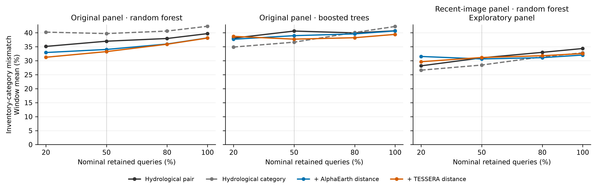
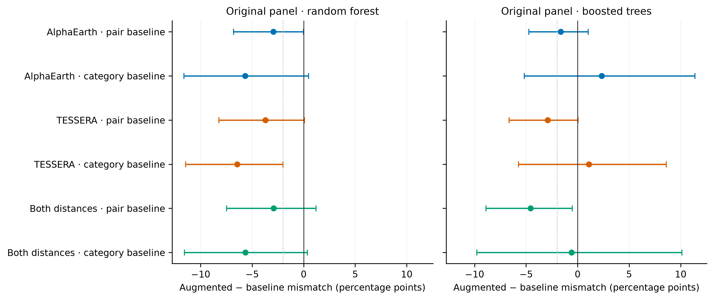
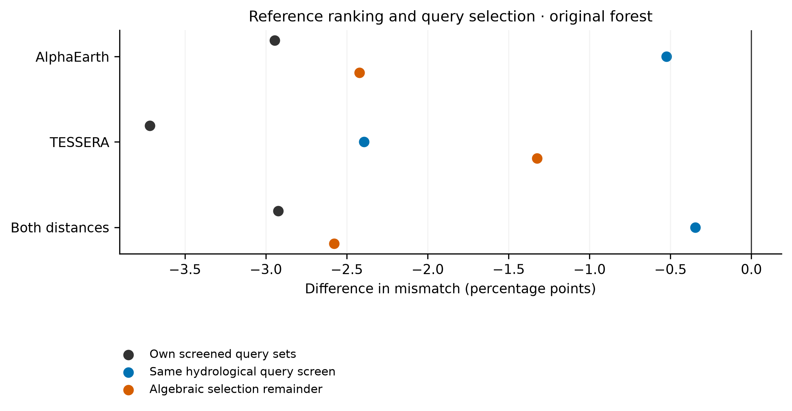
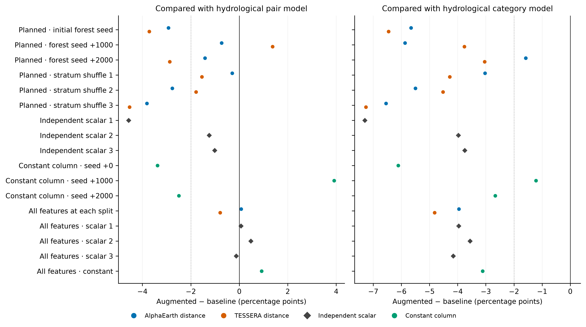
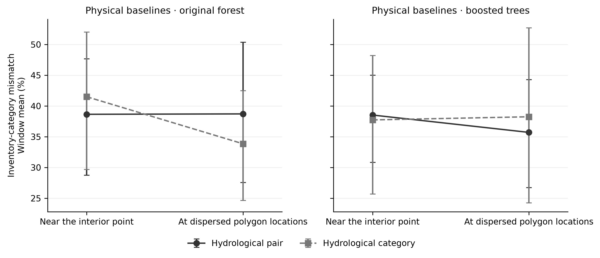

# Do annual satellite embedding distances improve matching of wetland inventory water regimes?

*Revised manuscript following one review by an AI agent. Frozen versions are recorded in the local Git tags.*

## Abstract

Wetland reference assessment needs hydrologically comparable sites to guide restoration targets and evaluation. We tested annual satellite embedding distances against 30 terrain, optical surface-water and drainage covariates using 3,667 wetlands in 12 convenience windows. Published National Wetlands Inventory water-regime labels were masked for query and candidate sites, with spatially separated training. At half coverage, an increment attributable to the embeddings was not established under the planned qualification rule: planned permutation controls gave changes comparable to the real distances. Against a model scoring wetland pairs from these covariates, AlphaEarth/TESSERA changed mismatch by -2.95/-3.72 percentage points with equal window weights, but -0.67/-2.44 when queries were pooled. One fewer mismatch among 5 accepted queries in one window supplied 57% of the AlphaEarth equal-window change. Planned permutation changes ranged from -4.53 to -0.29 percentage points equal-window (-1.00 to +0.78 pooled); planned seed and alternative-learner checks also qualified the gain. Exploratory six-seed corrected-input mean changes against the same model were -2.49/-4.49 equal-window and -0.60/-1.92 pooled. Exploratory category-prediction diagnostics also indicated value for predicting inventory labels. The endpoint is inventory-label agreement; field hydroperiod and practitioner benefit were not measured.

## 1. Introduction

Reference ecosystems provide benchmarks for assessing existing condition, setting targets, designing restoration and evaluating progress. For wetlands and streams, ecological reference assessment considers landscape position, hydrodynamics, geomorphology, hydroperiod and other characteristics that affect how a system functions. The US Environmental Protection Agency's compensatory-mitigation guidance describes this role of reference conditions and the need for comparable physical characteristics (Ainslie, Somerville and Monroe, 2023, p.83). Wetland hydrogeomorphic (HGM) assessment similarly connects geomorphic setting, water source and water movement to ecological processes, while recognising the limits of remotely derived indicators (Brinson, 1993, chapters 2–4).

These requirements matter when researchers or practitioners assemble candidate sites from maps. Similar vegetation or satellite appearance supplies useful evidence, but does not establish the full hydrological comparison. Annual satellite embedding products make another screening measurement widely accessible: a compact vector can summarize multiple satellite observations at each location. AlphaEarth Foundations and TESSERA provide precomputed global representations, reducing the need to build a sensor-processing pipeline for every downstream task (Brown et al.,2025; Feng et al.,2025). Similarity to reference vegetation has also been used to characterise forest-restoration trajectories (Heiman, 2026). This creates a concrete evaluation question for proposed wetland analogue searches: does representation distance add useful matching information beyond explicit public hydrological covariates?

The US National Wetlands Inventory (NWI) supplies a reproducible category endpoint for this question. Its temporarily flooded, seasonally flooded and semipermanently flooded regimes describe different typical growing-season water conditions (FGDC, 2013). These are interpreted inventory classes. The NWI mapping procedures caution that regime assignment is particularly uncertain, that long-term water-level information is often unavailable, and that a single image can reflect unusual wet or dry conditions (Dahl et al.,2020). Therefore agreement with an NWI regime cannot validate current hydroperiod or functional equivalence.

Our research question is: **Does adding annual satellite embedding distance improve wetland reference screening beyond public terrain and surface-water covariate matching, at fixed screening coverage, when vegetation subclass and geographic setting are controlled?** The study is a label-masked retrospective diagnostic. Where the relevant water-regime labels are already known, they can directly define a category filter; no operational advantage from masking them is established here. Potential applications include audits of outdated regime mapping and candidate searches where current inventory regimes are unavailable. Transfer to such settings, independently delineated wetlands and open-set inventories was not tested. Quantifying the increment here helps set evidence requirements, rather than demonstrating an operational benefit.

## 2. Prior work

Hydrological comparability is established reference-assessment practice (Brinson,1993; Ainslie et al.,2023). It is the motivation for the outcome, rather than a discovery of this study. Terrain-informed wetland remote sensing also has a substantial methodological basis. Askew et al.(2025) combined terrain descriptors, including height above nearest drainage (HAND), with multispectral observations and field measurements to study floodplain inundation. Our explicit covariates include HAND to avoid comparing embeddings only with local elevation and slope. The public surface-water product is another informative measurement, although its underlying optical method has documented limitations for small, short-lived or vegetation-obscured water (Pekel et al.,2016; JRC, 2026).

Brown et al.(2025) evaluated AlphaEarth features for mapping and biophysical prediction; Feng et al.(2025) evaluated TESSERA representations for several Earth-observation tasks. Ryan et al.(2026) compared embedding-based and conventional multisensor wetland vegetation mapping. Young and Keshav(2026) investigated the surface events retained by annual embedding products using decompositions and external reference data. Heiman(2026) examined forest-restoration trajectories using similarity to reference forest. These studies motivate the measurements but evaluate different endpoints from choosing a same-vegetation wetland reference with a matching inventory water regime. Vegetation classification, representation similarity and hydrological reference comparability require separate evidence.

A recent preprint by Sharma et al.(2026, version1, sections2.5–2.8 and3.1–3.2) evaluates binary wetland mapping with AlphaEarth, LiDAR and Sentinel predictors after excluding uncertain polygon-boundary pixels. Its endpoint differs from water-regime reference matching. Its boundary treatment also changes the population being evaluated; our common-cohort polygon comparison therefore holds eligible wetlands fixed when comparing sampling operators. The preprint has not been peer reviewed.

Close work also concerns inundation regimes directly. Abrahamson and Stegen (2026, **conference abstract only**) describe AlphaEarth-based classification of Everglades annual inundation regimes against gauge-derived EDEN labels and comparison with Sentinel-2 NDWI, including an unsupervised analysis. The full abstract was checked, but it reports no numerical performance estimates and is not a full empirical paper. It establishes a close research direction already being pursued; it does not supply outcome evidence for this screening task.

Rahman (2026, preprint version1, sections2.3–2.5 and3.1–3.2) evaluates how AlphaEarth predicts environmental variables, including terrain and hydrological maps, with random and spatial-block validation. This supports expecting overlap between representation and physical predictors, rather than assuming that embedding information is independent of the baseline. It does not establish a wetland screening increment.

Wetland inundation mapping predates embedding products. DeVries et al.(2017, sections3.1 and5.1–5.2) estimate sub-pixel surface-water fractions from Landsat, including small and partially inundated wetland features, while discussing remaining optical limitations. Lang et al.(2008, sections3.3–6) compare multi-temporal C-band SAR hydroperiod indicators with field inundation/soil moisture and NWI mapping in forested wetlands. Thus explicit radar-derived inundation is a relevant omitted predictor in our optical/terrain/HAND baseline. A related 2018 dataset poster is listed in DeVries’s author bibliography; only that listing, not its abstract or a SWaRe product validation, was checked, so it is a bibliographic pointer rather than supporting evidence.

The bounded literature and primary-source search is documented in `sources.jsonl` and `protocol/prior-work-candidates.md`. It included wetland reference condition, hydrogeomorphic classification, hydrological analogue/donor selection, satellite embeddings, wetland hydrology and ecological restoration similarity, including 2025–2026 work. The closest checks included vegetation mapping, rainfall–runoff modelling and representation interpretation, with endpoints distinct from this label-masked reference screen. An additional wetland-classification thesis was found only through its abstract; its full text was inaccessible behind an access check and it is retained as a pointer, not supporting evidence. No novelty claim follows from this bounded search. This search does not establish absence of prior work outside its coverage.

Basin-scale hydrological prediction is a further important comparison. Ou and Zheng(2026, sections2.1–2.4 and3.1–3.3) combined spatially aggregated, annually changing AlphaEarth features with static catchment descriptors and meteorological forcings in a rainfall–runoff model. They evaluated temporal and held-out-basin prediction with multiple training seeds and related learned similarity to hydrological signatures. That study provides evidence for a hydrological use of satellite embeddings at a different scale, with different inputs and endpoints. Our label-agreement screening diagnostic cannot confirm or refute its streamflow results.

More directly, Qu et al.(2026, version2, section2.3 and ExperimentB) used standardized AlphaEarth cosine similarity to select donor basins for rainfall–runoff models. Their reported advantage for embedding-based donors shows that representation similarity has already been evaluated for hydrological transfer. Liu et al.(2026, sections2.1–2.2 and3.1–3.2) compared annual and multi-year spatially averaged descriptors, including augmentation of conventional attributes, in temporal and ungauged-basin prediction. They found benefits that depended on the evaluation setting. Our contribution is narrower: a controlled wetland inventory-category screening comparison that tests the physical baseline, feature controls and spatial measurement operators. It is not the first use of embeddings for hydrological similarity, and its results do not generalize to donor-basin streamflow prediction.

## 3. Methods

A **pair model** scores how likely a query wetland and a candidate reference are to share a regime from their covariates. A **category model** predicts each wetland’s probabilities for the three regime classes and compares those probabilities. A **candidate pool** is the set of eligible local reference wetlands. A **nontrivial matchable pool** contains both a matching regime and a different regime, as determined retrospectively from masked labels. **Physical comparators** are models using the stated terrain, optical surface-water and drainage covariates. Differences are expressed in percentage points (pp). A **paired window bootstrap** resamples the same geographic windows for both methods to describe uncertainty across this convenience panel. Spatial sampling refers to how existing maps are summarized near a point or across a polygon.

### 3.1 Data and population

The primary panel comprised fixed 16 km squares in 12 contrasting US settings. These are convenience windows, with no national sampling interpretation. The eligible codes were exactly PEM1A/C/F, PFO1A/C/F and PSS1A/C/F: persistent emergent, broad-leaved deciduous forested and broad-leaved deciduous scrub-shrub wetlands with temporarily, seasonally or semipermanently flooded regimes. All nine combinations are permitted by the official NWI code rules. Mixed classes and special modifiers were excluded; Pf denotes Palustrine Farmed and lies outside this population.

Polygons needed projected area 0.1–100 ha and an interior point at least 15 m from the boundary. The point was obtained by polylabel with 2 m tolerance. We retained at most 1200 eligible polygons/window, ordered by a trial-specific SHA-256 hash of their public object identifiers, without balancing regimes. The full eligibility accounting and original responses are archived. NWI imagery-project polygons supplied source-image years, including overlap and missing-date flags. All 3,667 selected primary wetlands had usable features for both products. Source-image years were ≤2014 for 2,756, 2015–2019 for 770, ≥2020 for 141, and unknown for 0. Window and category counts are in the generated supplementary data.

After inspecting the primary panel's image dates, we fixed an **exploratory** supplementary panel of 6 windows using recent-project metadata alone. For six fixed anchors, we selected the nearest qualifying project with IMAGE_YR>=2020, sufficient interior area and separation from original windows; wetland counts, categories and matching outcomes did not choose the new centres. The complete algorithm and selected project records precede supplementary wetland retrieval in Git. The supplementary panel has separate fits and does not replace the original sites. Its landscapes and training sample sizes differ, so comparisons between panels cannot isolate a causal effect of inventory age.

### 3.2 Measurements

We used archived 2024 AlphaEarth Foundations Satellite Embedding V1 annual vectors and TESSERA v1.1-dclimate vectors. The published dimensions are 64 and 128 respectively. The latter identifies checkpoint `tessera_v1_1_aws_encoder.pt`; its public store publishes a specified subset of the model output. The exact AlphaEarth mirror checkpoint was not independently verified; the official catalogue describes production encoder v2.1 and related land-cover supervision. Consequently strict pretraining independence from related map information is not assumed.

For each wetland, we decoded the 3×3 native-grid pixels around its selected interior point, retained pixel centres inside its polygon and required at least five valid vectors. We averaged decoded vectors and normalized the mean for cosine methods. Full-vector decoders retained the magnitude of that mean. Quantization, scales, coordinates and masks are archived so these transformations can be recomputed. A direct-source TIFF transport optimization was adopted only after exact equality with an archived provider-VRT patch set; it changed no scientific input values.

The explicit baseline used 30 covariates: bare-earth elevation, slope and topographic position; JRC water occurrence, recurrence, 2024 seasonality and spatial context; distance to occurrence>=75%; HAND; and polygon area. Numerical source windows and reprojected 30 m grids are bundled. The USGS 3DEP export requested the raw elevation function. The corrected JRC v1.5 release was used, with its documented collection-transition limitations. Its valid zero values are published non-water detections, not proof of absent water beneath vegetation. Physically out-of-range pixels were preserved in source windows and treated as missing in derived grids. HAND derives from a surface DEM and has its own canopy and drainage-model limitations. These measurements do not constitute a field HGM assessment.

### 3.3 Spatial design and matching

Each window was partitioned into 4×4 blocks of 4 km, with fold `(block_x+2*block_y) mod 4`. Across four rotations, one fold supplied queries, the next references and the remaining two nominal training wetlands. Training wetlands within 1 km of any query or reference point in the window were removed. Queries and references did not supply supervised labels, transformations or fitted statistics. Each wetland served as a query once; shared training/reference data mean the rotations are not independent repetitions.

Candidates shared the query's window and exact vegetation subclass and were at least 1 km away. We counted empty pools, single-regime pools, pools without the query's regime and nontrivial pools containing both a matching class and another class. These bounds describe the sampled pools. They do not establish that a real region lacks ecologically acceptable references.

Comparators were geographic nearest neighbour, standardized hydrological distance, a hydrological pair classifier and a hydrological regime decoder. Pair features were symmetric covariate means/differences, missingness indicators, geographic distance and vegetation/window indicators. Training pairs were sampled within training windows and vegetation, at least 1 km apart, with at most 30 partners per training wetland. The augmented pair models added AlphaEarth cosine distance, TESSERA cosine distance or both. The decoder scored reference compatibility by the dot product of predicted class probabilities. This is an uncalibrated compatibility score.

The primary learner was a random forest with 200 trees, max_depth=12, max_features=0.7 and min_samples_leaf=20 for pair learning or 10 for individual decoding. Seeds and pairs were fixed; no query-outcome tuning was performed. Imputation/scaling and representation centring/whitening used retained training data only. Raw, centred and whitened cosine neighbours and full-vector decoders supplied planned information/metric diagnostics. Decoder failure would not prove information absent from a representation.

Physical predictors were imputed with retained-training medians, using zero only where a median was unavailable, then divided by retained-training interquartile ranges. Ranges no greater than 1e-9 were replaced by one; missingness indicators were appended. For embedding transformations, let $v$ be the unit-normalized wetland mean, $\mu$ the retained-training mean and $C=Q\operatorname{diag}(\lambda)Q^\top$ its sample covariance. The centred vector is $v-\mu$. The whitened vector before normalization is $(v-\mu)Q\operatorname{diag}(\max(\lambda_j,\tau)^{-1/2})Q^\top$, where $\tau=\max(0.01\lambda_{\max},10^{-12})$. Cosine scoring normalizes the transformed vectors with a norm denominator at least 1e-12. The floor was fixed rather than tuned on query outcomes.

All individual decoders include the common vegetation and window indicators.
The standalone representation decoders therefore test the specified representation-plus-context
predictor, while hybrid decoders append the full mean vector to physical predictors
and those same indicators. They do not identify the representation's causal information
contribution independently of this model and context.

### 3.4 Evaluation and uncertainty

The risk–coverage distinction is established selective-classification terminology (El-Yaniv and Wiener, 2010, pp. 1606–1607). Here the loss concerns a reference match, and the acceptance set is fixed by a screening budget. We provide empirical conditional losses, without a prospective risk-control guarantee.

Each method first selected its highest-scoring reference, breaking ties by reference identifier. Within each window/rotation it retained the highest-confidence half of queries with nonempty pools, with query-identifier tie breaking. The primary loss was exact inventory-regime mismatch among retained queries. We pooled numerator/denominator across rotations within each window and then averaged window risks. We also report pooled risk, achieved coverage and 20%, 80% and full-coverage results. A two-percentage-point difference was a predefined descriptive benchmark, not a validated benefit or cost-effectiveness threshold.

Primary contrasts compare each single-distance augmentation with **both** the hydrological pair learner and hydrological decoder. A gain over only one comparator does not establish the stated increment. Paired bootstrap intervals resample windows 10,000 times,seed 18018. They describe variation across the convenience panel and omit field-label uncertainty, model-family uncertainty and national sampling uncertainty. We report all contrasts and no uncorrected multiple-comparison significance claims.

To distinguish reference ranking from query selection, we evaluated every method on each hydrological method's fixed 50% query screen, as well as at full coverage. Conditional nontrivial-pool results use the already-selected queries; labels do not trigger rescreening. Uniform-reference expected mismatch and a label-aware oracle are diagnostic bounds. Class-specific coverage, reference-choice overlap and score ties identify cases where majority classes, empty alternatives or identical decisions constrain interpretation.

### 3.5 Additional checks and records

The first plan preceded main acquisition; training-buffer, HAND and full-vector-decoder clarifications preceded all fitting. The recent-image panel was added after inspecting imagery dates and before retrieving its labels. Further forest seeds, within-window/vegetation/role embedding permutations, and a fixed histogram gradient-boosting learner were specified after the first fit began but before the author inspected its matching-loss estimates. These are not external preregistrations.

After seeing primary and permutation outcomes, we added independent hash-derived pseudo-uniform pair scalars and an all-feature forest comparison. A separate constant-column check was fixed before inspecting those scalar losses: the appended feature equals zero for every pair, and all forests are checked to use it in zero splits. Three scalar repetitions and three forest seeds are diagnostics, without a permutation p-value. Considering all features at each split is a separate learner setting, not a correction selected to maximize satellite performance.

A later author verification repeat applied the zero-column condition to canonical corrected paths for seed offset 0 under the original forest, all-feature forest and fixed boosted trees. The physical inputs and roles were unchanged by the representation repair, so this was an expected replay check, without additional independent observations. Per-query reference, confidence and mismatch discrepancies against the saved original constant models were recorded.

We also specified an exploratory within-polygon measurement comparison. A deterministic hash sample selects up to 256 ten-metre pixel centres across each polygon. On one outcome-blind common cohort, we compare the original contiguous patch, dispersed embeddings with original physical covariates, dispersed embeddings with the same 30 physical feature maps averaged at the same sampled positions, and a dispersed subset with the original geometric inside-pixel count. Every sampled point must be at least 2030 m inside the archived physical grid; completeness and overlap checks precede fitting. These tests address measurement support, not field validity.

This check exposed a source-tile edge assembly defect in our original AlphaEarth patch reader: 12 inside-polygon pixels were missing at 4 wetlands. Rereading all nine positions of each affected patch exactly reproduced every formerly valid value and filled the omitted neighbouring-tile pixels. We preserved original inputs/results, saved corrected overrides, and reran the canonical primary and recent comparisons. The corrected feature arrays change 1 primary and 3 recent AlphaEarth rows; physical and TESSERA inputs are identical. Initial-extraction controls remain separately identified and internally paired.

The fixed alternative learner is histogram gradient boosting (200 iterations, learning rate 0.05, 31 leaves, L2=1, minimum leaf sizes 20 for pairs / 10 for decoding, no early stopping). Other prespecified boundary checks, completed or incomplete, are itemized below and in the execution records. No outcome-dependent site replacement was permitted.

After reading the planned whitened-cosine diagnostic, we fixed an exploratory stronger-distance comparison on the original inputs and the dispersed-polygon inputs with averaged physical covariates. We append the original training-only whitened cosine distance, with its unchanged 1% covariance-eigenvalue floor, to the physical pair models. We evaluate both fixed boosted trees and all-feature forests with seed offset 0, using matching physical pair/category baselines. We save transformed vectors and verify their nearest-reference cosine maxima against the archived diagnostic at tolerance 1e-12; any differing reference must have a score within that tolerance of the maximum. This tolerance audits equivalence and does not change the exact-maximum reference-selection rule. No whitening-floor or downstream-parameter search was performed.

The spatial boundary checks vary the minimum reference separation (0/3km), training exclusion (0/3km), minimum interior margin (30m), HAND inclusion, global versus within-window training-only median/IQR scaling, and patch versus centre-pixel embeddings. Each uses all 18 original methods and its stated complete-case population. Geographic transfer trains on the other 11 windows, retains vegetation indicators, and removes window indicators. Its training size, geography and seeds also change, so it does not isolate a causal effect of local-label availability.

For the alternate-year diagnostic,2023/2021 embeddings use the unchanged inventory labels and baseline physical grids. Before matching, the common cohort intersects the original quality rules across both products and all three years, retaining ordered IDs and role assignments. The original2024 fits are reused only when that intersection equals the original cohort; otherwise a separate2024 common-cohort reference is required. All18 methods are evaluated, and physical-only decisions and training pairs must agree across years. This is not annual field-hydroperiod validation or forecasting.

After inspecting per-window pool counts, we added exploratory shared-screen nontrivial-pool and single-window-omission diagnostics. The conditional analysis filters already-accepted queries without replacement and reports contributing windows. Two further acceptance policies allocate a window-total budget across rotations or preserve the original rotation total while allocating across known vegetation subclasses. Both use integer largest remainders with fixed hash ties; confidence is ranked only within each model/stratum. Query regimes do not select acceptance under these policies. The original screens remain the primary analysis, and the two-point benchmark is descriptive rather than a validated ecological benefit threshold.

After inspecting all original geographic-transfer results, we fixed an exploratory stronger-comparator check. It preserves the archived transfer training pairs, roles and candidate pools; it fits all-feature physical forests and fixed boosted trees with raw/whitened single distances. The forest benchmark copies the original 0.7 augmentations for comparison against 1.0 physical models, while both boosted-tree distance variants share their physical models. Targets retain fixed order, and consistency checks precede interpretation. These comparisons are not an externally preregistered confirmation.

After review by an AI agent, plan v23 fixed paired-window uncertainty for pooled screening and decoder metrics, small-window contribution/overlap calculations, real/null seed summaries, planned subgroup reporting and five additional corrected-input forest seed offsets. These analyses reuse the same sites and labels and are not independent confirmation. Decoder intervals resample paired windows 10,000 times at seed 18018; log loss uses natural logarithms and balanced accuracy averages recall over present classes per window or all three pooled classes. The original primary metric, population and acceptance rule are unchanged.

The complete plans, amendments, source checks, failures, commands and commits are archived. One different model, OpenAI `gpt-6-astra` with requested xhigh reasoning, critiqued topic candidates on 2026-10-27 under the trial's planning exception. It did not write code, analyse data or draft this paper. All experimental measurements use public archived data and local computation. No human participants or practitioner outcomes were studied.

## 4. Results

### 4.1 Prespecified primary comparison

The increment attributable to annual embedding distance is **not established on the prespecified metric under the planned qualification rule**. Plan v6 required qualification when the gain disappeared with the second learner or was comparable to null-feature perturbations. The planned permutations and seed checks meet that qualification (section 4.5). This is a descriptive diagnostic conclusion, not a formal test of equality or a permutation p-value.

The half-coverage screen retained 1,804 of 3,637 nonempty queries (49.60% achieved coverage). The four core window-mean risks were hydrological pair model 36.98%, hydrological category model 39.71%, hydrology + AlphaEarth distance 34.03%, hydrology + TESSERA distance 33.26%. The table includes every planned primary-panel method, including favourable secondary results.

Hydrology + AlphaEarth distance minus the hydrological pair model was -2.95 pp (95% window-bootstrap interval -6.81 to -0.01); minus the hydrological category model it was -5.68 pp (95% window-bootstrap interval -11.61 to +0.47). Hydrology + TESSERA distance minus the hydrological pair model was -3.72 pp (95% window-bootstrap interval -8.23 to +0.08); minus the hydrological category model it was -6.45 pp (95% window-bootstrap interval -11.45 to -2.01). The planned TESSERA whitened cosine-only diagnostic had 32.26% mismatch, compared with 35.72% for raw TESSERA cosine and 35.73% for geographic nearest reference. Metric choice and this simple geographic comparator therefore also matter to interpretation. Both single-distance point estimates meet the prespecified two-percentage-point descriptive benchmark against both comparators. Each product has an interval crossing zero against at least one comparator. The intervals describe this panel; they do not incorporate all sources of uncertainty or justify a general superiority claim.

*Figure 1. Window-mean inventory mismatch across four fixed screening budgets. The original convenience panel is shown with random forests and boosted trees; the recent-image panel is exploratory. Curves are empirical screened losses, not calibrated risk guarantees.*

*Figure 2. Augmented-minus-baseline window-mean mismatch at half coverage, with paired window-bootstrap intervals. The dotted line marks the descriptive two-point benchmark. Combined distances are a planned secondary comparison.*

| Augmentation | Comparator | Window Δ pp [95% interval] | Pooled Δ pp [95% interval] |
| --- | --- | --- | --- |
| Hydrology + AlphaEarth distance | Hydrological pair model | -2.95 [-6.81, -0.01] | -0.67 [-2.47, +1.20] |
| Hydrology + AlphaEarth distance | Hydrological category model | -5.68 [-11.61, +0.47] | -4.32 [-10.34, -0.15] |
| Hydrology + TESSERA distance | Hydrological pair model | -3.72 [-8.23, +0.08] | -2.44 [-5.03, -0.32] |
| Hydrology + TESSERA distance | Hydrological category model | -6.45 [-11.45, -2.01] | -6.10 [-12.77, -1.44] |

Both scales use 1,804 accepted queries across 12 windows, with method-specific accepted sets. The pooled point metric was planned; its paired-window uncertainty was added after review. Negative differences favour the augmentation. Equal-window means give each window the same weight; pooled mismatch gives each accepted query the same weight. The intervals resample windows and do not incorporate random-forest seed variation.

The hydrological pair model does not beat geographic nearest reference on the primary equal-window scale: 36.98% versus 35.73%. The order reverses when queries are pooled: 34.15% versus 39.58%.

| Method | Retained | Nonempty queries | Window mean (%) | Pooled (%) |
| --- | --- | --- | --- | --- |
| AlphaEarth centred cosine | 1,804 | 3,637 | 35.72 | 33.92 |
| AlphaEarth cosine | 1,804 | 3,637 | 37.44 | 33.92 |
| AlphaEarth category model | 1,804 | 3,637 | 37.71 | 33.98 |
| AlphaEarth whitened cosine | 1,804 | 3,637 | 35.94 | 33.48 |
| Geographic nearest reference | 1,804 | 3,637 | 35.73 | 39.58 |
| Hydrology + AlphaEarth category model | 1,804 | 3,637 | 41.36 | 35.75 |
| Hydrological category model | 1,804 | 3,637 | 39.71 | 37.80 |
| Hydrological Euclidean distance | 1,804 | 3,637 | 42.37 | 41.80 |
| Hydrological pair model | 1,804 | 3,637 | 36.98 | 34.15 |
| Hydrology + TESSERA category model | 1,804 | 3,637 | 39.75 | 35.03 |
| Label-aware oracle | 1,804 | 3,637 | 0.00 | 0.00 |
| Hydrology + AlphaEarth distance | 1,804 | 3,637 | 34.03 | 33.48 |
| Hydrology + both distances | 1,804 | 3,637 | 34.05 | 32.21 |
| Hydrology + TESSERA distance | 1,804 | 3,637 | 33.26 | 31.71 |
| TESSERA centred cosine | 1,804 | 3,637 | 34.10 | 31.98 |
| TESSERA cosine | 1,804 | 3,637 | 35.72 | 33.26 |
| TESSERA category model | 1,804 | 3,637 | 40.44 | 37.08 |
| TESSERA whitened cosine | 1,804 | 3,637 | 32.26 | 33.09 |

### 4.2 Pool bounds and screening composition

Of 3,667 queries, 30 had no pool; 204 pools allowed only correct matches and 59 none (26 of these were single-regime), leaving 3,374 nontrivial matchable queries. AlphaEarth/TESSERA changed 1,841/2,095 reference choices versus the pair baseline and 3,279/3,256 versus the category baseline. Overall, 59 nonempty pools lacked the query category. The uniform-reference expected window-mean mismatch was 45.07% over all nonempty queries, which is not a calibrated 50%-screen baseline. The label-aware oracle is a bound using withheld outcomes. Window sample sizes ranged from 18 to 890 queries; the smallest had 18 queries and only 2 nontrivial matchable pools. Equal-window means give it the same weight as the largest window, so overall pool counts alone do not establish the influence of trivial cases. The retained counts from nontrivial matchable pools were hydrological pair model 1,644, hydrological category model 1,671, hydrology + AlphaEarth distance 1,650, hydrology + TESSERA distance 1,648. Label-conditional counts describe already-selected queries and do not rescreen them. Class-specific coverage is supplied in `analysis/report-data/regime-coverage.csv`.

| Disjoint query-pool condition | Queries |
| --- | --- |
| No candidate pool | 30 |
| Only correct-category candidates | 204 |
| No correct-category candidate | 59 |
| Matching and alternative categories | 3,374 |

The no-match row includes the single-regime all-wrong pools; it is not an additional disjoint category.

| Method | Nonempty queries | Multiple best references | Constant multi-candidate pools | Nontrivial constant pools | Queries at tied screening boundaries |
| --- | --- | --- | --- | --- | --- |
| Hydrological category model | 3,637 | 0 | 0 | 0 | 0 |
| Hydrological pair model | 3,637 | 40 | 0 | 0 | 0 |
| Hydrology + AlphaEarth distance | 3,637 | 37 | 0 | 0 | 0 |
| Hydrology + TESSERA distance | 3,637 | 35 | 0 | 0 | 0 |

These exploratory counts use exact saved-score equality. Constant-pool counts require more than one candidate. Boundary counts include accepted and rejected queries sharing the cutoff; the prescribed query-ID tie rule determines acceptance. Full counts and zero-budget groups are in `analysis/report-data/score-ambiguity.csv`.

| Augmentation | Comparator | Compared queries | Same reference | Different reference | Screened-query overlap |
| --- | --- | --- | --- | --- | --- |
| Hydrology + AlphaEarth distance | Hydrological pair model | 3,637 | 1,796 | 1,841 | 1,522 |
| Hydrology + AlphaEarth distance | Hydrological category model | 3,637 | 358 | 3,279 | 1,216 |
| Hydrology + TESSERA distance | Hydrological pair model | 3,637 | 1,542 | 2,095 | 1,477 |
| Hydrology + TESSERA distance | Hydrological category model | 3,637 | 381 | 3,256 | 1,194 |

Reference overlap is counted across all nonempty queries; screened-query overlap concerns the half-coverage selected sets.

| Augmentation | Window | Accepted | Errors, augmented / pair | Window Δ pp | Contribution to mean, pp | Accepted-set overlap |
| --- | --- | --- | --- | --- | --- | --- |
| Hydrology + AlphaEarth distance | R07 | 5 | 1 / 2 | -20.00 | -1.67 | 4 |
| Hydrology + AlphaEarth distance | R08 | 14 | 6 / 7 | -7.14 | -0.60 | 10 |
| Hydrology + TESSERA distance | R07 | 5 | 2 / 2 | +0.00 | +0.00 | 5 |
| Hydrology + TESSERA distance | R08 | 14 | 4 / 7 | -21.43 | -1.79 | 10 |

The two windows contain 19 of 1,804 accepted queries. Together they supply 76.8% of the AlphaEarth equal-window change; omitting both gives -0.82 pp. Neither window is removed from the primary result. R07 has one fewer error, rather than necessarily one corrected prediction on the same query: accepted sets overlap only partly, as the table shows. These contribution calculations were added after review.

### 4.3 Ranking and recoverability diagnostics

For hydrology + AlphaEarth distance, the total own-screen change was -2.95 pp, of which the change on the fixed hydrological query screen was -0.52 pp; the algebraic selection remainder was -2.42 pp. For hydrology + TESSERA distance, the total own-screen change was -3.72 pp, of which the change on the fixed hydrological query screen was -2.39 pp; the algebraic selection remainder was -1.32 pp. For hydrology + both distances, the total own-screen change was -2.92 pp, of which the change on the fixed hydrological query screen was -0.35 pp; the algebraic selection remainder was -2.58 pp. This decomposition is descriptive and does not identify a causal mechanism. It shows why a lower screened mismatch need not mean better references for the same queries.

An exploratory check conditions the same hydrological query screens on nontrivial matchable pools, without selecting replacements. All methods are evaluated on identical queries within each row comparison. Windows with no retained nontrivial queries do not contribute; these are retrospective label-conditional diagnostics, not an operational acceptance rule.

| Condition | Screen | Augmentation | Queries | Windows | Δ, pp [95% interval] |
| --- | --- | --- | --- | --- | --- |
| Whitened distance; boosted trees | Hydrological pair model | Hydrology + AlphaEarth distance | 1,640 | 11 | -4.69 [-12.77, +1.40] |
| Whitened distance; boosted trees | Hydrological pair model | Hydrology + TESSERA distance | 1,640 | 11 | -4.60 [-7.94, -0.91] |
| Whitened distance; boosted trees | Hydrological category model | Hydrology + AlphaEarth distance | 1,658 | 11 | -1.33 [-4.99, +2.95] |
| Whitened distance; boosted trees | Hydrological category model | Hydrology + TESSERA distance | 1,658 | 11 | -3.20 [-10.62, +6.48] |
| Original raw distance; forest | Hydrological pair model | Hydrology + AlphaEarth distance | 1,644 | 11 | -0.62 [-1.65, +0.56] |
| Original raw distance; forest | Hydrological pair model | Hydrology + TESSERA distance | 1,644 | 11 | -2.60 [-5.17, +0.15] |
| Original raw distance; forest | Hydrological category model | Hydrology + AlphaEarth distance | 1,671 | 11 | -4.40 [-9.88, +1.15] |
| Original raw distance; forest | Hydrological category model | Hydrology + TESSERA distance | 1,671 | 11 | -5.54 [-11.54, +0.26] |

Across all 12 single-window omissions, hydrology + AlphaEarth distance differences against the pair comparator ranged from -3.64 to -1.40 pp; 1 omissions changed whether the predefined two-point benchmark was met. Across all 12 single-window omissions, hydrology + TESSERA distance differences against the pair comparator ranged from -4.59 to -2.11 pp; 0 omissions changed whether the predefined two-point benchmark was met. Every omission remains archived; none replaces the primary estimate.

| Method | Query wetlands | Balanced accuracy | Log loss |
| --- | --- | --- | --- |
| AlphaEarth category model | 3,667 | 0.539 | 0.729 |
| Hydrology + AlphaEarth category model | 3,667 | 0.543 | 0.723 |
| Hydrological category model | 3,667 | 0.502 | 0.780 |
| Hydrology + TESSERA category model | 3,667 | 0.543 | 0.731 |
| TESSERA category model | 3,667 | 0.539 | 0.741 |

These pooled query diagnostics measure recoverability by the specified forest. They cannot establish absence of hydrological information.

*Figure 3. Total own-screen difference, reference-ranking difference on the same hydrological screen, and their algebraic remainder. These components do not identify causal effects.*

| Decoder | Weighting | Δ log loss, nats [95% interval] | Δ balanced accuracy, pp [95% interval] | Windows with lower log loss |
| --- | --- | --- | --- | --- |
| AlphaEarth category model | window | -0.052 [-0.083, -0.016] | +0.56 [-2.27, +3.08] | 11/12 |
| AlphaEarth category model | pooled | -0.051 [-0.077, -0.006] | +3.68 [+1.01, +5.90] | 11/12 |
| TESSERA category model | window | -0.024 [-0.062, +0.014] | +2.66 [+0.15, +5.12] | 7/12 |
| TESSERA category model | pooled | -0.038 [-0.065, +0.000] | +3.65 [+1.12, +7.44] | 7/12 |
| Hydrology + AlphaEarth category model | window | -0.047 [-0.073, -0.019] | +1.17 [-2.29, +4.17] | 9/12 |
| Hydrology + AlphaEarth category model | pooled | -0.057 [-0.079, -0.022] | +4.03 [+1.78, +6.18] | 9/12 |
| Hydrology + TESSERA category model | window | -0.038 [-0.075, -0.003] | +2.90 [+0.80, +4.95] | 8/12 |
| Hydrology + TESSERA category model | pooled | -0.049 [-0.072, -0.016] | +4.11 [+1.85, +7.39] | 8/12 |

These post-review exploratory paired-window intervals compare each label predictor with the hydrological category model on all query wetlands. Log loss measures the probability assigned to the observed class (natural logarithm, lower is better); balanced accuracy averages class-specific recall (higher is better). Window balanced accuracy averages recalls for true classes present in that window; pooled accuracy uses the summed three-class confusion matrix. The results indicate useful predictive information for these classifiers, without establishing conditional information absent from every possible physical model, better reference screening, or field hydrological validity.

### 4.4 Exploratory recent-image panel

The separate panel contained 2,696 wetlands in 6 windows with source-image years 2020–2024. Of 2,691 nonempty pools, 1,338 were retained. Hydrological pair model: 31.02%; Hydrological category model: 28.45%; Hydrology + AlphaEarth distance: 30.64%; Hydrology + TESSERA distance: 31.15%. The secondary combined-distance and full-vector alternatives are retained in the supplementary tables. This is not a causal inventory-age comparison. On the pooled scale, the physical pair and AlphaEarth augmentation each have 37.52% mismatch, while TESSERA has 36.62%.

### 4.5 Planned secondary controls and later randomness diagnostics

The seed, embedding-permutation and boosted-tree checks were fixed in plan v6 before the first explicitly logged aggregate inspection. They are **planned secondary analyses**, not externally preregistered tests. Independent scalars, constant columns and all-feature forests were added later and remain exploratory.

| Condition | Seed / repeat | AlphaEarth W | AlphaEarth P | TESSERA W | TESSERA P | Scalar W | Scalar P | Zero W | Zero P |
| --- | --- | --- | --- | --- | --- | --- | --- | --- | --- |
| Planned forest; initial inputs | 0 | -2.92 | -0.61 | -3.72 | -2.44 | — | — | — | — |
| Planned forest; initial inputs | 1000 | -0.73 | -0.44 | +1.37 | -1.16 | — | — | — | — |
| Planned forest; initial inputs | 2000 | -1.42 | -0.83 | -2.87 | -0.78 | — | — | — | — |
| Primary forest; corrected inputs | 0 | -2.95 | -0.67 | -3.72 | -2.44 | — | — | — | — |
| Planned embedding shuffle | 0 | -0.29 | +0.28 | -1.55 | -0.33 | — | — | — | — |
| Planned embedding shuffle | 1 | -2.76 | -1.00 | -1.78 | -0.78 | — | — | — | — |
| Planned embedding shuffle | 2 | -3.81 | +0.78 | -4.53 | -0.61 | — | — | — | — |
| Later independent scalar; forest0.7 | 0 | — | — | — | — | -4.56 | -1.05 | — | — |
| Later independent scalar; forest0.7 | 1 | — | — | — | — | -1.24 | +0.17 | — | — |
| Later independent scalar; forest0.7 | 2 | — | — | — | — | -1.02 | -0.72 | — | — |
| Later zero column; forest0.7 | 0 | — | — | — | — | — | — | -3.38 | -0.44 |
| Later zero column; forest0.7 | 1000 | — | — | — | — | — | — | +3.92 | +0.50 |
| Later zero column; forest0.7 | 2000 | — | — | — | — | — | — | -2.50 | +0.89 |
| Later all-feature forest; initial inputs | 0 | +0.07 | -1.16 | -0.79 | -2.22 | — | — | — | — |
| Later scalar; all-feature forest | 0 | — | — | — | — | +0.07 | -0.28 | — | — |
| Later scalar; all-feature forest | 1 | — | — | — | — | +0.47 | -0.11 | — | — |
| Later scalar; all-feature forest | 2 | — | — | — | — | -0.13 | -0.17 | — | — |
| Later zero column; all-feature forest | 0 | — | — | — | — | — | — | +0.92 | +0.00 |
| Planned boosted trees; corrected inputs | 0 | -1.65 | -0.83 | -2.89 | -0.33 | — | — | — | — |
| Later zero column; boosted trees | 0 | — | — | — | — | — | — | +0.00 | +0.00 |
| Later all-feature forest; corrected inputs | 0 | +0.12 | -1.11 | -0.79 | -2.22 | — | — | — | — |
| Later all-feature forest; corrected inputs | 1000 | -0.01 | -0.83 | -1.08 | -2.16 | — | — | — | — |
| Later all-feature forest; corrected inputs | 2000 | -3.42 | -0.83 | -4.84 | -3.55 | — | — | — | — |
| Post-review forest; corrected inputs | 3000 | -2.81 | -0.67 | -3.22 | -1.77 | — | — | — | — |
| Post-review forest; corrected inputs | 4000 | -4.00 | -1.05 | -7.43 | -2.49 | — | — | — | — |
| Post-review forest; corrected inputs | 5000 | -0.02 | +0.17 | -2.35 | -1.39 | — | — | — | — |
| Post-review forest; corrected inputs | 6000 | -1.35 | -0.17 | -4.81 | -2.11 | — | — | — | — |
| Post-review forest; corrected inputs | 7000 | -3.82 | -1.22 | -5.40 | -1.33 | — | — | — | — |

Changes from the matched physical pair model, in percentage points: W = equal-window mean, P = query-pooled. “Planned-initial” and the original permutations/scalars/constant seeds share the initial extraction. The corrected primary and post-review seeds are separate homogeneous inputs. Appending a constant or scalar can change random feature draws; these diagnostics are not a formal null distribution. The permutation audit also records a small number of unchanged candidate pools. Real-distance columns copied into null-control outputs are reused archived comparisons, not new fits. Full changes against the category model are in `analysis/review-reanalysis-v2/real-null.csv`.

| Seed group | Method | Comparator | Weighting | Seeds | Mean Δ pp | Range Δ pp | Physical baseline range, % |
| --- | --- | --- | --- | --- | --- | --- | --- |
| Three planned seeds; initial inputs | Hydrology + AlphaEarth distance | Hydrological category model | pooled | 3 | -3.57 | -4.27 to -2.61 | 35.75 to 37.80 |
| Three planned seeds; initial inputs | Hydrology + AlphaEarth distance | Hydrological category model | window | 3 | -4.37 | -5.87 to -1.58 | 37.59 to 39.71 |
| Three planned seeds; initial inputs | Hydrology + AlphaEarth distance | Hydrological pair model | pooled | 3 | -0.63 | -0.83 to -0.44 | 33.59 to 34.15 |
| Three planned seeds; initial inputs | Hydrology + AlphaEarth distance | Hydrological pair model | window | 3 | -1.69 | -2.92 to -0.73 | 32.57 to 37.42 |
| Three planned seeds; initial inputs | Hydrology + TESSERA distance | Hydrological category model | pooled | 3 | -4.40 | -6.10 to -3.33 | 35.75 to 37.80 |
| Three planned seeds; initial inputs | Hydrology + TESSERA distance | Hydrological category model | window | 3 | -4.42 | -6.45 to -3.04 | 37.59 to 39.71 |
| Three planned seeds; initial inputs | Hydrology + TESSERA distance | Hydrological pair model | pooled | 3 | -1.46 | -2.44 to -0.78 | 33.59 to 34.15 |
| Three planned seeds; initial inputs | Hydrology + TESSERA distance | Hydrological pair model | window | 3 | -1.74 | -3.72 to +1.37 | 32.57 to 37.42 |
| Six seeds; corrected inputs, five after review | Hydrology + AlphaEarth distance | Hydrological category model | pooled | 6 | -3.10 | -4.32 to -2.33 | 35.75 to 37.80 |
| Six seeds; corrected inputs, five after review | Hydrology + AlphaEarth distance | Hydrological category model | window | 6 | -5.58 | -7.18 to -5.01 | 37.92 to 41.70 |
| Six seeds; corrected inputs, five after review | Hydrology + AlphaEarth distance | Hydrological pair model | pooled | 6 | -0.60 | -1.22 to +0.17 | 33.59 to 34.70 |
| Six seeds; corrected inputs, five after review | Hydrology + AlphaEarth distance | Hydrological pair model | window | 6 | -2.49 | -4.00 to -0.02 | 34.54 to 36.98 |
| Six seeds; corrected inputs, five after review | Hydrology + TESSERA distance | Hydrological category model | pooled | 6 | -4.43 | -6.10 to -2.88 | 35.75 to 37.80 |
| Six seeds; corrected inputs, five after review | Hydrology + TESSERA distance | Hydrological category model | window | 6 | -7.58 | -9.51 to -5.62 | 37.92 to 41.70 |
| Six seeds; corrected inputs, five after review | Hydrology + TESSERA distance | Hydrological pair model | pooled | 6 | -1.92 | -2.49 to -1.33 | 33.59 to 34.70 |
| Six seeds; corrected inputs, five after review | Hydrology + TESSERA distance | Hydrological pair model | window | 6 | -4.49 | -7.43 to -2.35 | 34.54 to 36.98 |

The three-seed mean uses the internally paired initial-extraction fits; it does not silently replace initial seed zero with the corrected fit. The six corrected-seed mean includes the original corrected seed and five fixed offsets added after review. A mean over seeds averages fitting randomness on the same sites; it is not six independent geographic replications.

The fixed boosted-tree risks were hydrological pair model 40.61%, hydrological category model 36.63%, hydrology + AlphaEarth distance 38.96%, hydrology + TESSERA distance 37.72%, hydrology + both distances 36.04%. This alternative family changes the comparison and should be read together with the primary forest.

The all-feature forest is an important stronger physical comparison, with corrected inputs and the available fixed seeds shown below.

| Condition | Hydrological pair model | Hydrological category model | Hydrology + AlphaEarth distance | Hydrology + TESSERA distance |
| --- | --- | --- | --- | --- |
| All features per split; forest seed offset 0; corrected extraction | 32.78 | 36.81 | 32.90 | 31.99 |
| All features per split; forest seed offset 1000; corrected extraction | 33.11 | 38.66 | 33.10 | 32.03 |
| All features per split; forest seed offset 2000; corrected extraction | 36.33 | 37.11 | 32.91 | 31.49 |

Window-mean mismatch (%) at half coverage. A favourable within-learner satellite increment does not imply that the augmented model outperforms another physical-only learner. These are exploratory settings, without a validated model-selection procedure.

On the initial extraction, the constant-column changes against same-seed hydrological pair baselines were seed offset 0: -3.38 pp, seed offset 1000: +3.92 pp, seed offset 2000: -2.50 pp. All added values were zero and every forest used the added column in zero splits. This is consistent with ordinary feature-sampling and tree randomization: a fixed random-state integer does not hold the fitted trees fixed when the input dimension changes. It is not a newly discovered failure mechanism. The seed baseline ranges above quantify the relevant Monte Carlo variability; no unique tree-level cause was tested.

For the independent scalar, the three initial-extraction differences at the original feature-sampling setting were -4.56 pp, -1.24 pp, -1.02 pp. At the all-feature setting they were +0.07 pp, +0.47 pp, -0.13 pp. These are diagnostic repetitions, not a formal randomization distribution.

*Figure 4. Same-input, same-seed augmented-minus-baseline differences for archived initial-extraction controls. The first three seed rows and the three permutation rows are planned secondary controls; constant/scalar and all-feature checks are later exploratory additions. The zero column contains no varying site information. The independent scalar is generated without outcomes. All comparisons are reported, including reversals. Supplementary tables give exact denominators and all-feature checks.*

| Constant-column condition | Nonempty queries | Changed reference | Changed confidence | Changed screened queries |
| --- | --- | --- | --- | --- |
| constant-seed-0 | 3,637 | 1,304 | 3,596 | 162 |
| constant-seed-1000 | 3,637 | 1,348 | 3,596 | 169 |
| constant-seed-2000 | 3,637 | 1,364 | 3,598 | 159 |
| constant-all | 3,637 | 121 | 3,085 | 19 |
| constant-hgb | 3,637 | 0 | 0 | 0 |

Confidence changes use absolute tolerance 1e-12. The boosted-tree constant condition leaves all choices, confidences and screens unchanged. Initial-extraction within-window risks for direct real-distance-minus-constant contrasts are supplied in `analysis/report-data/null-feature-comparisons.csv`; these contrasts were chosen after outcomes and are exploratory.

A further author verification repeat uses the canonical corrected input paths, the same retained roles/pairs, seed offset 0, and three fixed learner settings. Each is paired with its own corrected physical baseline. The tile-edge correction leaves the physical inputs unchanged, so these are expected replay checks rather than independent new evidence.

| Corrected-input zero column | Nonempty queries | Changed reference | Changed confidence | Changed screened queries | Δ vs matched physical pair, pp |
| --- | --- | --- | --- | --- | --- |
| Corrected-input zero column; forest feature fraction 0.7; seed offset 0 | 3,637 | 1,304 | 3,596 | 162 | -3.38 |
| Corrected-input zero column; all-feature forest; seed offset 0 | 3,637 | 121 | 3,085 | 19 | +0.92 |
| Corrected-input zero column; fixed boosted trees | 3,637 | 0 | 0 | 0 | +0.00 |

The added training values are exactly zero. Forest splits on the added column are audited; that split count does not apply to boosted trees. This one-seed repeat is not a general estimate of model randomness.

The polygon-support comparison used 3,624 of 3,667 primary wetlands, excluding 43 under fixed quality/context criteria. Previously valid shared raw pixels agreed exactly after the tile-edge correction. The sampled-pixel role audit found no cross-role pixel reuse under its stated scope; it does not test independence of all physical neighbourhoods. Fitted condition-specific results are in the generated supplementary table when completed.

### 4.6 Sampling the polygon and the physical covariates

| Sampling condition | Learner | Hydrological pair model | Hydrological category model | Hydrology + AlphaEarth distance | Hydrology + TESSERA distance | Hydrology + AlphaEarth category model | Hydrology + TESSERA category model |
| --- | --- | --- | --- | --- | --- | --- | --- |
| Contiguous patch; point covariates | Forest | 38.65 | 41.50 | 37.96 | 34.63 | 43.82 | 41.54 |
| Contiguous patch; point covariates | Boosted trees | 38.53 | 37.73 | 35.86 | 35.91 | 36.95 | 39.36 |
| Dispersed up to 256; point covariates | Forest | 38.65 | 41.50 | 36.23 | 35.32 | 31.13 | 36.56 |
| Dispersed up to 256; point covariates | Boosted trees | 38.53 | 37.73 | 37.75 | 36.70 | 38.82 | 37.90 |
| Dispersed up to 256; averaged covariates | Forest | 38.71 | 33.86 | 38.52 | 35.60 | 32.38 | 32.93 |
| Dispersed up to 256; averaged covariates | Boosted trees | 35.71 | 38.25 | 38.89 | 35.91 | 37.19 | 32.48 |
| Dispersed original count; point covariates | Forest | 38.65 | 41.50 | 35.29 | 33.42 | 37.10 | 35.74 |
| Dispersed original count; point covariates | Boosted trees | 38.53 | 37.73 | 36.12 | 36.85 | 38.80 | 36.79 |

*Window-mean mismatch (%), same common cohort and half-coverage budget. Averaged covariates are values of the existing physical feature maps at the same sampled pixel centres; neighbourhood operators mean the sensors do not have identical effective support.*

*Figure 5. Physical pair/category comparator means and window-bootstrap intervals when the physical feature maps are sampled near the interior point or averaged at dispersed polygon locations. Cohort and embedding vectors are held fixed. These are descriptive intervals across the convenience windows, without field-label or model-family uncertainty.*

With point physical covariates fixed, dispersed embedding sampling changed the hybrid AlphaEarth vector model from 43.82% to 31.13% under the forest, but from 36.95% to 38.82% under boosted trees. This favourable forest case should not be hidden by the distance results.

Holding those dispersed embeddings fixed and also averaging the physical feature maps changed the forest's physical category-model mismatch from 41.50% to 33.86%. Under this sampling condition, the two raw-distance pair risks were 38.52%/35.60% for forests and 38.89%/35.91% for boosted trees. On the equal-window scale in these original settings neither beat both corresponding physical comparators. On the pooled scale, TESSERA does beat both; the paired scales below make that qualification explicit. This is evidence that the specified physical rule for sampling maps affects the incremental-value comparison, not proof that polygon averages recover field hydrology or remove all information from embeddings.

The exploratory input-change check found 0 exactly unchanged physical vectors between point and polygon averaging. Across the four archived training scales, 69–93 of 3,624 wetlands had maximum finite-feature change≤0.1 scale unit, while 1,665–1,761 exceeded one unit. Missingness changes affected 0 wetlands. These repeated counts use the same sites with different training-only scale estimates; the thresholds have no ecological-equivalence interpretation. Full feature and embedding-direction distributions are archived in `analysis/input-change-audit/`.

| Condition | Hydrological pair model W / P | Hydrological category model W / P | Hydrology + AlphaEarth distance W / P | Hydrology + TESSERA distance W / P |
| --- | --- | --- | --- | --- |
| Dispersed up to 256 pixels and averaged covariates; common polygon cohort; forest | 38.71 / 33.03 | 33.86 / 30.01 | 38.52 / 32.19 | 35.60 / 29.28 |
| Dispersed up to 256 pixels and averaged covariates; common polygon cohort; boosted trees | 35.71 / 34.32 | 38.25 / 35.78 | 38.89 / 34.55 | 35.91 / 31.24 |

Mismatch (%) as equal-window / pooled. These weightings answer different questions. The other-window boosted-tree TESSERA gain against its category comparator reverses on the pooled scale; the polygon-C pooled advantage does not establish the prespecified equal-window benchmark.

### 4.7 Exploratory transformed-distance augmentation

| Condition | Distance | Mismatch (%) | Δ vs pair, pp [95% interval] | Δ vs category, pp [95% interval] |
| --- | --- | --- | --- | --- |
| Original interior patches; whitened cosine augmentation; boosted trees | AlphaEarth | 34.18 | -6.43 [-14.86, +0.24] | -2.45 [-7.90, +3.43] |
| Original interior patches; whitened cosine augmentation; boosted trees | TESSERA | 33.98 | -6.63 [-13.89, -1.43] | -2.65 [-9.62, +6.04] |
| Original interior patches; whitened cosine augmentation; all-feature forest | AlphaEarth | 31.86 | -0.92 [-2.81, +0.71] | -4.95 [-10.24, -0.13] |
| Original interior patches; whitened cosine augmentation; all-feature forest | TESSERA | 32.28 | -0.50 [-3.43, +2.09] | -4.53 [-9.03, -0.30] |
| Dispersed embeddings and averaged physical covariates; whitened cosine augmentation; boosted trees | AlphaEarth | 33.92 | -1.79 [-4.73, +1.03] | -4.33 [-11.44, +2.60] |
| Dispersed embeddings and averaged physical covariates; whitened cosine augmentation; boosted trees | TESSERA | 36.26 | +0.55 [-3.75, +5.61] | -1.99 [-9.90, +7.77] |
| Dispersed embeddings and averaged physical covariates; whitened cosine augmentation; all-feature forest | AlphaEarth | 38.19 | -1.59 [-4.36, +1.10] | +1.15 [-7.05, +10.62] |
| Dispersed embeddings and averaged physical covariates; whitened cosine augmentation; all-feature forest | TESSERA | 37.41 | -2.37 [-6.74, +1.21] | +0.37 [-5.69, +6.61] |

All completed product/learner/input conditions are shown; missing planned conditions remain incomplete. Intervals resample convenience windows and do not account for post-primary operator choice or model-family uncertainty. Denominators and fixed-query losses are in the corresponding summaries. These results test a pre-existing whitening operator selected for augmentation after the primary outcomes, rather than a confirmatory metric comparison.

The raw TESSERA augmentation under the polygon all-feature forest was slightly better than both of its physical comparators; the change against its category comparator was -0.09 pp. Thus the broader statement of no positive point increment would be false. The raw comparisons in these polygon configurations do not meet the predefined two-point benchmark against both comparators.

The original all-feature physical pair forest had 32.78% mismatch, lower than either whitened boosted-tree augmentation in this panel. The whitened all-feature forest itself is compared with that stronger physical learner in the table. Thus the larger boosted-tree increments establish a within-setting point comparison, not superiority over every tested physical method.

### 4.8 Boundary conditions

| Condition | Queries / retained | Empty / all-correct / unmatchable | Training wetlands / rotation, range | Hydrological pair model | Hydrological category model | Hydrology + AlphaEarth distance | Hydrology + TESSERA distance |
| --- | --- | --- | --- | --- | --- | --- | --- |
| Primary: 1 km reference and training buffers | 3,667 / 1,804 | 30 / 204 / 59 | 1,168–1,370 | 36.98 | 39.71 | 34.03 | 33.26 |
| Reference distance ≥0 km; forest; corrected extraction | 3,667 / 1,808 | 22 / 204 / 57 | 1,168–1,370 | 36.93 | 39.77 | 33.56 | 32.86 |
| Reference distance ≥3 km; forest; corrected extraction | 3,667 / 1,791 | 56 / 219 / 59 | 1,168–1,370 | 37.28 | 39.86 | 34.19 | 34.02 |
| Training exclusion 0 km; forest; corrected extraction | 3,667 / 1,804 | 30 / 204 / 59 | 1,739–1,928 | 35.28 | 37.02 | 33.10 | 34.08 |
| Training exclusion 3 km; forest; corrected extraction | 3,667 / 1,804 | 30 / 204 / 59 | 132–280 | 45.67 | 39.13 | 45.21 | 41.70 |
| Interior margin ≥30 m; forest; corrected extraction | 1,684 / 815 | 33 / 84 / 48 | 601–729 | 45.66 | 43.61 | 45.42 | 45.22 |
| Within-window physical median/IQR scaling; forest; corrected extraction | 3,667 / 1,804 | 30 / 204 / 59 | 1,168–1,370 | 34.33 | 41.54 | 34.81 | 37.35 |
| Physical model without HAND; forest; corrected extraction | 3,667 / 1,804 | 30 / 204 / 59 | 1,168–1,370 | 38.95 | 42.09 | 34.74 | 33.98 |
| Centre-pixel embeddings; forest; corrected extraction | 3,667 / 1,804 | 30 / 204 / 59 | 1,168–1,370 | 36.98 | 39.71 | 32.59 | 32.97 |

Window-mean mismatch (%), with pool bounds and retained training counts shown because buffer and interior-margin rules can change task feasibility and the amount of supervision. The training range spans the four rotations, not independent samples. These are within-condition comparisons, not estimates of a causal effect of changing the buffer. All fitted methods and coverage levels remain archived.

#### Planned descriptive subgroups

| Group | Method | Available | Accepted | Windows | Pooled mismatch, % |
| --- | --- | --- | --- | --- | --- |
| Vegetation subclass: PEM1 | Hydrological category model | 2071 | 957 | 10 | 38.45 |
| Vegetation subclass: PFO1 | Hydrological category model | 1140 | 655 | 8 | 41.83 |
| Vegetation subclass: PSS1 | Hydrological category model | 426 | 192 | 8 | 20.83 |
| Vegetation subclass: PEM1 | Hydrological pair model | 2071 | 884 | 10 | 36.88 |
| Vegetation subclass: PFO1 | Hydrological pair model | 1140 | 659 | 8 | 36.12 |
| Vegetation subclass: PSS1 | Hydrological pair model | 426 | 261 | 9 | 19.92 |
| Vegetation subclass: PEM1 | Hydrology + AlphaEarth distance | 2071 | 890 | 10 | 36.07 |
| Vegetation subclass: PFO1 | Hydrology + AlphaEarth distance | 1140 | 659 | 8 | 35.96 |
| Vegetation subclass: PSS1 | Hydrology + AlphaEarth distance | 426 | 255 | 8 | 18.04 |
| Vegetation subclass: PEM1 | Hydrology + TESSERA distance | 2071 | 911 | 10 | 34.69 |
| Vegetation subclass: PFO1 | Hydrology + TESSERA distance | 1140 | 636 | 8 | 33.49 |
| Vegetation subclass: PSS1 | Hydrology + TESSERA distance | 426 | 257 | 8 | 16.73 |
| Source-image year: 2015-2019 | Hydrological category model | 756 | 363 | 3 | 49.04 |
| Source-image year: <=2014 | Hydrological category model | 2740 | 1375 | 11 | 32.44 |
| Source-image year: >=2020 | Hydrological category model | 141 | 66 | 1 | 87.88 |
| Source-image year: 2015-2019 | Hydrological pair model | 756 | 376 | 3 | 48.40 |
| Source-image year: <=2014 | Hydrological pair model | 2740 | 1378 | 11 | 29.46 |
| Source-image year: >=2020 | Hydrological pair model | 141 | 50 | 1 | 56.00 |
| Source-image year: 2015-2019 | Hydrology + AlphaEarth distance | 756 | 373 | 3 | 49.60 |
| Source-image year: <=2014 | Hydrology + AlphaEarth distance | 2740 | 1383 | 11 | 28.49 |
| Source-image year: >=2020 | Hydrology + AlphaEarth distance | 141 | 48 | 1 | 52.08 |
| Source-image year: 2015-2019 | Hydrology + TESSERA distance | 756 | 370 | 3 | 44.32 |
| Source-image year: <=2014 | Hydrology + TESSERA distance | 2740 | 1385 | 11 | 27.44 |
| Source-image year: >=2020 | Hydrology + TESSERA distance | 141 | 49 | 1 | 57.14 |
| Polygon area: <=1ha | Hydrological category model | 2144 | 1051 | 12 | 31.87 |
| Polygon area: >1ha | Hydrological category model | 1493 | 753 | 12 | 46.08 |
| Polygon area: <=1ha | Hydrological pair model | 2144 | 1027 | 12 | 30.96 |
| Polygon area: >1ha | Hydrological pair model | 1493 | 777 | 12 | 38.35 |
| Polygon area: <=1ha | Hydrology + AlphaEarth distance | 2144 | 1014 | 12 | 29.39 |
| Polygon area: >1ha | Hydrology + AlphaEarth distance | 1493 | 790 | 12 | 38.73 |
| Polygon area: <=1ha | Hydrology + TESSERA distance | 2144 | 1048 | 12 | 29.58 |
| Polygon area: >1ha | Hydrology + TESSERA distance | 1493 | 756 | 12 | 34.66 |

Own-screen risks at half coverage; no group-specific rescreening. The source-image groups, size groups and vegetation subclasses were planned. Accepted denominators differ by method. Image dates and other subgroup composition are confounded with window; these figures cannot identify an inventory-age, size or vegetation effect. Full available/retained coverage is in `analysis/review-reanalysis-v2/planned-subgroups.csv`.

### 4.9 Training without target-window labels

The fixed-order leave-one-window-out comparison evaluated 3,667 queries across 12 held-out windows. Each model used retained wetlands from the other windows, with vegetation indicators and no window indicators. At half coverage, Hydrological pair model: 40.64%; Hydrological category model: 43.42%; Hydrology + AlphaEarth distance: 39.69%; Hydrology + TESSERA distance: 37.05%. Query/reference role assignment and within-window candidate rules were unchanged. Training size, geographic composition, model seeds and indicator design differ from the primary experiment, so the comparison does not isolate a causal effect of local-label availability. Paired contrasts and all secondary methods are retained in the supplementary tables.

Among the planned transfer metric diagnostics, TESSERA whitened cosine had 30.66% mismatch, versus 35.73% for geographic neighbours. This favourable metric-only case is retained alongside the augmented-model comparisons.

After reading the original transfer results, we tested the fixed stronger comparators below on exactly the archived training pairs and target-window roles.

| Exploratory comparator | Hydrological pair model | Hydrological category model | Hydrology + AlphaEarth distance | Hydrology + TESSERA distance |
| --- | --- | --- | --- | --- |
| Other-window training; all-feature physical forest versus original 0.7 augmented forest | 38.34 | 43.22 | 39.69 | 37.05 |
| Other-window training; boosted trees; raw cosine augmentation | 41.01 | 38.83 | 43.14 | 34.39 |
| Other-window training; boosted trees; whitened cosine augmentation | 41.01 | 38.83 | 40.29 | 38.56 |

Window-mean mismatch (%) at half coverage. The all-feature physical benchmark deliberately reuses the original 0.7 single-distance forests; its augmentation columns are not refitted 1.0 forests. Boosted-tree raw/white conditions share the same physical models. The consistency audit checks shared pools, copied accepted decisions and whitening maxima. These post-transfer comparisons provide no validated model-selection procedure or independent confirmation.

Raw TESSERA augmentation under other-window boosted-tree training provides a favourable point comparison against both of its physical models: -6.62 pp (95% window-bootstrap interval -14.87 to +1.27) versus the pair comparator, and -4.43 pp (95% window-bootstrap interval -14.48 to +4.74) versus the category comparator. Both intervals cross zero. Whitening does not improve this raw-distance configuration, so the favourable transformation in the original local-training setting does not transfer uniformly. Training geography and sample size change together, preventing a causal explanation from this comparison.

| Condition | Hydrological pair model W / P | Hydrological category model W / P | Hydrology + AlphaEarth distance W / P | Hydrology + TESSERA distance W / P |
| --- | --- | --- | --- | --- |
| Train on other windows; forest; corrected extraction | 40.64 / 40.41 | 43.42 / 45.73 | 39.69 / 42.96 | 37.05 / 37.53 |
| Other-window training; boosted trees; raw cosine augmentation | 41.01 / 42.29 | 38.83 / 36.92 | 43.14 / 38.75 | 34.39 / 37.86 |

Mismatch (%) as equal-window / pooled. These weightings answer different questions. The other-window boosted-tree TESSERA gain against its category comparator reverses on the pooled scale; the polygon-C pooled advantage does not establish the prespecified equal-window benchmark.

### 4.10 Embedding years on a common cohort

The outcome-blind intersection retained 3,667 wetlands, excluding 0 from the original cohort. | Embedding year | Hydrological pair model | Hydrological category model | Hydrology + AlphaEarth distance | Hydrology + TESSERA distance | AlphaEarth cosine | AlphaEarth whitened cosine | TESSERA cosine | TESSERA whitened cosine |
| --- | --- | --- | --- | --- | --- | --- | --- | --- |
| 2024 | 36.98 | 39.71 | 34.03 | 33.26 | 37.44 | 35.94 | 35.72 | 32.26 |
| 2023 | 36.98 | 39.71 | 34.20 | 33.06 | 34.12 | 32.52 | 31.58 | 31.91 |
| 2021 | 36.98 | 39.71 | 30.96 | 32.88 | 36.73 | 35.63 | 30.58 | 28.49 |

Window-mean mismatch (%) at half coverage. Inventory labels and baseline physical covariates are held fixed. The separate audit checks identical physical-only predictions and roles/pairs; this is an embedding-year diagnostic, without annual field-hydroperiod validation or forecasting inference.

### 4.11 Exploratory allocation of the screening budget

| Condition | Allocation | Retained / nonempty | Hydrological pair model | Hydrological category model | Hydrology + AlphaEarth distance | Hydrology + TESSERA distance |
| --- | --- | --- | --- | --- | --- | --- |
| Original panel; boosted trees; corrected extraction | Vegetation within each rotation | 1,804 / 3,637 | 41.40 | 37.84 | 39.88 | 38.57 |
| Original panel; boosted trees; corrected extraction | Window total across rotations | 1,815 / 3,637 | 39.47 | 35.97 | 38.34 | 36.72 |
| Dispersed embeddings and averaged physical covariates; whitened cosine augmentation; boosted trees | Vegetation within each rotation | 1,783 / 3,595 | 37.41 | 40.33 | 36.55 | 38.51 |
| Dispersed embeddings and averaged physical covariates; whitened cosine augmentation; boosted trees | Window total across rotations | 1,794 / 3,595 | 35.59 | 37.83 | 32.99 | 35.75 |
| Dispersed embeddings and averaged physical covariates; whitened cosine augmentation; all-feature forest | Vegetation within each rotation | 1,783 / 3,595 | 40.28 | 39.25 | 39.52 | 40.53 |
| Dispersed embeddings and averaged physical covariates; whitened cosine augmentation; all-feature forest | Window total across rotations | 1,794 / 3,595 | 39.33 | 36.43 | 37.83 | 36.47 |
| Original interior patches; whitened cosine augmentation; boosted trees | Vegetation within each rotation | 1,804 / 3,637 | 41.40 | 37.84 | 35.16 | 36.27 |
| Original interior patches; whitened cosine augmentation; boosted trees | Window total across rotations | 1,815 / 3,637 | 39.47 | 35.97 | 34.17 | 34.02 |
| Original interior patches; whitened cosine augmentation; all-feature forest | Vegetation within each rotation | 1,804 / 3,637 | 35.96 | 36.95 | 34.65 | 35.32 |
| Original interior patches; whitened cosine augmentation; all-feature forest | Window total across rotations | 1,815 / 3,637 | 32.76 | 36.84 | 31.97 | 32.20 |
| Dispersed up to 256 pixels and averaged covariates; common polygon cohort; boosted trees | Vegetation within each rotation | 1,783 / 3,595 | 37.41 | 40.33 | 40.75 | 36.43 |
| Dispersed up to 256 pixels and averaged covariates; common polygon cohort; boosted trees | Window total across rotations | 1,794 / 3,595 | 35.59 | 37.83 | 37.57 | 35.74 |
| Dispersed up to 256 pixels and averaged covariates; common polygon cohort; forest | Vegetation within each rotation | 1,783 / 3,595 | 39.99 | 36.48 | 39.26 | 38.53 |
| Dispersed up to 256 pixels and averaged covariates; common polygon cohort; forest | Window total across rotations | 1,794 / 3,595 | 38.19 | 33.78 | 37.69 | 34.68 |
| Original panel; forest; corrected extraction | Vegetation within each rotation | 1,804 / 3,637 | 38.83 | 39.07 | 37.10 | 34.81 |
| Original panel; forest; corrected extraction | Window total across rotations | 1,815 / 3,637 | 36.09 | 38.79 | 33.46 | 32.57 |

Window-mean mismatch (%) at nominal half coverage. The window-total policy allocates a single window budget across rotations by largest remainders; the vegetation policy preserves the original per-rotation total and allocates it across known vegetation subclasses. Confidence ranks and reference choices are archived and unchanged. Neither policy uses the withheld query regime for acceptance.

The allocation rule can change which descriptive two-point contrasts are met. In particular, a small change in this benchmark is not a validated ecological benefit threshold. All eight fixed conditions, including favourable and unfavourable cases, are shown. Full method/coverage results, paired intervals, accepted IDs and zero-coverage vegetation strata are in `analysis/budget-allocation-v1`. These post-primary policies do not replace the original screens or provide independent confirmation.

## 5. Discussion

The embeddings show label-prediction value for the specified classifiers. The exploratory paired decoder analysis improves probability-based predictions in several comparisons, with different patterns for equal-window and pooled balanced accuracy. This is evidence about predicting the published inventory regimes from these representations. It does not establish that the physical covariates contain no comparable information under a stronger model, nor that the predictions represent current field hydrology.

Improved reference screening is a separate claim. The prespecified equal-window contrast does not establish an increment attributable to the embeddings under the study's own planned qualification rule: planned permutation changes are comparable, seed variability is substantial, and the second learner changes the comparison. The primary intervals resample windows rather than model seeds. A zero column changing a forest is consistent with its ordinary randomization, so the relevant lesson is the size of fitting variability relative to the proposed increment. Small retained windows and method-specific acceptance further amplify instability. Pooled results and fixed-query comparisons must accompany the equal-window endpoint.

Exploratory transformations, all-feature forests, embedding years and training geographies contain favourable cases, retained in Results. These are configuration-specific observations without a validated selection rule or independent confirmation. They prevent a general claim that satellite representations are uninformative, but cannot rescue the primary attribution claim.

For method developers, an added-feature comparison should include fixed seeds, multiple seed fits, permuted representations, alternative physical learners and reference quality on identical accepted queries. The tests here concern a particular optical surface-water/terrain/HAND baseline; they omit an explicit SAR-derived inundation predictor.

For wetland practitioners: use these results to judge evidence for a proposed map-based candidate screen, not to choose a field reference site. Neither a low embedding distance nor an inventory-category match establishes hydrological comparability, ecological condition or a restoration target. The potential settings are outdated inventory audits or locations without current regime labels. Those deployments, independently delineated wetlands and user benefit were not tested; other-window training is a limited retrospective check with no stable conclusion across weightings and model settings.

The post-review corrected six-seed mean changes against the physical pair model are AlphaEarth -2.49 pp equal-window / -0.60 pp pooled and TESSERA -4.49 / -1.92 pp. Their equal-window seed ranges are -4.00 to -0.02 and -7.43 to -2.35 pp, respectively. These additional fixed runs supply favourable point evidence where the means are negative; they do not erase the original planned seed reversal or the comparable permutation controls. The five added seeds have no corresponding repeated-permutation fits, so their averages do not isolate an information effect from all fitting perturbations. All seed results are retained.

## 6. Limitations

The endpoint is interpreted inventory-category agreement, with source-image dates that vary by site. It does not validate current field hydroperiod, water source, groundwater exchange, ecological condition or restoration success. NWI mapping uncertainty and temporal landscape change remain potential explanations. Recent-source sampling reduces one concern but cannot provide field truth or isolate age from landscape and training differences.

Regional update guidance can adopt particular classification definitions and code conventions (Macleod, Paige and Kreiger, 2016, section5.3). We did not audit semantic uniformity across the projects and vintages represented in our windows. This is an additional reason to interpret exact code agreement and geographic transfer as inventory diagnostics rather than field hydrological equivalence.

The primary pool is restricted to selected unmodified codes, size/interior criteria and sampled local candidates. Unmodified codes do not establish an undisturbed reference condition. Geographic buffers concern selected points and do not remove every form of environmental dependence. The convenience panel and region bootstrap support no national ranking or prevalence estimate. NWI also supplies the polygon boundaries and vegetation subclasses used as inputs. Masking the water-regime field does not remove the inventory process that created those geometries, and this closed three-regime population does not test independently delineated, open-set wetland mapping. Conditional subgroup denominators and class-specific screening coverage must accompany aggregate performance.

Agreement with a site's current inventory class does not establish its desired restoration target, especially where current condition is degraded or the restoration objective differs. The diagnostic therefore supplies a measurement comparison rather than an ecological reference-selection recommendation.

Topic selection included one candidate critique by the specified external AI model, as recorded in Methods; the study was not designed without that consultation. The critique did not evaluate the finished paper or independently verify the results.

The comparison concerns the specified public covariates and fitted learners. The physical comparators contain no explicit SAR-derived inundation predictor. Soil properties, gauges, water budgets and a full field-based hydrogeomorphic assessment are also absent. “Beyond public hydrological covariates” therefore refers to this particular terrain, optical surface-water and HAND set. Frozen representations can contain related supervised map information, and their pretraining geography overlaps downstream evaluation locations. Two products are not independent replications of data collection. The conclusions concern the archived versions and years; they do not establish a universal property of all models, periods or locations.

Temporal support also differs. JRC occurrence and recurrence summarize its long observation record, while seasonality and annual embeddings describe particular years (JRC, 2026, release guide). The comparison asks whether an annual measurement adds to these available physical predictors; it does not isolate equal-duration satellite observations or compare sensors with equal information budgets. Holding the physical maps fixed in the alternate-year diagnostic preserves this limitation.

The seed, permutation and fixed boosted-tree checks were planned before aggregate inspection; later controls and all review-response additions are exploratory. Both timings are distinguished in section 4.5. Their purpose is to probe alternative explanations; they do not provide an externally preregistered confirmation or exhaustive assessment of model randomness. Initial-extraction controls are paired internally and preserved rather than silently replaced by corrected inputs. The polygon comparison changes measurement support on a common cohort but does not make embedding products and explicit physical maps equivalent measurements. Completion status and any unexecuted planned checks are recorded in the execution report. The additional geographic-frame replication remained unexecuted: its centres and selection records are preserved, but no reference-screening result from that frame is claimed. Work instead deepened the controlled physical comparisons, geographic transfer, temporal inputs and acceptance rules in the fixed panels.

## 7. Data availability and reproduction

All selected raw patches, source raster windows, NWI responses and analysis outputs needed for offline verification are in the research directory. `VERIFY.md` provides the single regeneration entry point, environment setup, expected values, timeline checks and deviations. Network acquisition and the archived topic critique are separate from offline recomputation. Saved fresh-copy author runs regenerated evidence and refitted both the original primary and the dispersed-polygon/averaged-physical models, each across all four rotations. This is a re-run by the study author, not independent reproduction.

The AlphaEarth Foundations Satellite Embedding dataset is produced by Google and Google DeepMind. JRC attribution: Source: EC JRC/Google. NWI/FWS, USGS 3DEP, ASF HAND and TESSERA attributions, reuse terms and the TESSERA licensing ambiguity are documented with retrieval dates in `sources.jsonl` and the data-licence record. The research did not publish data or contact third parties.

## References

- Ainslie, W., Somerville, D. E., and Monroe, A. (2023). *An Ecological Approach for Reviewing CWA Section 404 Compensatory Mitigation Projects in EPA Region 4*, version 1.1. EPA-904-D-23001. [Official report](https://www.epa.gov/system/files/documents/2023-10/ecolog_approach_to_comp_mit_oct-2023.pdf). Relevant reference-comparability passage: p.83.
- Askew, S. M., Munch, Z., Grenfell, M. C., and Grenfell, S. E. (2025). Development and application of a hybrid terrain–multispectral image model of floodplain hydroperiod. *Wetlands Ecology and Management*, 33, 58. [Article](https://doi.org/10.1007/s11273-025-10072-1).
- Brinson, M. M. (1993). *A Hydrogeomorphic Classification for Wetlands*. Technical Report WRP-DE-4, US Army Engineer Waterways Experiment Station. [Archived full report](https://digital.library.unt.edu/ark:/67531/metadc949046/).
- Brown, C. F., et al. (2025). AlphaEarth Foundations: An embedding field model for accurate and efficient global mapping from sparse label data. arXiv:2507.22291v1. [Full text](https://arxiv.org/html/2507.22291v1).
- Dahl, T. E., Dick, J., Swords, J., and Wilen, B. O. (2020). *Data Collection Requirements and Procedures for Mapping Wetland, Deepwater and Related Habitats of the United States*, version 3. US Fish and Wildlife Service. [Official report](https://www.fws.gov/sites/default/files/documents/data-collection-requirements-and-procedures-for-mapping-wetland-deepwater-and-related-habitats-of-the-united-states.pdf).
- El-Yaniv, R., and Wiener, Y. (2010). On the foundations of noise-free selective classification. *Journal of Machine Learning Research*, 11, 1605–1641. [Full text](https://jmlr.org/papers/volume11/el-yaniv10a/el-yaniv10a.pdf). Risk and coverage definitions: pp.1606–1607.
- Federal Geographic Data Committee (FGDC) (2013). *Classification of Wetlands and Deepwater Habitats of the United States*. FGDC-STD-004-2013. [Official standard](https://www.fws.gov/sites/default/files/documents/Classification-of-Wetlands-and-Deepwater-Habitats-of-the-United-States-2013.pdf).
- Feng, Z., et al. (2025). TESSERA: Temporal Embeddings of Surface Spectra for Earth Representation and Analysis. arXiv:2506.20380v1. [Full text](https://arxiv.org/html/2506.20380v1). Public product used here: v1.1-dclimate, separately archived metadata.
- Heiman, A. (2026). Characterizing Brazilian Atlantic Forest Restoration Outcomes with Geospatial AlphaEarth Embeddings. arXiv:2605.05547v1. [Full text](https://arxiv.org/html/2605.05547v1).
- Pekel, J.-F., Cottam, A., Gorelick, N., and Belward, A. S. (2016). High-resolution mapping of global surface water and its long-term changes. *Nature*, 540, 418–422. [Article](https://doi.org/10.1038/nature20584). Dataset used here: corrected JRC Global Surface Water v1.5, 2024 distribution, with archived official release notes and user guide.
- Ou, Z., and Zheng, Y. (2026). Foundation-Scale Satellite Embeddings Reframe Hydrological Generalization as a Representation Problem. *Geophysical Research Letters*,53, e2025GL121604. [Full article](https://doi.org/10.1029/2025GL121604). Relevant full-text methods and results sections2.1–2.4 and3.1–3.3 checked through the primary publisher page.
- Ryan, S., Powell, M., Ling, J., and Wen, L. (2026). Streamlining Wetland Vegetation Mapping with AlphaEarth Embeddings: Comparable Accuracy to Traditional Methods with Cleaner Maps and Minimal Preprocessing. *Remote Sensing*, 18(2), 293. [Full article](https://doi.org/10.3390/rs18020293).
- Young, R., and Keshav, S. (2026). Earth embeddings are decomposable records of the land surface. arXiv:2610.32617v1. [Full text](https://arxiv.org/html/2610.32617v1).
- European Commission Joint Research Centre (JRC) (2026, accessed). *Global Surface Water*, corrected version1.5,2024 distribution and data-user guide. [Official release and download notes](https://global-surface-water.appspot.com/download); [user guide](https://storage.googleapis.com/water-world/downloads_ancillary/DataUsersGuidev2024_v.5.pdf). Relevant release corrections and occurrence/seasonality definitions checked in the full documentation.
- Macleod, R. D., Paige, R. S., and Kreiger, A. J. (2016). *Updating the National Wetland Inventory in Northeast Minnesota: Technical Documentation*. May31,2016, Ducks Unlimited; hosted by the Minnesota Department of Natural Resources. [Full report](https://files.dnr.state.mn.us/eco/wetlands/nwi_nemn_technical_documentation.pdf). Relevant regional water-regime conventions: section5.3, p.16.
- Qu, P., et al. (2026). *Utilizing Earth Foundation Models to Enhance the Simulation Performance of Hydrological Models with AlphaEarth Embeddings*. arXiv:2601.01558v2. [Full manuscript](https://arxiv.org/pdf/2601.01558v2). Relevant passages: section2.3, ExperimentB and its results.
- Liu, J., Shen, C., Yang, Y., Ji, H., Lawson, K., and Kraabel, N. (2026). Geospatial Foundation Embeddings as Transferable Catchment Descriptors. *Geophysical Research Letters*,53, e2026GL122814. [Full article](https://doi.org/10.1029/2026GL122814). Relevant full-text passages: sections2.1–2.2 and3.1–3.2.

- Sharma, A., Kharbanda, A., Anand, A., Mishra, R., Zhang, Y., and Biswas, S. (2026). *Wetland Mapping Under Boundary Uncertainty with AlphaEarth Embeddings, LiDAR and Sentinel*. Preprints.org, version 1 (not peer reviewed), posted 10 October 2026. [Full text](https://www.preprints.org/manuscript/202610.0964). Relevant full-text sections 2.5–2.8 and 3.1–3.2 checked.

Product documentation, service snapshots, version identities, retrieval dates, passage checks and reuse terms for NWI, JRC Global Surface Water, USGS 3DEP, ASF HAND, AlphaEarth and TESSERA are indexed in `sources.jsonl`. Abstract-only/search-only pointers are kept in the research records and are not supporting evidence for empirical claims.

- Abrahamson, J., and Stegen, J. (2026). Mapping Wetland Inundation Regimes using Google’s AlphaEarth Embeddings: A Case Study in the Florida Everglades. Society for Freshwater Science Annual Meeting, poster222. [Conference abstract](https://sfs-2026.p.asnevents.com.au/days/2026-05-20/abstract/135001). Abstract checked; no full empirical report assessed.
- Rahman, M. (2026). Physically Interpretable AlphaEarth Foundation Model Embeddings Enable LLM-Based Land Surface Intelligence. arXiv:2602.10354v1. [Full text](https://arxiv.org/html/2602.10354v1). Preprint.
- DeVries, B., Huang, C., Lang, M.W., Jones, J.W., Huang, W., Creed, I.F., and Carroll, M.L. (2017). Automated Quantification of Surface Water Inundation in Wetlands Using Optical Satellite Imagery. Remote Sensing9(8),807. [DOI](https://doi.org/10.3390/rs9080807).
- Lang, M.W., Kasischke, E.S., Prince, S.D., and Pittman, K.W. (2008). Assessment of C-band synthetic aperture radar data for mapping and monitoring Coastal Plain forested wetlands in the Mid-Atlantic Region, U.S.A. Remote Sensing of Environment112,4120–4130. [DOI](https://doi.org/10.1016/j.rse.2007.08.026).
- DeVries, B., Huang, C.-Q., Lang, M.W., Jones, J.W., Creed, I.F., and Carroll, M.L. (2018). Developing a Dataset Describing Surface Water Regimes Across North American Wetlandscapes. AGU Fall Meeting poster. [Author bibliography](https://bendevries.ca/talks/). Listing checked only; not supporting empirical evidence.

## Appendix

The table reports window-mean mismatch (%) at half coverage for every completed supplementary condition. The null column is the independent scalar or constant feature named in that row. Full per-condition tables, including every other fitted method and favourable secondary result, are in `analysis/report-data/supplementary-tables.md`; full risk–coverage, pool bounds, class-specific coverage and paired intervals are in `metrics-all.csv`, `contrasts-all.csv` and the corresponding summaries. These are method comparisons within stated settings, not rankings of regions.

| Condition | Retained/nonempty | Pair | Category | +AlphaEarth | +TESSERA | +Both | Hybrid AlphaEarth | Hybrid TESSERA | Null column |
| --- | --- | --- | --- | --- | --- | --- | --- | --- | --- |
| Centre-pixel embeddings; forest; corrected extraction | 1,804/3,637 | 36.98 | 39.71 | 32.59 | 32.97 | 33.18 | 40.75 | 37.52 | — |
| Interior margin ≥30 m; forest; corrected extraction | 815/1,651 | 45.66 | 43.61 | 45.42 | 45.22 | 47.06 | 30.53 | 45.80 | — |
| Physical model without HAND; forest; corrected extraction | 1,804/3,637 | 38.95 | 42.09 | 34.74 | 33.98 | 33.50 | 41.51 | 41.96 | — |
| Reference distance ≥0 km; forest; corrected extraction | 1,808/3,645 | 36.93 | 39.77 | 33.56 | 32.86 | 34.01 | 40.26 | 39.81 | — |
| Reference distance ≥3 km; forest; corrected extraction | 1,791/3,611 | 37.28 | 39.86 | 34.19 | 34.02 | 34.99 | 40.91 | 39.94 | — |
| Training exclusion 0 km; forest; corrected extraction | 1,804/3,637 | 35.28 | 37.02 | 33.10 | 34.08 | 33.81 | 33.89 | 35.30 | — |
| Training exclusion 3 km; forest; corrected extraction | 1,804/3,637 | 45.67 | 39.13 | 45.21 | 41.70 | 37.89 | 43.81 | 44.04 | — |
| Within-window physical median/IQR scaling; forest; corrected extraction | 1,804/3,637 | 34.33 | 41.54 | 34.81 | 37.35 | 34.77 | 35.50 | 40.97 | — |
| Reference distance ≥0 km; forest; initial extraction | 1,808/3,645 | 36.93 | 39.77 | 33.58 | 32.86 | 33.99 | 39.89 | 39.81 | — |
| All features per split; forest seed offset 0; corrected extraction | 1,804/3,637 | 32.78 | 36.81 | 32.90 | 31.99 | — | — | — | — |
| All features per split; forest seed offset 1000; corrected extraction | 1,804/3,637 | 33.11 | 38.66 | 33.10 | 32.03 | — | — | — | — |
| All features per split; forest seed offset 2000; corrected extraction | 1,804/3,637 | 36.33 | 37.11 | 32.91 | 31.49 | — | — | — | — |
| Constant column; all features; initial extraction | 1,804/3,637 | 32.78 | 36.81 | — | — | — | — | — | 33.70 |
| Corrected-input zero column; all-feature forest; seed offset 0 | 1,804/3,637 | 32.78 | 36.81 | — | — | — | — | — | 33.70 |
| Corrected-input zero column; fixed boosted trees | 1,804/3,637 | 40.61 | 36.63 | — | — | — | — | — | 40.61 |
| Corrected-input zero column; forest feature fraction 0.7; seed offset 0 | 1,804/3,637 | 36.98 | 39.71 | — | — | — | — | — | 33.60 |
| Constant column; boosted trees; initial extraction | 1,804/3,637 | 40.61 | 36.63 | — | — | — | — | — | 40.61 |
| Constant column; forest seed offset 0; initial extraction | 1,804/3,637 | 36.98 | 39.71 | — | — | — | — | — | 33.60 |
| Constant column; forest seed offset 1000; initial extraction | 1,804/3,637 | 32.57 | 37.71 | — | — | — | — | — | 36.49 |
| Constant column; forest seed offset 2000; initial extraction | 1,804/3,637 | 37.42 | 37.59 | — | — | — | — | — | 34.93 |
| All features per split; forest seed offset 0; initial extraction | 1,804/3,637 | 32.78 | 36.81 | 32.85 | 31.99 | — | — | — | — |
| Original panel; boosted trees; corrected extraction | 1,804/3,637 | 40.61 | 36.63 | 38.96 | 37.72 | 36.04 | 37.66 | 39.66 | — |
| Original panel; boosted trees; initial extraction | 1,804/3,637 | 40.61 | 36.63 | 38.95 | 37.72 | 33.50 | 37.70 | 39.66 | — |
| Independent scalar; forest feature fraction 0.7; repetition 1; initial extraction | 1,804/3,637 | 36.98 | 39.71 | — | — | — | — | — | 32.41 |
| Independent scalar; forest feature fraction 0.7; repetition 2; initial extraction | 1,804/3,637 | 36.98 | 39.71 | — | — | — | — | — | 35.74 |
| Independent scalar; forest feature fraction 0.7; repetition 3; initial extraction | 1,804/3,637 | 36.98 | 39.71 | — | — | — | — | — | 35.96 |
| Independent scalar; all features per split; repetition 1; initial extraction | 1,804/3,637 | 32.78 | 36.81 | — | — | — | — | — | 32.85 |
| Independent scalar; all features per split; repetition 2; initial extraction | 1,804/3,637 | 32.78 | 36.81 | — | — | — | — | — | 33.25 |
| Independent scalar; all features per split; repetition 3; initial extraction | 1,804/3,637 | 32.78 | 36.81 | — | — | — | — | — | 32.65 |
| Within-window/vegetation/role embedding shuffle; repetition 1; initial extraction | 1,804/3,637 | 36.98 | 39.71 | 36.69 | 35.43 | — | — | — | — |
| Within-window/vegetation/role embedding shuffle; repetition 2; initial extraction | 1,804/3,637 | 36.98 | 39.71 | 34.21 | 35.19 | — | — | — | — |
| Within-window/vegetation/role embedding shuffle; repetition 3; initial extraction | 1,804/3,637 | 36.98 | 39.71 | 33.17 | 32.45 | — | — | — | — |
| Forest seed offset 1000; initial extraction | 1,804/3,637 | 32.57 | 37.71 | 31.84 | 33.94 | — | — | — | — |
| Forest seed offset 2000; initial extraction | 1,804/3,637 | 37.42 | 37.59 | 36.01 | 34.55 | — | — | — | — |
| Dispersed embeddings and averaged physical covariates; whitened cosine augmentation; boosted trees | 1,783/3,595 | 35.71 | 38.25 | 33.92 | 36.26 | — | — | — | — |
| Dispersed embeddings and averaged physical covariates; raw cosine augmentation; all-feature forest | 1,783/3,595 | 39.78 | 37.04 | 38.44 | 36.95 | — | — | — | — |
| Dispersed embeddings and averaged physical covariates; whitened cosine augmentation; all-feature forest | 1,783/3,595 | 39.78 | 37.04 | 38.19 | 37.41 | — | — | — | — |
| Original interior patches; whitened cosine augmentation; boosted trees | 1,804/3,637 | 40.61 | 36.63 | 34.18 | 33.98 | — | — | — | — |
| Original interior patches; whitened cosine augmentation; all-feature forest | 1,804/3,637 | 32.78 | 36.81 | 31.86 | 32.28 | — | — | — | — |
| Contiguous patch and point covariates; common polygon cohort; boosted trees | 1,783/3,595 | 38.53 | 37.73 | 35.86 | 35.91 | 35.32 | 36.95 | 39.36 | — |
| Contiguous patch and point covariates; common polygon cohort; forest | 1,783/3,595 | 38.65 | 41.50 | 37.96 | 34.63 | 34.84 | 43.82 | 41.54 | — |
| Dispersed up to 256 pixels and point covariates; common polygon cohort; boosted trees | 1,783/3,595 | 38.53 | 37.73 | 37.75 | 36.70 | 37.28 | 38.82 | 37.90 | — |
| Dispersed up to 256 pixels and point covariates; common polygon cohort; forest | 1,783/3,595 | 38.65 | 41.50 | 36.23 | 35.32 | 33.87 | 31.13 | 36.56 | — |
| Dispersed up to 256 pixels and averaged covariates; common polygon cohort; boosted trees | 1,783/3,595 | 35.71 | 38.25 | 38.89 | 35.91 | 36.82 | 37.19 | 32.48 | — |
| Dispersed up to 256 pixels and averaged covariates; common polygon cohort; forest | 1,783/3,595 | 38.71 | 33.86 | 38.52 | 35.60 | 36.61 | 32.38 | 32.93 | — |
| Dispersed original pixel count and point covariates; common polygon cohort; boosted trees | 1,783/3,595 | 38.53 | 37.73 | 36.12 | 36.85 | 33.81 | 38.80 | 36.79 | — |
| Dispersed original pixel count and point covariates; common polygon cohort; forest | 1,783/3,595 | 38.65 | 41.50 | 35.29 | 33.42 | 32.92 | 37.10 | 35.74 | — |
| Original panel; forest; initial extraction | 1,804/3,637 | 36.98 | 39.71 | 34.05 | 33.26 | 33.96 | 41.62 | 39.75 | — |
| Recent-image panel; forest; corrected extraction | 1,338/2,691 | 31.02 | 28.45 | 30.64 | 31.15 | 29.86 | 27.67 | 30.05 | — |
| Recent-image panel; forest; initial extraction | 1,338/2,691 | 31.02 | 28.45 | 30.43 | 31.15 | 30.37 | 27.53 | 30.05 | — |
| Post-review forest seed offset 3000; corrected inputs | 1,804/3,637 | 36.62 | 39.02 | 33.81 | 33.41 | — | — | — | — |
| Post-review forest seed offset 4000; corrected inputs | 1,804/3,637 | 36.77 | 37.92 | 32.77 | 29.34 | — | — | — | — |
| Post-review forest seed offset 5000; corrected inputs | 1,804/3,637 | 34.54 | 41.70 | 34.52 | 32.19 | — | — | — | — |
| Post-review forest seed offset 6000; corrected inputs | 1,804/3,637 | 34.60 | 38.26 | 33.25 | 29.79 | — | — | — | — |
| Post-review forest seed offset 7000; corrected inputs | 1,804/3,637 | 36.91 | 38.33 | 33.09 | 31.51 | — | — | — | — |
| Train on other windows; forest; corrected extraction | 1,804/3,637 | 40.64 | 43.42 | 39.69 | 37.05 | 41.90 | 44.36 | 44.55 | — |
| Other-window training; boosted trees; raw cosine augmentation | 1,804/3,637 | 41.01 | 38.83 | 43.14 | 34.39 | — | — | — | — |
| Other-window training; boosted trees; whitened cosine augmentation | 1,804/3,637 | 41.01 | 38.83 | 40.29 | 38.56 | — | — | — | — |
| Other-window training; all-feature physical forest versus original 0.7 augmented forest | 1,804/3,637 | 38.34 | 43.22 | 39.69 | 37.05 | — | — | — | — |
| 2021 embeddings with fixed physical covariates; forest | 1,804/3,637 | 36.98 | 39.71 | 30.96 | 32.88 | 30.26 | 42.79 | 32.63 | — |
| 2023 embeddings with fixed physical covariates; forest | 1,804/3,637 | 36.98 | 39.71 | 34.20 | 33.06 | 32.38 | 42.09 | 41.06 | — |

## Revision history

After review by an AI agent (REVIEW-1), the final version applies the planned qualification rule explicitly, distinguishes planned secondary controls from exploratory additions, reports pooled estimates and tiny-window contributions, adds paired decoder uncertainty and five corrected-input seed fits, reports planned subgroups, narrows the physical-baseline claim, and fixes optional-refit bytecode handling. Pointwise decisions and evidence are in `review/response-1.md`. The first draft remains at tag `submission-1` and in `review/submission-1/`.
